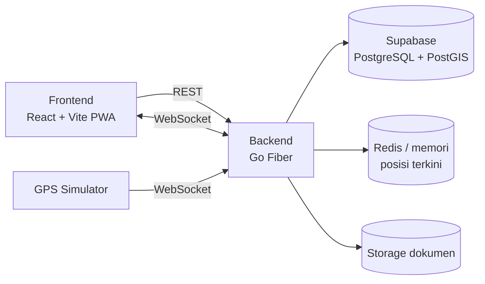
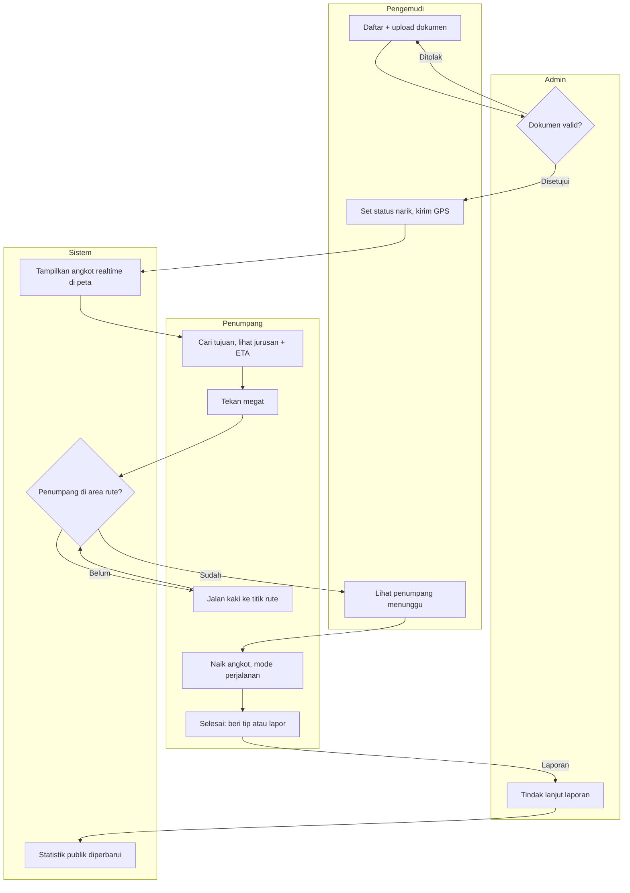
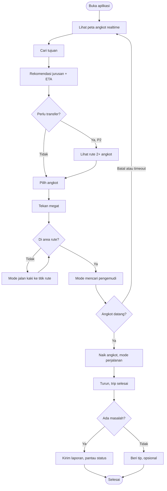
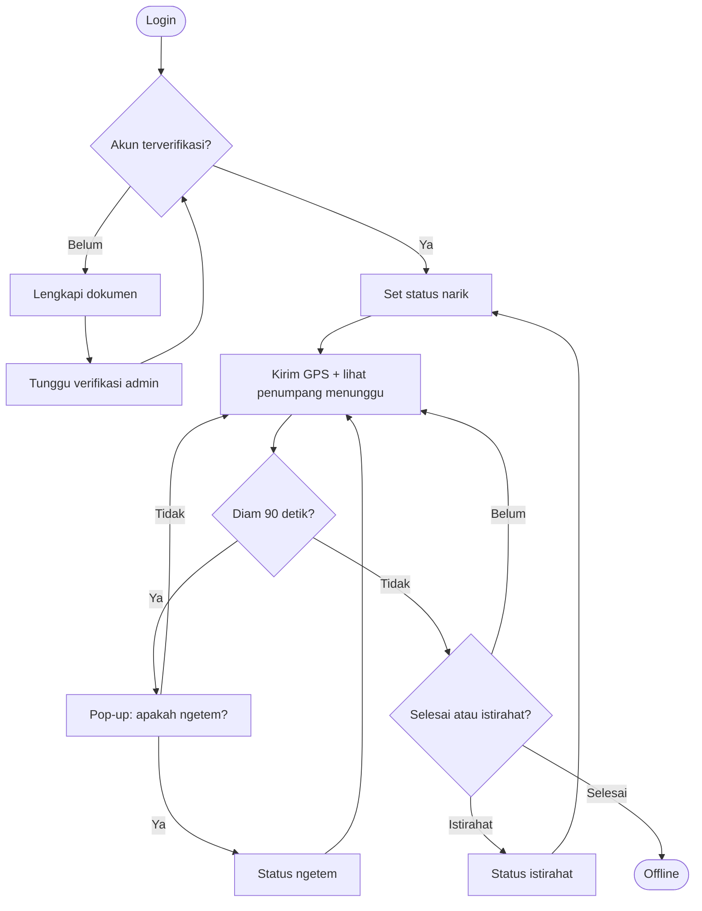
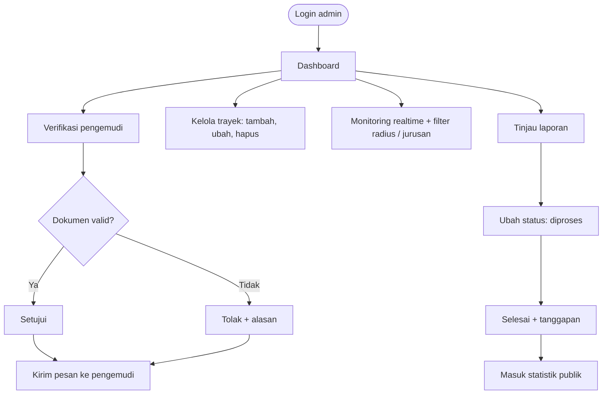

# PRD — Angkot-Live

**Platform pelacakan angkot realtime & transparansi layanan transportasi publik**

| | |
|---|---|
| Event | Multimedia In Action (MIA) 2026 — Kategori Web Development |
| Subtema | Public Service Tracking |
| Versi | 0.1 |
| Tanggal | 25 Oktober 2026 |
| Status | Draft |

---

## 1. Ringkasan

Angkot-Live adalah aplikasi web (PWA) yang menampilkan posisi angkot secara realtime di peta, membantu penumpang menemukan angkot dan jurusan yang tepat, membantu pengemudi mendapat informasi penumpang di sekitar rute, serta memberi admin/instansi alat untuk memverifikasi pengemudi, mengelola trayek, dan memantau kualitas layanan.

Aplikasi ini **bukan** ride-hailing. Framing-nya adalah *informasi keberadaan dan transparansi layanan*, bukan pemesanan angkot.

## 2. Latar belakang & masalah

| Masalah | Dampak |
|---|---|
| Penumpang tidak tahu angkot mana yang lewat, kapan datang, dan jurusan mana yang menuju tujuannya | Waktu tunggu tidak pasti, penumpang beralih ke kendaraan pribadi/ojol |
| Pengemudi tidak tahu di mana penumpang menunggu | Angkot ngetem lama atau lewat tanpa penumpang |
| Instansi tidak punya data realtime kondisi layanan dan kelayakan kendaraan | Pengawasan lambat dan manual |
| Tidak ada kanal pelaporan yang jelas untuk pengemudi ugal-ugalan atau fasilitas buruk | Keluhan tidak terdokumentasi dan tidak ditindaklanjuti |

## 3. Keselarasan dengan subtema

Subtema **Public Service Tracking**: website untuk memantau status/progres layanan publik dengan sistem tracking yang transparan dari sisi pengguna maupun instansi.

| Aspek subtema | Wujud di Angkot-Live |
|---|---|
| Tracking layanan | Posisi, status, dan ETA angkot realtime |
| Transparan bagi pengguna | Peta publik, status angkot, status tindak lanjut laporan |
| Transparan bagi instansi | Dashboard admin, verifikasi dokumen, monitoring trayek dan kendaraan |
| Partisipasi warga | Hotline pelaporan dan tracking status laporan |

## 4. Tujuan & metrik keberhasilan

### Tujuan
1. Penumpang dapat melihat angkot di sekitar dan mengetahui jurusan menuju tujuannya.
2. Pengemudi dapat membagikan posisi/status dan melihat penumpang di area rute.
3. Admin dapat memverifikasi pengemudi, mengelola trayek, dan memantau layanan.
4. Layanan dapat dipertanggungjawabkan lewat laporan dan statistik publik.

### Metrik (untuk demo & evaluasi)
| Metrik | Target |
|---|---|
| Latensi update posisi (pengemudi → peta penumpang) | ≤ 3 detik |
| Interval pengiriman GPS | 3–5 detik |
| Akurasi penempatan angkot di jalur (setelah map matching) | Titik berada pada polyline trayek |
| Waktu dari buka aplikasi ke melihat peta | ≤ 3 detik pada jaringan 4G |
| Alur demo end-to-end tanpa error | 100% pada skenario utama |

## 5. Persona & peran

| Peran | Deskripsi | Kebutuhan utama |
|---|---|---|
| **Penumpang** | Warga pengguna angkot harian | Tahu angkot mana yang datang, ETA, rekomendasi jurusan, melapor |
| **Pengemudi** | Sopir angkot terverifikasi | Lihat penumpang di rute, atur status, terima pesan, terima tip |
| **Admin** | Petugas/instansi pengelola | Verifikasi, kelola trayek, monitoring, tindak lanjut laporan |

## 6. Ruang lingkup & prioritas

### Prioritas

| Prioritas | Cakupan |
|---|---|
| **P0 — wajib jalan saat demo** | Auth & role, peta realtime (WebSocket), filter jurusan/radius, detail angkot + ETA, pencarian tujuan + rekomendasi jurusan langsung, mode pengemudi (kirim GPS + status), simulator GPS |
| **P1 — nilai tambah** | Verifikasi pengemudi, CRUD trayek, monitoring admin realtime, auto-ngetem 90 detik, megat angkot, dashboard ringkas tiap role, hotline laporan + tracking status, halaman statistik publik |
| **P2 — jika waktu cukup** | Transfer 2+ angkot, tip pengemudi, inbox, dashboard analitik lengkap, monitoring kondisi kendaraan dari dokumen, heatmap permintaan |

### Di luar cakupan (out of scope)
- Pemesanan/pembayaran angkot (bukan ride-hailing)
- Integrasi pembayaran riil (tip dapat disimulasikan)
- Aplikasi native Android/iOS (cukup PWA)
- Prediksi berbasis machine learning

## 7. Kebutuhan fungsional

### 7.1 Autentikasi & akun

| ID | Kebutuhan | Prioritas |
|---|---|---|
| AUTH-01 | Login/register dengan role-based access control: admin, pengemudi, penumpang | P0 |
| AUTH-02 | Penumpang mendaftar dengan email dan nomor telepon | P0 |
| AUTH-03 | Pengemudi mendaftar dengan data administrasi: SIM, NIK, STNK, KIR, foto kondisi mobil, jurusan | P1 |
| AUTH-04 | Status akun pengemudi: `pending` → `disetujui` / `ditolak` (dengan alasan) | P1 |
| AUTH-05 | Pengemudi belum terverifikasi tidak dapat tampil di peta publik | P1 |
| AUTH-06 | Token berbasis JWT dengan refresh; sesi dapat dicabut | P0 |

### 7.2 Admin

| ID | Kebutuhan | Prioritas |
|---|---|---|
| ADM-01 | Dashboard analitik: total angkot, angkot aktif, jumlah per jurusan | P1 |
| ADM-02 | CRUD trayek: data jurusan, rute (polyline GeoJSON), titik halte/terminal | P1 |
| ADM-03 | Verifikasi administrasi akun pengemudi (lihat dokumen, setujui/tolak) | P1 |
| ADM-04 | Monitoring posisi angkot realtime dengan filter radius dan jurusan | P1 |
| ADM-05 | Monitoring kondisi kendaraan berdasarkan dokumen (masa berlaku STNK/KIR, foto) dan penanda dokumen kedaluwarsa | P2 |
| ADM-06 | Kelola laporan masuk: ubah status (diterima → diproses → selesai) dan beri tanggapan | P1 |
| ADM-07 | Kirim pesan ke pengemudi (masuk ke inbox) | P2 |

### 7.3 Pengemudi

| ID | Kebutuhan | Prioritas |
|---|---|---|
| DRV-01 | Mengirim GPS secara berkala selama status aktif | P0 |
| DRV-02 | Status: `narik`, `ngetem`, `istirahat`, `offline` | P0 |
| DRV-03 | Peta trayek interaktif; hanya menampilkan mobil sendiri dan penumpang di sekitar rute | P0 |
| DRV-04 | Melihat penumpang yang sedang megat, hanya di area rute (halte, terminal, pinggir jalan) | P1 |
| DRV-05 | Dashboard: kendaraan, jarak tempuh, tip | P1 |
| DRV-06 | Inbox pesan dari sistem dan admin | P2 |
| DRV-07 | Pop-up konfirmasi ngetem (lihat aturan bisnis BR-01) | P1 |
| DRV-08 | Wake lock agar layar tidak mati saat bertugas | P1 |

### 7.4 Penumpang

| ID | Kebutuhan | Prioritas |
|---|---|---|
| PAX-01 | Peta trayek interaktif dengan angkot realtime | P0 |
| PAX-02 | Status angkot: `ngetem`, `jalan`, `merayap` | P0 |
| PAX-03 | Klik angkot → jurusan, nama pengemudi, plat nomor, ETA ke titik penumpang | P0 |
| PAX-04 | Pencarian lokasi tujuan + rekomendasi jurusan (rute langsung) | P0 |
| PAX-05 | Tombol "megat angkot" dengan mode otomatis (lihat BR-03) | P1 |
| PAX-06 | Mode perjalanan setelah naik angkot | P1 |
| PAX-07 | Hotline pelaporan di aplikasi (pengemudi ugal-ugalan, fasilitas tidak memadai) beserta tracking status laporan | P1 |
| PAX-08 | Dashboard: jumlah naik angkot, jarak tempuh, angkot yang sering dinaiki | P2 |
| PAX-09 | Rekomendasi perjalanan dengan transfer 2+ angkot (lihat bagian 9) | P2 |
| PAX-10 | Memberi tip kepada pengemudi | P2 |

### 7.5 Publik (tanpa login) — *rekomendasi*

| ID | Kebutuhan | Prioritas |
|---|---|---|
| PUB-01 | Melihat peta angkot realtime dan mencari rute tanpa login | P0 |
| PUB-02 | Halaman statistik transparansi: angkot aktif per jurusan, jumlah laporan, persentase laporan ditindaklanjuti | P1 |

## 8. Aturan bisnis

| ID | Aturan |
|---|---|
| BR-01 | **Auto-ngetem:** jika koordinat GPS pengemudi tidak berpindah (di bawah ambang jarak) selama **90 detik**, sistem menampilkan pop-up "Apakah Anda sedang ngetem?". Jika dikonfirmasi atau tidak ada respons selama T detik (ditentukan), status menjadi `ngetem`. |
| BR-02 | **Visibilitas penumpang:** pengemudi hanya melihat penumpang yang megat pada jurusan yang sama, dalam radius tertentu, dan berada di area rute. |
| BR-03 | **Megat angkot:** penumpang menekan tombol. Jika lokasi jauh dari area rute → mode **jalan kaki** (diarahkan ke titik rute terdekat). Jika sudah di area rute (pinggir jalan/halte/terminal) → otomatis mode **mencari pengemudi**, terlihat oleh pengemudi. |
| BR-04 | **Mode perjalanan** aktif setelah penumpang naik angkot; posisi penumpang tidak lagi ditampilkan sebagai "menunggu". |
| BR-05 | **Akurasi bersama:** pengemudi dan penumpang sama-sama mengirim GPS agar ETA dan pencocokan akurat. |
| BR-06 | **Merayap (macet):** kecepatan rata-rata di bawah ambang X km/jam selama Y detik (nilai ditentukan saat uji lapangan/simulasi). |
| BR-07 | **Angkot hilang:** tidak ada update GPS > N detik → ditandai terputus, lalu hilang dari peta publik. |
| BR-08 | **Timeout megat:** jika tidak ada pengemudi yang merespons dalam batas waktu, permintaan kedaluwarsa; penumpang dapat membatalkan kapan saja. |

### Pemetaan status

| Status pengemudi (manual/otomatis) | Tampilan ke penumpang |
|---|---|
| `narik` + kecepatan normal | `jalan` |
| `narik` + kecepatan rendah (BR-06) | `merayap` |
| `ngetem` | `ngetem` |
| `istirahat` / `offline` | Tidak ditampilkan |

## 9. Rekomendasi rute & transfer

1. **Rute langsung:** cari jurusan yang polyline-nya dekat dengan titik asal dan tujuan, dengan urutan sesuai arah trayek.
2. **Transfer:** bila tidak ada rute langsung, cari titik transfer di mana dua trayek berdekatan (jarak jalan kaki ≤ ±150–200 m).
3. **Algoritma:** graph berarah (directed). Node = titik sampling polyline (50–100 m). Edge = pergerakan searah trayek; edge transfer = jalan kaki antar trayek dengan penalti tunggu. Pencarian dengan Dijkstra/A*.
4. **Batas:** maksimal 1–2 transfer.
5. **Keluaran:** daftar leg (jalan kaki → angkot A → transfer → angkot B → jalan kaki) beserta estimasi waktu.

## 10. Kebutuhan non-fungsional

| Kategori | Kebutuhan |
|---|---|
| Performa | Update posisi ≤ 3 detik; peta tetap mulus dengan ≥ 50 marker simultan |
| Keandalan | WebSocket auto-reconnect + indikator status koneksi |
| Keamanan | Supabase Auth (password di-hash), JWT, RLS, validasi input, rate limit pada endpoint GPS, validasi tipe/ukuran file upload |
| Privasi | Dokumen SIM/NIK/STNK hanya dapat diakses admin (storage privat); lokasi penumpang hanya terlihat sesuai BR-02 dan hilang saat mode berhenti |
| Kompatibilitas | Responsif (mobile-first), PWA, browser modern |
| Baterai | Throttling GPS, hentikan pengiriman saat offline/istirahat |
| Aksesibilitas | Kontras warna memadai, label ikon status jelas, bukan hanya warna |

## 11. Arsitektur & tech stack

| Lapisan | Pilihan |
|---|---|
| Frontend | React + Vite (SPA/PWA), peta (Leaflet atau MapLibre) |
| Backend | Go + Fiber, **modular monolith** (modul: auth, tracking, trayek, laporan, notifikasi) yang siap dipecah menjadi service |
| Realtime | WebSocket (hub per jurusan/area) |
| Penyimpanan posisi | In-memory (atau Redis) untuk posisi terkini; snapshot berkala ke tabel `vehicle_positions` |
| Database | **Supabase (PostgreSQL + PostGIS)**, relational, dinormalisasi hingga 3NF; Supabase Auth + RLS untuk role |
| File | Supabase Storage (bucket privat) untuk dokumen dan foto kendaraan |
| Peta/geo | Geolocation API, map matching ke polyline trayek, index geospasial (PostGIS `GIST`) |
| Demo | **Simulator GPS** yang menjalankan beberapa angkot di trayek nyata |

> Catatan: arsitektur awal rencana adalah microservices. Untuk skala lomba, modular monolith memberi hasil demo yang sama dengan biaya pengembangan dan debugging jauh lebih rendah.

### 11.1 Diagram arsitektur sistem



| Komponen | Peran |
|---|---|
| Frontend | Satu PWA untuk penumpang, pengemudi, admin, dan halaman publik |
| Backend | Auth, trayek, tracking, routing, laporan (modular monolith) |
| WebSocket | Update posisi dan status secara realtime |
| Redis / memori | Posisi terkini angkot (cepat, tanpa tulis ke database tiap titik) |
| Supabase | PostgreSQL + PostGIS, Auth, Storage, RLS |
| Storage dokumen | File SIM, STNK, KIR, foto (akses admin saja) |
| GPS Simulator | Angkot virtual untuk demo |

## 12. Antarmuka API & WebSocket

### REST
| Endpoint | Fungsi |
|---|---|
| `POST /auth/register`, `POST /auth/login`, `POST /auth/refresh` | Autentikasi |
| `GET /routes`, `GET /routes/:id` | Daftar/detail trayek |
| `POST/PUT/DELETE /admin/routes` | CRUD trayek |
| `GET /admin/drivers?status=pending`, `PATCH /admin/drivers/:id/verify` | Verifikasi pengemudi |
| `GET /search/route?from=&to=` | Rekomendasi jurusan/transfer |
| `POST /reports`, `GET /reports/:id`, `PATCH /admin/reports/:id` | Laporan |
| `GET /stats/public` | Statistik transparansi |

### WebSocket (event)
| Event | Arah | Isi |
|---|---|---|
| `driver:position` | Pengemudi → server | lat, lng, speed, heading |
| `driver:status` | Pengemudi → server | narik/ngetem/istirahat/offline |
| `vehicles:update` | Server → klien | posisi + status angkot dalam area/jurusan yang di-subscribe |
| `passenger:position` | Penumpang → server | lat, lng, mode |
| `passengers:nearby` | Server → pengemudi | penumpang megat di area rute |
| `ngetem:prompt` | Server → pengemudi | konfirmasi ngetem (BR-01) |
| `message:new` | Server → pengguna | pesan inbox |

## 13. Alur kerja (flowchart)

### 13.1 Proses bisnis keseluruhan



### 13.2 Alur penumpang



### 13.3 Alur pengemudi



### 13.4 Alur admin



## 14. Struktur repository

Monorepo agar frontend, backend, simulator, dan data trayek mudah disinkronkan.

```text
angkot-live/
├── apps/
│   ├── web/                          # Frontend: React + Vite (PWA)
│   │   ├── public/                   # manifest.webmanifest, ikon, service worker
│   │   ├── src/
│   │   │   ├── app/                  # entry, router, providers, guard role
│   │   │   ├── features/
│   │   │   │   ├── auth/             # login, register, upload dokumen pengemudi
│   │   │   │   ├── map/              # komponen peta, layer angkot, marker, filter
│   │   │   │   ├── tracking/         # hook WebSocket, store posisi, status angkot
│   │   │   │   ├── passenger/        # dashboard, megat, mode perjalanan, riwayat
│   │   │   │   ├── driver/           # dashboard, status, penumpang sekitar, inbox
│   │   │   │   ├── admin/            # verifikasi, CRUD trayek, monitoring, laporan
│   │   │   │   ├── routing/          # pencarian tujuan, hasil rekomendasi, transfer
│   │   │   │   ├── reports/          # form laporan, tracking status laporan
│   │   │   │   └── stats/            # halaman statistik publik
│   │   │   ├── components/           # UI bersama (button, modal, toast, badge status)
│   │   │   ├── hooks/                # useGeolocation, useWakeLock, useWebSocket
│   │   │   ├── lib/                  # api client, ws client, geo utils, format
│   │   │   ├── store/                # state global (Zustand / Redux Toolkit)
│   │   │   ├── styles/
│   │   │   └── types/
│   │   ├── index.html
│   │   ├── vite.config.ts
│   │   └── package.json
│   │
│   └── api/                          # Backend: Go + Fiber (modular monolith)
│       ├── cmd/
│       │   └── api/main.go           # entry point, wiring dependency
│       ├── internal/
│       │   ├── config/               # env, konfigurasi ambang (90 detik, radius, dll)
│       │   ├── platform/
│       │   │   ├── postgres/         # koneksi Supabase (pgx), query, transaksi
│       │   │   ├── redis/            # opsional, cache posisi
│       │   │   ├── ws/               # hub, client, room per jurusan
│       │   │   └── storage/          # penyimpanan file privat + signed URL
│       │   ├── middleware/           # JWT, RBAC, rate limit, logger, recover
│       │   ├── auth/                 # handler, service, repository, dto
│       │   ├── user/
│       │   ├── driver/               # profil, dokumen, verifikasi
│       │   ├── vehicle/
│       │   ├── route/                # trayek + halte (CRUD, GeoJSON)
│       │   ├── tracking/             # validasi GPS, map matching, status, ngetem
│       │   ├── passenger/            # megat, mode, request
│       │   ├── trip/
│       │   ├── routing/              # graph, Dijkstra/A*, transfer, ETA
│       │   ├── report/               # laporan + report_updates
│       │   ├── message/              # inbox
│       │   ├── tip/
│       │   └── stats/                # statistik publik + dashboard
│       ├── pkg/                      # util bersama: geo (haversine), errors, response
│       ├── api/                      # openapi.yaml (kontrak REST)
│       ├── go.mod
│       └── Dockerfile
│
├── tools/
│   └── simulator/                    # GPS simulator: angkot virtual di trayek nyata
│       ├── main.go
│       └── scenarios/                # konfigurasi skenario demo (jumlah angkot, kecepatan)
│
├── data/
│   ├── routes/                       # GeoJSON per trayek (rute + halte)
│   └── seed/                         # data awal: user admin, contoh pengemudi
│
├── deploy/
│   ├── docker-compose.yml            # web, api, redis, simulator
│   ├── nginx.conf                    # proxy HTTP + WebSocket
│   └── .env.example
│
├── docs/
│   ├── PRD.md                        # dokumen ini
│   ├── architecture.md
│   ├── erd.md
│   └── demo-script.md
│
├── .github/workflows/                # CI: lint, test, build
├── .gitignore
├── Makefile                          # make dev, make seed, make simulate
└── README.md
```

## 15. Breakdown fitur & halaman

Ringkasan: **29 halaman** + 5 komponen modal/sheet. Per prioritas: P0 = 7, P1 = 17, P2 = 5.

| Area | Halaman | P0 | P1 | P2 |
|---|---|---|---|---|
| Publik | 6 | 4 | 2 | 0 |
| Penumpang | 7 | 2 | 3 | 2 |
| Pengemudi | 6 | 1 | 4 | 1 |
| Admin | 10 | 0 | 8 | 2 |

### 15.1 Sitemap

```text
Angkot-Live
├── Publik (tanpa login)
│   ├── /                  Peta publik
│   ├── /rute              Cari rute
│   ├── /trayek            Daftar trayek
│   ├── /statistik         Statistik transparansi
│   ├── /login
│   └── /register
├── Penumpang  (/penumpang)
│   ├── /                  Peta penumpang
│   ├── /perjalanan        Perjalanan aktif
│   ├── /dashboard
│   ├── /riwayat
│   ├── /lapor
│   ├── /laporan           Laporan saya
│   └── /profil
├── Pengemudi  (/pengemudi)
│   ├── /daftar            Onboarding dokumen
│   ├── /verifikasi        Status verifikasi
│   ├── /                  Peta kerja
│   ├── /dashboard
│   ├── /inbox
│   └── /profil            Profil & kendaraan
└── Admin  (/admin)
    ├── /                  Dashboard
    ├── /pengemudi         Verifikasi (+ /:id detail)
    ├── /trayek            Kelola trayek (+ /:id editor)
    ├── /monitoring        Monitoring realtime
    ├── /kendaraan         Kondisi & dokumen kendaraan
    ├── /laporan           Laporan (+ /:id detail)
    └── /pesan             Pesan ke pengemudi
```

Setelah login, pengguna diarahkan otomatis ke area sesuai role-nya; halaman area lain ditolak oleh route guard.

### 15.2 Halaman publik

| Halaman | Route | Fitur & komponen | Data | Prioritas |
|---|---|---|---|---|
| Peta publik | `/` | Peta angkot realtime, marker per jurusan, filter jurusan + radius, status angkot (ngetem/jalan/merayap), klik marker → sheet detail (jurusan, pengemudi, plat, ETA), kotak pencarian tujuan | WS `vehicles:update`, `routes`, `vehicles` | P0 |
| Cari rute | `/rute` | Input asal/tujuan, hasil rekomendasi jurusan + ETA, rute tampil di peta, rute transfer 2+ angkot (P2) | `routes`, `route_stops`, posisi terkini | P0 |
| Daftar trayek | `/trayek` | Daftar jurusan, peta rute, halte dan terminal per trayek | `routes`, `route_stops` | P1 |
| Statistik transparansi | `/statistik` | Angkot aktif per jurusan, jumlah laporan, persentase laporan ditindaklanjuti | view `public_stats` | P1 |
| Login | `/login` | Email + password, redirect sesuai role | Supabase Auth | P0 |
| Register | `/register` | Pilih peran (penumpang / pengemudi), form email + telepon + data dasar | `profiles` | P0 |

### 15.3 Halaman penumpang

| Halaman | Route | Fitur & komponen | Data | Prioritas |
|---|---|---|---|---|
| Peta penumpang | `/penumpang` | Semua fitur peta publik + tombol **megat** (mode jalan kaki / mencari pengemudi), indikator mode aktif, tombol batal | `passenger_requests`, WS `passenger:position` | P0 (megat P1) |
| Perjalanan aktif | `/penumpang/perjalanan` | Mode perjalanan setelah naik, posisi angkot, ETA turun, tombol selesai, lanjut ke tip/lapor | `trips`, `trip_legs` | P1 |
| Dashboard | `/penumpang/dashboard` | Jumlah naik angkot, total jarak, angkot yang sering dinaiki | view agregat dari `trips`, `trip_legs` | P2 |
| Riwayat | `/penumpang/riwayat` | Daftar perjalanan, detail leg per angkot | `trips`, `trip_legs` | P2 |
| Buat laporan | `/penumpang/lapor` | Pilih kendaraan (dari riwayat atau plat), kategori, deskripsi | `reports` | P1 |
| Laporan saya | `/penumpang/laporan` | Daftar laporan + timeline status (diterima → diproses → selesai) + tanggapan admin | `reports`, `report_updates` | P1 |
| Profil | `/penumpang/profil` | Ubah nama, telepon, ganti password | `profiles` | P0 |

### 15.4 Halaman pengemudi

| Halaman | Route | Fitur & komponen | Data | Prioritas |
|---|---|---|---|---|
| Onboarding dokumen | `/pengemudi/daftar` | Stepper: data diri + NIK → SIM → kendaraan (plat, jurusan, STNK, KIR, foto) → kirim | `driver_profiles`, `driver_documents`, `vehicles`, `vehicle_documents`, `vehicle_photos` | P1 |
| Status verifikasi | `/pengemudi/verifikasi` | Status pending/ditolak, alasan penolakan, tombol unggah ulang | `driver_profiles` | P1 |
| Peta kerja | `/pengemudi` | Pilih status (narik/ngetem/istirahat/offline), kirim GPS berkala, peta hanya mobil sendiri + penumpang menunggu di area rute, wake lock, indikator koneksi | WS `driver:position`, `driver:status`, `passengers:nearby` | P0 |
| Dashboard | `/pengemudi/dashboard` | Kendaraan, jarak tempuh, tip diterima | view `driver_stats` | P1 |
| Inbox | `/pengemudi/inbox` | Pesan dari sistem dan admin, tandai dibaca | `messages` | P2 |
| Profil & kendaraan | `/pengemudi/profil` | Data diri, data kendaraan, status dokumen + masa berlaku | `driver_profiles`, `vehicles`, dokumen | P1 |

### 15.5 Halaman admin

| Halaman | Route | Fitur & komponen | Data | Prioritas |
|---|---|---|---|---|
| Dashboard | `/admin` | Total angkot, angkot aktif, jumlah per jurusan, laporan baru, pengemudi menunggu verifikasi | `vehicles`, `routes`, `reports`, `driver_profiles` | P1 |
| Verifikasi pengemudi | `/admin/pengemudi` | Daftar pengemudi dengan filter status | `driver_profiles` | P1 |
| Detail verifikasi | `/admin/pengemudi/:id` | Lihat dokumen (signed URL), setujui, tolak + alasan, kirim pesan otomatis | dokumen, `driver_profiles`, `messages` | P1 |
| Daftar trayek | `/admin/trayek` | Tabel jurusan, aktif/nonaktif, tambah, hapus | `routes` | P1 |
| Editor trayek | `/admin/trayek/:id` | Gambar polyline rute di peta, kelola halte dan terminal, urutan halte | `routes`, `route_stops` | P1 |
| Monitoring realtime | `/admin/monitoring` | Peta semua angkot, filter radius dan jurusan, daftar angkot aktif, status per angkot | WS `vehicles:update` | P1 |
| Kendaraan | `/admin/kendaraan` | Kondisi kendaraan dari dokumen, penanda STNK/KIR kedaluwarsa, foto kendaraan | `vehicles`, `vehicle_documents`, `vehicle_photos` | P2 |
| Daftar laporan | `/admin/laporan` | Tabel laporan, filter status/kategori | `reports`, `report_current_status` | P1 |
| Detail laporan | `/admin/laporan/:id` | Detail + riwayat, ubah status, tulis tanggapan, pesan ke pengemudi terkait | `report_updates`, `messages` | P1 |
| Pesan | `/admin/pesan` | Kirim pesan ke satu atau semua pengemudi | `messages` | P2 |
