# PRD — Angkot-Live

> Platform web realtime untuk memantau angkot, memudahkan penumpang, membantu pengemudi, dan memberi instansi data yang transparan.

| | |
|---|---|
| **Versi** | 1.0 (Draft) |
| **Tanggal** | 30 Oktober 2026 |
| **Kompetisi** | Multimedia In Action (MIA) 2026 — Web in Action |
| **Subtema utama** | Public Service Tracking |
| **Subtema pendukung** | Civic Reporting & Accountability, Data-Driven Decision Support |
| **Status dokumen** | Draft untuk review tim |

## Daftar Isi

1. Ringkasan Eksekutif
2. Overview & Tujuan
3. Target Pengguna & Persona
4. Scope & Prioritas Fitur
5. Functional Requirements per Modul
6. Business Logic & Aturan Sistem
7. User Flow
8. Arsitektur & Tech Stack
9. Data Model
10. Non-Functional Requirements
11. Risiko, Asumsi & Dependensi
12. Roadmap & Milestone
13. Referensi
14. Lampiran (Glosarium & Open Questions)

---

## 1. Ringkasan Eksekutif

**Angkot-Live** adalah aplikasi web (SPA) dengan tiga peran: **Admin**, **Pengemudi**, dan **Penumpang**. Pengemudi dan penumpang sama-sama mengirim data GPS secara akurat ke server. Server mengolahnya menjadi informasi realtime yang tampil di peta: posisi angkot, statusnya (jalan, ngetem, merayap), estimasi tiba (ETA), dan penumpang yang sedang menunggu di sepanjang rute.

Bagi penumpang, angkot yang tadinya "datang entah kapan" menjadi bisa dilihat, diprediksi, dan dicegat secara terarah. Bagi pengemudi, titik penumpang menunggu menjadi terlihat. Bagi admin atau instansi, seluruh armada, kondisi dokumen kendaraan, laporan warga, dan pola operasional terpantau dalam satu dashboard.

**Pernyataan produk (one-liner):** *Angkot yang bisa dilacak, dicegat, dan dipertanggungjawabkan.*

---

## 2. Overview & Tujuan

### 2.1 Overview Produk

Angkot-Live bekerja dengan tiga lapisan:

1. **Data trayek**: admin mengelola jurusan, rute (garis di peta), halte, terminal, dan titik ngetem.
2. **Data realtime**: aplikasi pengemudi dan penumpang mengirim lokasi via WebSocket. Server memfilter, mencocokkan posisi ke rute, dan menurunkan status serta ETA.
3. **Antarmuka per peran**: setiap peran melihat peta dan fitur yang sesuai kebutuhannya, dengan aturan visibilitas data yang ketat (lihat bagian 6.5).

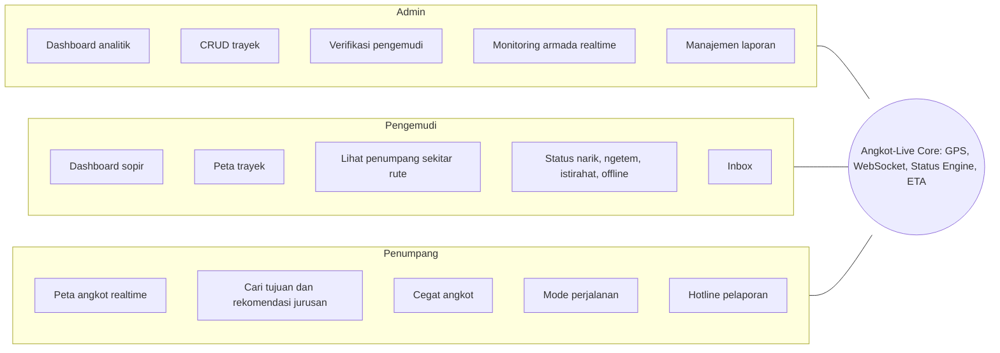

### 2.2 Tujuan (Goals)

| # | Tujuan | Wujud di produk |
|---|---|---|
| G1 | Memberi kepastian informasi angkot kepada penumpang | Peta realtime, status angkot, ETA |
| G2 | Mempertemukan penumpang dan pengemudi secara efisien | Fitur Cegat, penumpang terlihat oleh pengemudi di area rute |
| G3 | Menertibkan data armada dan pengemudi | Verifikasi dokumen, monitoring kondisi kendaraan |
| G4 | Membuka kanal akuntabilitas layanan | Hotline pelaporan dengan status yang dapat dilacak |
| G5 | Memberi dasar keputusan berbasis data bagi instansi | Dashboard analitik (armada, pola ngetem, laporan, jam sibuk) |

### 2.3 Non-Goals (di luar cakupan versi 1.0)

- Pembayaran tarif angkot di dalam aplikasi.
- Aplikasi native (Android/iOS). Versi ini web (SPA) yang responsif, dipakai lewat browser.
- Verifikasi NIK ke Dukcapil dan verifikasi dokumen otomatis (OCR). Verifikasi dilakukan manual oleh admin.
- Integrasi dengan moda transportasi lain (bus, KRL, ojek online).
- Prediksi berbasis machine learning. ETA memakai pendekatan kinematik sederhana.

### 2.4 Success Metrics

Angka berikut adalah **target usulan** untuk MVP dan perlu disepakati tim.

| Metrik | Target MVP | Cara ukur |
|---|---|---|
| Latensi posisi (pengemudi kirim sampai tampil di peta penumpang) | p95 ≤ 2 detik | Timestamp kirim vs render, di jaringan lokal/4G |
| Akurasi ETA | Selisih ≤ ±2 menit pada ≥ 80% sampel uji | Uji lapangan atau simulasi rute |
| Akurasi deteksi status (ngetem, merayap) | ≥ 85% pada skenario uji | Skenario uji terskrip di simulator |
| Koneksi realtime bersamaan | ≥ 200 koneksi WebSocket stabil | Load test |
| Penyelesaian alur utama penumpang (cari, cegat, naik) | ≤ 5 langkah dari buka aplikasi | Uji usability dengan ≥ 5 responden |
| Waktu verifikasi akun pengemudi oleh admin | ≤ 5 klik per akun | Walkthrough alur admin |

### 2.5 Keselarasan dengan Subtema MIA 2026

Subtema utama **Public Service Tracking** mendeskripsikan website untuk memantau status atau progres layanan publik dengan sistem tracking yang transparan dari sisi pengguna maupun instansi.

| Elemen subtema | Implementasi Angkot-Live |
|---|---|
| Memantau status layanan publik | Posisi dan status angkot realtime (ngetem, jalan, merayap) |
| Tracking transparan dari sisi pengguna | Penumpang melihat angkot, ETA, dan status laporan miliknya |
| Tracking transparan dari sisi instansi | Admin memonitor armada, kondisi kendaraan, dan antrean laporan |
| Contoh "pengaduan warga" | Hotline pelaporan dengan **status yang bisa dilacak** (Diterima, Ditinjau, Ditindaklanjuti, Selesai) |

**Subtema pendukung:** *Civic Reporting & Accountability* dilayani oleh hotline pelaporan. *Data-Driven Decision Support* dilayani oleh dashboard analitik admin. Keduanya diposisikan sebagai pendukung, bukan identitas utama.

> **Catatan:** Contoh pada subtema berfokus pada layanan administratif (pengaduan, perizinan, bansos). Agar keselarasan terasa kuat di mata juri, **alur pelaporan beserta pelacakan statusnya (F-PSG-10 dan F-ADM-06) dijadikan prioritas Must**, bukan sekadar pelengkap.

---

## 3. Target Pengguna & Persona

| | Admin (Instansi/Operator) | Pengemudi | Penumpang |
|---|---|---|---|
| **Siapa** | Petugas dinas perhubungan, koperasi, atau operator trayek | Sopir angkot terdaftar | Masyarakat umum pengguna angkot |
| **Tujuan utama** | Memantau armada, memastikan kelayakan kendaraan dan pengemudi, menindaklanjuti laporan | Mendapat penumpang lebih efisien, mengurangi waktu kosong | Tahu angkot mana, kapan datang, dan bagaimana ke tujuan |
| **Pain point** | Data armada tersebar, sulit memantau, laporan warga tidak terlacak | Tidak tahu di mana penumpang menunggu, ngetem lama karena tidak ada informasi | Tidak ada kepastian waktu, bingung jurusan, tidak punya kanal komplain |
| **Perangkat dominan** | Desktop | Ponsel (di dashboard kendaraan) | Ponsel |
| **Keahlian digital** | Menengah | Dasar | Dasar sampai menengah |

**Implikasi desain:**
- UI pengemudi harus **besar, sederhana, minim teks**, karena dipakai sambil mengemudi (tombol status besar, notifikasi singkat).
- UI penumpang **mobile-first**.
- UI admin **desktop-first** dengan tabel dan filter.

---

## 4. Scope & Prioritas Fitur

Prioritas memakai **MoSCoW**. *Fase 1* adalah MVP untuk lomba, *Fase 2* adalah roadmap lanjutan.

| ID | Fitur | Role | Prioritas | Fase |
|---|---|---|---|---|
| F-AUTH-01 | Registrasi & login | Semua | Must | 1 |
| F-AUTH-02 | Role-based access control | Semua | Must | 1 |
| F-AUTH-03 | Registrasi penumpang (email, telepon, NIK) | Penumpang | Must | 1 |
| F-AUTH-04 | Registrasi pengemudi + upload dokumen | Pengemudi | Must | 1 |
| F-ADM-01 | Dashboard analitik admin | Admin | Should | 1 |
| F-ADM-02 | CRUD trayek (jurusan, rute, halte) | Admin | Must | 1 |
| F-ADM-03 | Verifikasi akun pengemudi | Admin | Must | 1 |
| F-ADM-04 | Monitoring kondisi kendaraan dari dokumen | Admin | Should | 1 |
| F-ADM-05 | Monitoring armada realtime + filter | Admin | Must | 1 |
| F-ADM-06 | Manajemen laporan penumpang *(tambahan)* | Admin | Must | 1 |
| F-ADM-07 | Kirim pesan ke pengemudi *(tambahan)* | Admin | Could | 1 |
| F-DRV-01 | Dashboard analitik pengemudi | Pengemudi | Could | 1 |
| F-DRV-02 | Peta trayek interaktif | Pengemudi | Must | 1 |
| F-DRV-03 | Monitoring penumpang di sekitar rute | Pengemudi | Should | 1 |
| F-DRV-04 | Status narik, ngetem, istirahat, offline | Pengemudi | Must | 1 |
| F-DRV-05 | Inbox pesan sistem dan admin | Pengemudi | Could | 1 |
| F-PSG-01 | Dashboard penumpang | Penumpang | Could | 1 |
| F-PSG-02 | Peta trayek interaktif | Penumpang | Must | 1 |
| F-PSG-03 | Monitoring angkot realtime | Penumpang | Must | 1 |
| F-PSG-04 | Status angkot (ngetem, jalan, merayap) | Penumpang | Must | 1 |
| F-PSG-05 | Preview angkot (jurusan, pengemudi, plat, ETA) | Penumpang | Must | 1 |
| F-PSG-06 | Pencarian tujuan + rekomendasi jurusan (1 angkot) | Penumpang | Must | 1 |
| F-PSG-07 | Perjalanan multi-angkot (transit) | Penumpang | Won't | 2 |
| F-PSG-08 | Cegat angkot (mode jalan kaki, mode mencari) | Penumpang | Should | 1 |
| F-PSG-09 | Mode perjalanan | Penumpang | Should | 1 |
| F-PSG-10 | Hotline pelaporan + pelacakan status | Penumpang | Must | 1 |
| F-PSG-11 | Tip untuk pengemudi | Penumpang | Won't | 2 |
| F-SYS-01 | Deteksi otomatis ngetem | Sistem | Must | 1 |
| F-SYS-02 | Pertukaran GPS realtime (WebSocket) | Sistem | Must | 1 |
| F-SYS-03 | Perhitungan ETA | Sistem | Must | 1 |
| F-SYS-04 | Deteksi merayap (macet) | Sistem | Must | 1 |
| F-SYS-05 | Simulator GPS untuk demo dan pengujian *(tooling)* | Tim | Must | 1 |

**Perubahan terhadap rancangan awal (perlu persetujuan tim):**
- **F-ADM-06** ditambahkan karena hotline pelaporan tanpa sisi admin untuk menindaklanjuti tidak akan berfungsi.
- **F-ADM-07** ditambahkan karena inbox pengemudi menerima pesan dari admin, sehingga admin perlu cara mengirimnya.
- **F-SYS-04** dibuat eksplisit karena status "merayap" butuh logika deteksi tersendiri.
- **F-SYS-05** dibuat eksplisit karena tanpa angkot sungguhan, demo realtime hanya bisa berjalan dengan simulator.
- **F-PSG-10** dinaikkan dari Should ke **Must** demi keselarasan subtema (lihat 2.5).

---
## 5. Functional Requirements per Modul

Format tiap fitur: **User story** dan **Acceptance Criteria (AC)**.

### 5.1 Auth & Onboarding

#### F-AUTH-01 — Registrasi & Login
- **User story:** Sebagai pengguna, saya ingin mendaftar dan masuk dengan email dan password agar dapat memakai fitur sesuai peran saya.
- **AC:**
  - Login memakai email + password. Sesi memakai access token berumur pendek + refresh token.
  - Password minimal 8 karakter, disimpan sebagai hash (bcrypt atau argon2).
  - Email wajib unik. Verifikasi email lewat tautan (OTP SMS di luar MVP).
  - Rate limit pada endpoint login (mis. 5 percobaan gagal per 15 menit per akun/IP).
  - Setelah login, pengguna diarahkan ke dashboard sesuai peran.

#### F-AUTH-02 — Role-Based Access Control
- **User story:** Sebagai sistem, saya ingin membatasi akses berdasarkan peran agar data dan fitur tidak bocor antar peran.
- **AC:**
  - Tiga peran: `admin`, `driver`, `passenger`. Satu akun memiliki tepat satu peran.
  - Setiap endpoint REST dan channel WebSocket divalidasi terhadap peran di sisi server.
  - Rute UI yang tidak sesuai peran dialihkan ke halaman 403.
  - Akun admin dibuat lewat seeding atau oleh admin lain, **tidak** lewat registrasi publik.

| Kemampuan | Admin | Pengemudi | Penumpang |
|---|:-:|:-:|:-:|
| Kelola trayek | ✅ | ❌ | ❌ |
| Verifikasi pengemudi | ✅ | ❌ | ❌ |
| Lihat semua angkot realtime | ✅ | ❌ (hanya dirinya) | ✅ (angkot aktif, data terbatas) |
| Lihat penumpang mencari angkot | ❌ (hanya agregat) | ✅ (di area rute) | ❌ (hanya dirinya) |
| Kirim laporan | ❌ | ❌ | ✅ |
| Tindak lanjut laporan | ✅ | ❌ | ❌ |
| Ubah status operasional | ❌ | ✅ | ❌ |

#### F-AUTH-03 — Registrasi Penumpang
- **User story:** Sebagai penumpang, saya ingin mendaftar dengan data minimal agar bisa segera memakai aplikasi.
- **AC:**
  - Field: nama, email, nomor telepon, NIK, password.
  - NIK divalidasi format (16 digit numerik), disimpan **terenkripsi**, dan ditampilkan dalam bentuk termasker.
  - Nomor telepon divalidasi format Indonesia.
  - Tujuan pengumpulan NIK dijelaskan di form (akuntabilitas laporan, mencegah akun palsu) beserta persetujuan pengguna.

#### F-AUTH-04 — Registrasi Pengemudi + Upload Dokumen
- **User story:** Sebagai pengemudi, saya ingin mendaftarkan diri dan kendaraan beserta dokumennya agar dapat diverifikasi dan mulai narik.
- **AC:**
  - Data diri: nama, email, telepon, password.
  - Data kendaraan: plat nomor, jurusan (dipilih dari trayek terdaftar).
  - Dokumen wajib: **SIM, KTP, STNK, KIR, dan foto kondisi kendaraan** (depan, belakang, kiri, kanan, interior).
  - Tanggal berlaku (expiry) wajib diisi untuk SIM, STNK, dan KIR.
  - File: JPG, PNG, atau PDF, maksimal 5 MB per file. Disimpan di storage privat.
  - Setelah submit, status akun `pending`. Pengemudi **tidak dapat online** sebelum `approved`.
  - Jika `rejected`, pengemudi melihat alasan per dokumen dan dapat mengunggah ulang.

---

### 5.2 Admin

#### F-ADM-01 — Dashboard Analitik
- **User story:** Sebagai admin, saya ingin ringkasan kondisi layanan agar dapat mengambil keputusan cepat.
- **AC:**
  - **Kartu KPI:** total angkot (terdaftar, aktif, online sekarang), total jurusan, pengemudi menunggu verifikasi, laporan terbuka, dokumen mendekati kedaluwarsa.
  - **Grafik:** trip per hari, sebaran angkot per jurusan, distribusi status (narik/ngetem/merayap), rata-rata durasi ngetem per jurusan, kategori laporan terbanyak, jam sibuk.
  - Filter rentang waktu dan jurusan.
  - Data dihitung dari agregasi database. Tampilan boleh memakai data seed untuk demo.

#### F-ADM-02 — CRUD Trayek
- **User story:** Sebagai admin, saya ingin mengelola jurusan dan rute angkot agar peta dan rekomendasi akurat.
- **AC:**
  - Create, read, update, dan nonaktifkan (soft delete) **jurusan** (kode, nama, asal, tujuan, warna di peta).
  - Rute digambar di peta atau diimpor sebagai **GeoJSON LineString**. Tiap jurusan punya jalur per arah (berangkat dan pulang).
  - Kelola **halte, terminal, dan titik ngetem** (nama, tipe, koordinat, urutan).
  - Kelola data angkot (kendaraan) dan penugasannya ke jurusan.
  - Validasi: rute minimal 2 titik, tidak ada jurusan dengan kode ganda.
  - Perubahan rute langsung tercermin di peta pengemudi dan penumpang.

#### F-ADM-03 — Verifikasi Akun Pengemudi
- **User story:** Sebagai admin, saya ingin meninjau dokumen pengemudi agar hanya pengemudi sah yang beroperasi.
- **AC:**
  - Antrean verifikasi dengan filter status (`pending`, `approved`, `rejected`).
  - Halaman detail menampilkan seluruh dokumen (pratinjau gambar/PDF) dan data kendaraan.
  - Admin dapat **approve** atau **reject** dengan alasan wajib per dokumen yang bermasalah.
  - Keputusan memicu notifikasi ke inbox dan email pengemudi.
  - Setiap keputusan dicatat di audit log (siapa, kapan, keputusan).

#### F-ADM-04 — Monitoring Kondisi Kendaraan
- **User story:** Sebagai admin, saya ingin memantau kelayakan kendaraan dari dokumen yang diunggah agar armada tetap laik jalan.
- **AC:**
  - Tabel kendaraan dengan indikator masa berlaku tiap dokumen: **Valid**, **≤ 30 hari lagi**, **Kedaluwarsa**.
  - Galeri foto kondisi kendaraan, dengan penilaian admin: *Layak*, *Perlu perhatian*, *Tidak layak* beserta catatan.
  - Sistem mengirim peringatan otomatis ke inbox pengemudi saat dokumen mendekati atau melewati kedaluwarsa.
  - Kebijakan dokumen kedaluwarsa (hanya peringatan atau blokir online) dapat dikonfigurasi admin. **Default: peringatan.**

#### F-ADM-05 — Monitoring Armada Realtime
- **User story:** Sebagai admin, saya ingin melihat seluruh angkot yang berjalan secara realtime agar dapat mengawasi operasional.
- **AC:**
  - Peta menampilkan semua angkot online dengan marker berwarna sesuai status dan jurusan.
  - **Filter:** jurusan (multi-pilih), radius (pilih titik di peta + slider jarak), status, dan pencarian plat nomor.
  - Klik marker membuka panel detail: pengemudi, plat, jurusan, status, kecepatan, waktu update terakhir.
  - Tampilan alternatif berupa daftar tabel yang tersinkron dengan peta.
  - Angkot tanpa update > 30 detik ditandai **sinyal hilang**.
  - Pembaruan posisi tanpa refresh halaman.

#### F-ADM-06 — Manajemen Laporan *(tambahan)*
- **User story:** Sebagai admin, saya ingin menerima dan menindaklanjuti laporan penumpang agar layanan dapat dipertanggungjawabkan.
- **AC:**
  - Daftar laporan dengan filter status, kategori, jurusan, dan tanggal.
  - Detail laporan: kategori, deskripsi, angkot terkait (plat, pengemudi, jurusan), waktu, pelapor.
  - Admin mengubah status: `Diterima` → `Ditinjau` → `Ditindaklanjuti` → `Selesai` (atau `Ditolak` dengan alasan).
  - Admin dapat menambah catatan yang **terlihat oleh pelapor** dan catatan internal yang tidak terlihat.
  - Setiap perubahan status memberi notifikasi ke pelapor.
  - Dari laporan, admin dapat langsung mengirim pesan ke pengemudi terkait (inbox).

#### F-ADM-07 — Kirim Pesan ke Pengemudi *(tambahan)*
- **User story:** Sebagai admin, saya ingin mengirim pengumuman atau pesan ke pengemudi agar informasi operasional tersampaikan.
- **AC:**
  - Kirim ke satu pengemudi, semua pengemudi pada satu jurusan, atau seluruh pengemudi.
  - Pesan muncul di inbox pengemudi dengan penanda belum dibaca.

---

### 5.3 Pengemudi

#### F-DRV-01 — Dashboard Analitik Pengemudi
- **User story:** Sebagai pengemudi, saya ingin melihat ringkasan kerja saya agar dapat mengevaluasi pendapatan dan aktivitas.
- **AC:**
  - Menampilkan: kendaraan dan jurusan, **jarak tempuh** (hari ini, minggu ini, bulan ini), jam online, jumlah penumpang terangkut, dan **tip**.
  - Tip bernilai 0 atau data simulasi pada Fase 1 (fitur tip ada di Fase 2).

#### F-DRV-02 — Peta Trayek Interaktif
- **User story:** Sebagai pengemudi, saya ingin melihat rute jurusan saya agar tahu jalur dan titik-titik penting.
- **AC:**
  - Peta menampilkan polyline jurusan, halte, terminal, dan titik ngetem.
  - Zoom, pan, dan tombol "pusatkan ke posisi saya".
  - Tap pada halte atau terminal menampilkan nama dan tipe titik.

#### F-DRV-03 — Monitoring Penumpang di Sekitar Rute
- **User story:** Sebagai pengemudi, saya ingin tahu di mana penumpang menunggu agar tidak melewatkan mereka.
- **AC:**
  - Peta hanya menampilkan **mobil sendiri** dan **penumpang berstatus Mencari** yang berada di area rute jurusan yang sama.
  - Penumpang ditampilkan pada radius ke depan sesuai konfigurasi (default 1,5 km sepanjang rute).
  - Marker penumpang berisi jarak sepanjang rute. Posisi disajikan **dibulatkan ke titik di rute** (snap), bukan koordinat presisi.
  - Notifikasi ringkas saat ada penumpang baru di depan (mis. "2 penumpang, 400 m di depan").
  - Identitas penumpang **tidak** ditampilkan.

#### F-DRV-04 — Status Operasional
- **User story:** Sebagai pengemudi, saya ingin menetapkan status saya agar penumpang dan admin mendapat informasi yang benar.
- **AC:**
  - Empat status: **Narik**, **Ngetem**, **Istirahat**, **Offline**, dengan tombol besar.
  - Perilaku siaran GPS: *Narik* penuh, *Ngetem* frekuensi rendah, *Istirahat* frekuensi rendah dan hanya terlihat admin, *Offline* tanpa siaran.
  - Status dapat berubah otomatis oleh sistem (ngetem, lihat F-SYS-01) dengan konfirmasi pengemudi.
  - Perubahan status tampil di peta penumpang dan admin dalam ≤ 2 detik.

#### F-DRV-05 — Inbox
- **User story:** Sebagai pengemudi, saya ingin menerima pesan dari sistem dan admin agar tidak ketinggalan informasi penting.
- **AC:**
  - Daftar pesan dengan penanda belum dibaca dan lencana jumlah.
  - Jenis pesan: sistem (hasil verifikasi, peringatan dokumen), admin (pengumuman, tindak lanjut laporan).
  - Pesan dapat ditandai terbaca. Pesan baru muncul realtime lewat WebSocket.

---

### 5.4 Penumpang

#### F-PSG-01 — Dashboard Penumpang
- **User story:** Sebagai penumpang, saya ingin melihat riwayat perjalanan saya agar tahu kebiasaan naik angkot.
- **AC:**
  - Menampilkan: **total berapa kali naik angkot**, **total jarak tempuh**, dan **angkot atau jurusan yang paling sering dinaiki**.
  - Riwayat perjalanan terbaru (tanggal, jurusan, jarak).

#### F-PSG-02 — Peta Trayek Interaktif
- **User story:** Sebagai penumpang, saya ingin melihat seluruh rute angkot agar paham jaringan trayek.
- **AC:**
  - Peta menampilkan semua jurusan dengan warna berbeda, lengkap dengan halte dan terminal.
  - Filter tampil/sembunyi per jurusan dan legenda warna.
  - Klik pada garis rute menampilkan nama dan kode jurusan.

#### F-PSG-03 — Monitoring Angkot Realtime
- **User story:** Sebagai penumpang, saya ingin melihat angkot yang sedang berjalan agar tahu kapan angkot akan lewat.
- **AC:**
  - Marker angkot bergerak mulus (interpolasi antar update).
  - Hanya angkot berstatus Narik atau Ngetem yang tampil. Angkot Istirahat dan Offline disembunyikan.
  - Penumpang dapat memfilter berdasarkan jurusan.
  - Server hanya mengirim angkot dalam area pandang peta (viewport) atau jurusan yang dipilih, untuk menghemat bandwidth.

#### F-PSG-04 — Status Angkot
- **User story:** Sebagai penumpang, saya ingin tahu kondisi angkot agar bisa memutuskan menunggu atau mencari alternatif.
- **AC:**
  - Tiga status publik: **Ngetem**, **Jalan**, **Merayap (macet)**, dibedakan warna dan ikon (tidak hanya warna, demi aksesibilitas).
  - Pemetaan status internal ke publik: lihat bagian 6.2.

#### F-PSG-05 — Preview Angkot
- **User story:** Sebagai penumpang, saya ingin melihat info singkat angkot saat saya klik agar tahu itu angkot yang saya cari.
- **AC:**
  - Klik marker membuka kartu: **jurusan, nama pengemudi, plat nomor, status, dan ETA ke tempat berdiri penumpang**.
  - "Tempat berdiri" adalah posisi penumpang saat ini atau titik naik yang dipilih (halte/titik di rute).
  - ETA diperbarui otomatis. Jika angkot sudah melewati titik tersebut, tampil "sudah lewat".
  - Dari kartu terdapat tombol **Cegat**.

#### F-PSG-06 — Pencarian Tujuan & Rekomendasi Jurusan
- **User story:** Sebagai penumpang, saya ingin mencari tujuan dan mendapat saran angkot yang harus dinaiki.
- **AC:**
  - Kolom pencarian tujuan dengan autocomplete (halte, terminal, dan tempat umum). Asal default adalah posisi saat ini.
  - Hasil: daftar jurusan yang melintasi dekat asal **dan** tujuan dengan arah yang benar, berisi: titik naik, titik turun, jarak jalan kaki, estimasi total waktu, dan angkot terdekat beserta ETA.
  - Hasil diurutkan berdasarkan estimasi total waktu.
  - Jika tidak ada rute langsung, tampil pesan informatif (mekanisme transit ada di Fase 2, F-PSG-07).
  - Rute rekomendasi digambar di peta.

#### F-PSG-07 — Perjalanan Multi-Angkot *(Fase 2)*
- **User story:** Sebagai penumpang, saya ingin mendapat rute dengan pindah angkot jika tujuan tidak terjangkau satu angkot.
- **AC:**
  - Mendukung hingga 2 kali transit (3 angkot).
  - Menampilkan tiap segmen (jurusan, titik naik, titik turun) dan titik transit.
  - Algoritma: lihat bagian 6.6.

#### F-PSG-08 — Cegat Angkot
- **User story:** Sebagai penumpang, saya ingin memberi tahu pengemudi bahwa saya menunggu agar angkot berhenti.
- **AC:**
  - Tombol **Cegat** tersedia pada kartu angkot dan hasil rekomendasi.
  - Jika posisi penumpang **di luar area rute**: masuk **Mode Jalan Kaki** dengan arahan menuju titik naik terdekat.
  - Jika posisi **di area rute** (pinggir jalan, halte, terminal): langsung **Mode Mencari Pengemudi**, dan posisi terlihat oleh pengemudi terkait.
  - Saat penumpang di Mode Jalan Kaki memasuki area rute, sistem **otomatis** pindah ke Mode Mencari.
  - Penumpang dapat membatalkan kapan saja. Permintaan kedaluwarsa otomatis (lihat 6.1).
  - Penumpang hanya boleh memiliki **satu** permintaan aktif.

#### F-PSG-09 — Mode Perjalanan
- **User story:** Sebagai penumpang, saya ingin aplikasi mendampingi perjalanan saya setelah naik.
- **AC:**
  - Mode aktif saat sistem mendeteksi penumpang naik (atau konfirmasi manual).
  - Menampilkan: angkot yang dinaiki, posisi di rute, ETA ke titik turun, jarak tempuh berjalan.
  - Tombol **Turun** mengakhiri perjalanan. Sistem juga menawarkan konfirmasi otomatis saat penumpang menjauh dari angkot.
  - Ringkasan perjalanan di akhir, dengan pintasan **Laporkan** dan (Fase 2) **Beri Tip**.
  - Perjalanan tercatat untuk dashboard penumpang dan analitik admin.

#### F-PSG-10 — Hotline Pelaporan + Pelacakan Status
- **User story:** Sebagai penumpang, saya ingin melaporkan pengemudi atau fasilitas bermasalah dan melihat tindak lanjutnya.
- **AC:**
  - Form laporan: **kategori** (*Ugal-ugalan*, *Fasilitas tidak memadai*, *Tarif tidak sesuai*, *Lainnya*), deskripsi, angkot terkait.
  - Angkot terkait terisi otomatis dari perjalanan terakhir/aktif, atau diisi manual lewat plat nomor.
  - Submit menghasilkan **nomor tiket**.
  - Halaman **Riwayat Laporan** menampilkan linimasa status (Diterima → Ditinjau → Ditindaklanjuti → Selesai/Ditolak) dan catatan publik dari admin.
  - Notifikasi saat status berubah.
  - Pembatasan: maksimal 5 laporan per hari per akun.
  - Lampiran foto bersifat opsional (Could).

#### F-PSG-11 — Tip untuk Pengemudi *(Fase 2)*
- **User story:** Sebagai penumpang, saya ingin memberi tip agar dapat mengapresiasi pengemudi yang baik.
- **AC:**
  - Tip diberikan setelah perjalanan selesai, dengan nominal pilihan atau bebas.
  - Pembayaran lewat payment gateway/e-wallet (perlu keputusan integrasi). Untuk demo dapat memakai mode simulasi.
  - Tip tercatat di dashboard pengemudi.

---

### 5.5 Sistem (Lintas Peran)

#### F-SYS-01 — Deteksi Otomatis Ngetem
- **User story:** Sebagai sistem, saya ingin mendeteksi angkot yang ngetem agar status penumpang akurat tanpa pengemudi harus selalu mengubah manual.
- **AC:**
  - Jika koordinat GPS tidak berpindah (dalam ambang) selama **90 detik**, sistem menampilkan pop-up ke pengemudi: *"Apakah Anda sedang ngetem?"* dengan batas waktu respons (default 15 detik).
  - Aturan lengkap dan pengecualian: bagian 6.1.

#### F-SYS-02 — Pertukaran GPS Realtime
- **User story:** Sebagai sistem, saya ingin menerima dan mendistribusikan lokasi pengemudi dan penumpang secara akurat agar informasi saling tukar.
- **AC:**
  - Klien mengirim lokasi via WebSocket (`lat`, `lng`, `accuracy`, `speed`, `heading`, `timestamp`).
  - Server membuang titik dengan akurasi buruk, melakukan *snap-to-route*, lalu menyiarkan ke subscriber yang berhak (aturan visibilitas 6.5).
  - Koneksi putus otomatis tersambung kembali dengan *exponential backoff*, dan klien memulihkan state terakhir.

#### F-SYS-03 — Perhitungan ETA
- **User story:** Sebagai sistem, saya ingin memperkirakan waktu tiba angkot agar penumpang dapat merencanakan perjalanan.
- **AC:**
  - ETA dihitung dari **jarak sepanjang rute** antara angkot dan titik tujuan dibagi **kecepatan rata-rata terhaluskan** (rumus 6.7).
  - Angkot yang ngetem menampilkan "sedang ngetem" dengan ETA berstatus *tidak pasti*.
  - ETA tidak ditampilkan jika angkot berada di arah berlawanan atau sudah melewati titik.

#### F-SYS-04 — Deteksi Merayap (Macet)
- **User story:** Sebagai sistem, saya ingin mengetahui angkot yang bergerak sangat lambat agar penumpang tahu ada kemacetan.
- **AC:**
  - Status **Merayap** diberikan jika kecepatan rata-rata jendela waktu tertentu berada di bawah ambang namun angkot masih bergerak (lihat 6.2).
  - Status kembali **Jalan** saat kecepatan pulih.

#### F-SYS-05 — Simulator GPS *(tooling)*
- **User story:** Sebagai tim, kami ingin mensimulasikan banyak angkot dan penumpang agar demo dan pengujian tidak bergantung pada kendaraan nyata.
- **AC:**
  - Skrip/CLI memutar ulang titik sepanjang polyline rute dengan kecepatan variatif.
  - Mendukung skenario terskrip: ngetem 2 menit, macet, penumpang mencegat, dan GPS buruk.
  - Mengirim data lewat kanal WebSocket yang sama dengan klien asli.

---
## 6. Business Logic & Aturan Sistem

### 6.1 Deteksi Ngetem Otomatis

**Definisi "diam":** selama jendela 90 detik, kecepatan < 0,5 m/s **dan** seluruh titik GPS berada dalam radius ≤ 15 m dari titik pertama jendela. Titik dengan akurasi buruk diabaikan.

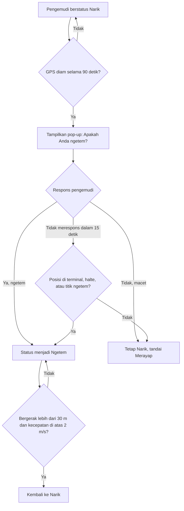

> **Usulan:** aturan *timeout* di atas (bergantung lokasi) dirancang agar kemacetan total tidak salah dianggap ngetem. Pengemudi tetap bisa mengubah status manual kapan saja.

### 6.2 Status Pengemudi dan Status Publik

**State machine status pengemudi (diatur pengemudi atau sistem):**

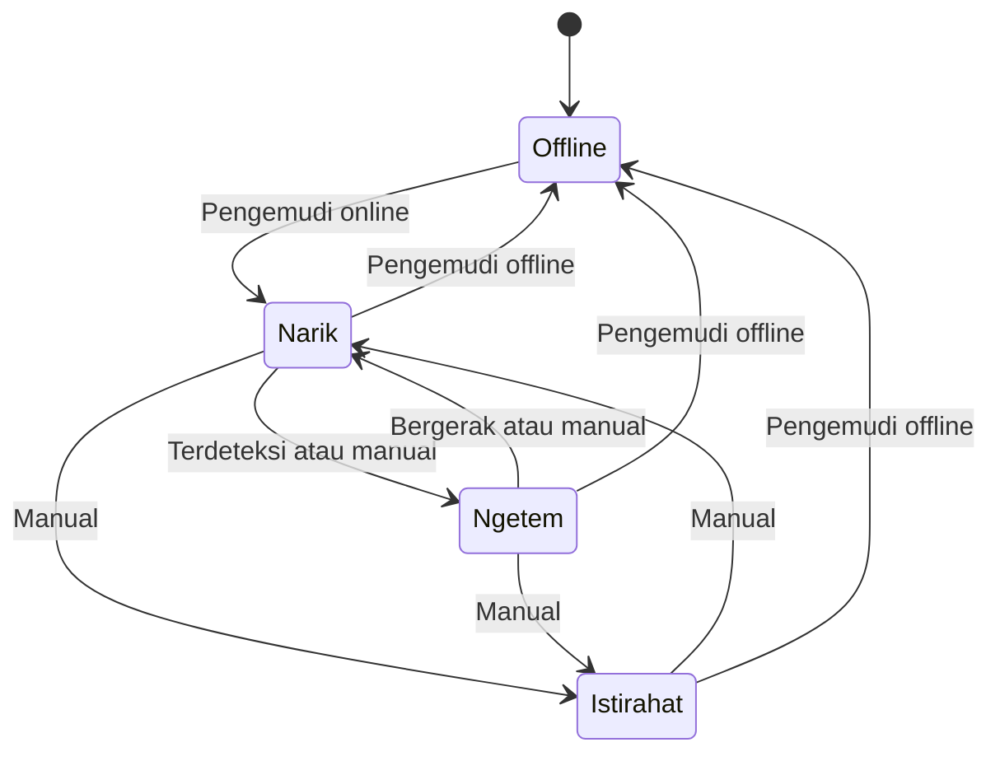

**Pemetaan ke status yang dilihat penumpang:**

| Status internal | Kondisi tambahan | Status publik | Tampil ke penumpang | Tampil ke admin |
|---|---|---|---|---|
| Narik | Kecepatan rata-rata 60 detik ≥ 10 km/jam | **Jalan** | ✅ | ✅ |
| Narik | Kecepatan rata-rata 60 detik 2–10 km/jam, atau dikonfirmasi macet | **Merayap** | ✅ | ✅ |
| Ngetem | — | **Ngetem** | ✅ | ✅ |
| Istirahat | — | — | ❌ | ✅ |
| Offline | — | — | ❌ | ✅ (daftar, bukan peta) |

### 6.3 Mode Penumpang

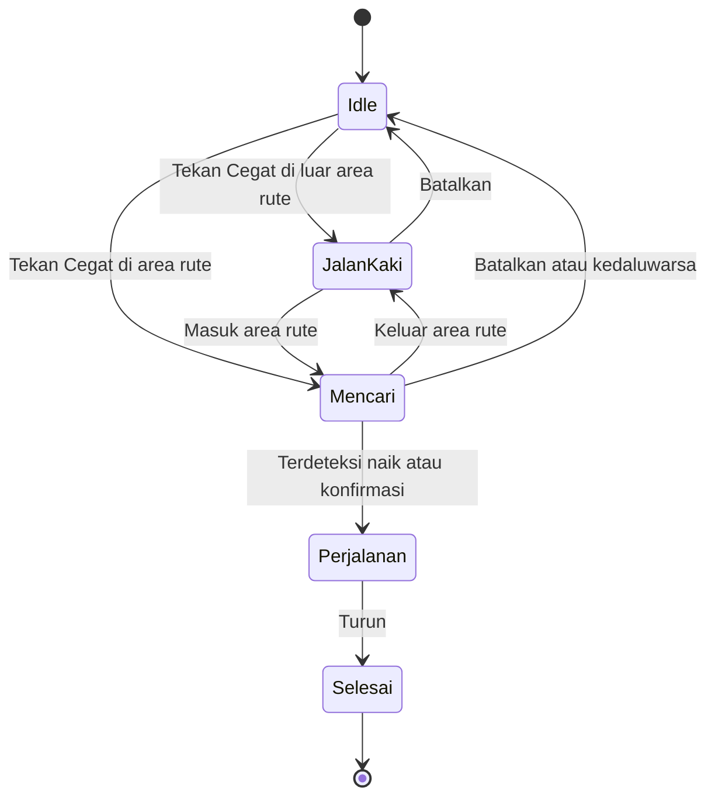

| Mode | Berbagi lokasi ke pengemudi | Keterangan |
|---|---|---|
| Idle | ❌ | Hanya melihat peta |
| Jalan Kaki | ❌ | Penumpang diarahkan menuju titik naik. Lokasi hanya dipakai untuk navigasi |
| Mencari | ✅ (hanya pengemudi jurusan sama di area terkait) | Posisi tampil sebagai titik di rute |
| Perjalanan | ❌ | Lokasi dipakai untuk melacak perjalanan |

### 6.4 Parameter Sistem (Dapat Dikonfigurasi)

Seluruh nilai adalah **usulan awal** dan harus dikalibrasi lewat uji lapangan/simulasi.

| Parameter | Nilai default | Keterangan |
|---|---|---|
| `GPS_INTERVAL_MOVING` | 3 detik | Interval kirim saat bergerak |
| `GPS_INTERVAL_IDLE` | 10 detik | Interval saat ngetem/istirahat |
| `GPS_MIN_ACCURACY` | ≤ 30 m | Titik dengan akurasi lebih buruk dibuang |
| `STATIONARY_SPEED` | < 0,5 m/s | Ambang diam |
| `STATIONARY_RADIUS` | 15 m | Radius dianggap tidak berpindah |
| `NGETEM_DETECT_SECONDS` | 90 detik | Lama diam sebelum pop-up |
| `NGETEM_POPUP_TIMEOUT` | 15 detik | Batas respons pop-up |
| `NGETEM_EXIT_DISTANCE` | 30 m | Jarak berpindah untuk keluar dari ngetem |
| `CRAWL_SPEED_RANGE` | 2–10 km/jam | Rentang kecepatan "merayap" (jendela 60 detik) |
| `ROUTE_BUFFER` | 30 m | Jarak maksimum dari polyline agar dianggap di area rute |
| `STOP_GEOFENCE` | 50 m | Radius area halte, terminal, titik ngetem |
| `PICKUP_VISIBLE_AHEAD` | 1.500 m | Jarak sepanjang rute di depan pengemudi |
| `PICKUP_TTL` | 20 menit | Permintaan cegat kedaluwarsa jika tidak ada aktivitas |
| `BOARDING_DISTANCE` | ≤ 30 m dari angkot | Syarat deteksi naik |
| `BOARDING_DURATION` | ≥ 20 detik | Lama berdekatan dan bergerak bersama |
| `STALE_SIGNAL` | 30 detik | Tanpa update dianggap sinyal hilang |
| `OFFLINE_TIMEOUT` | 5 menit | Tanpa update dianggap offline |
| `WALK_RADIUS_MAX` | 400 m | Jarak jalan kaki maksimum pada rekomendasi |

### 6.5 Aturan Visibilitas Data

Prinsip: **setiap peran hanya menerima data minimum yang dibutuhkan**, terutama untuk lokasi penumpang.

| Data | Admin | Pengemudi | Penumpang |
|---|---|---|---|
| Posisi semua angkot online | ✅ | ❌ | ✅ (Narik/Ngetem) |
| Posisi angkot sendiri | ✅ | ✅ | — |
| Posisi penumpang berstatus Mencari | ❌ (agregat saja) | ✅ hanya jurusan sama, di depan, dalam radius | ❌ (hanya miliknya) |
| Identitas penumpang | ❌ pada peta | ❌ | — |
| Nama dan plat pengemudi | ✅ | — | ✅ pada kartu preview |
| Dokumen pengemudi | ✅ | ✅ miliknya | ❌ |
| NIK penumpang | ✅ termasker (dibuka untuk keperluan tindak lanjut laporan, tercatat di audit log) | ❌ | ✅ miliknya, termasker |
| Laporan | ✅ semua | ❌ | ✅ miliknya |

### 6.6 Rekomendasi Rute

**Fase 1: rute langsung (1 angkot)**

1. Cari semua jalur yang melintas dalam `WALK_RADIUS_MAX` dari titik asal **dan** dari titik tujuan.
2. Proyeksikan asal dan tujuan ke garis jalur. Terima jalur jika posisi proyeksi asal **berada sebelum** proyeksi tujuan menurut arah jalur.
3. Hitung biaya: `waktu_jalan_awal + waktu_tunggu (ETA angkot terdekat) + waktu_naik + waktu_jalan_akhir`.
4. Urutkan berdasarkan biaya terkecil.

**Fase 2: multi-angkot**

- Bangun graf dengan simpul = halte dan titik persinggungan antar jalur, sisi = ruas jalur (biaya waktu naik) dan sisi jalan kaki antar simpul berdekatan (biaya waktu jalan).
- Tambahkan **penalti transit** per pindah angkot (mis. setara 5 menit).
- Cari jalur terbaik dengan Dijkstra atau A*, batasi maksimal 2 transit.

### 6.7 Perhitungan ETA

```
v_smooth   = EMA(kecepatan, jendela 60 detik), dengan batas bawah v_min
jarak_rute = jarak sepanjang polyline dari posisi angkot (hasil snap) ke titik tujuan
ETA        = jarak_rute / v_smooth
```

- `v_min` mencegah pembagian dengan nilai mendekati nol (mis. 5 km/jam).
- Jika angkot **Ngetem**, ETA ditandai *tidak pasti*.
- Jika titik tujuan berada di belakang angkot menurut arah jalur, angkot dianggap **sudah lewat**.

### 6.8 Deteksi Naik dan Turun

- **Naik:** posisi penumpang berada ≤ `BOARDING_DISTANCE` dari angkot yang sama dengan arah dan kecepatan serupa selama ≥ `BOARDING_DURATION`. Sistem meminta konfirmasi: *"Apakah Anda naik angkot [plat]?"*. Penumpang dapat juga mengonfirmasi manual.
- **Turun:** penumpang menekan **Turun**, atau jarak penumpang dari angkot > 100 m selama 30 detik, lalu sistem meminta konfirmasi.
- Deteksi otomatis hanya mengusulkan, bukan memaksa, karena GPS dapat keliru saat dua kendaraan berdekatan.

---

## 7. User Flow

### 7.1 Onboarding dan Verifikasi Pengemudi

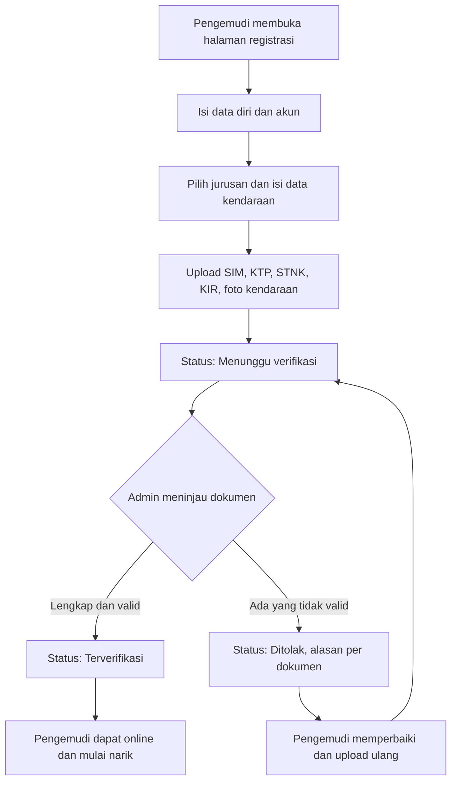

### 7.2 Perjalanan Penumpang

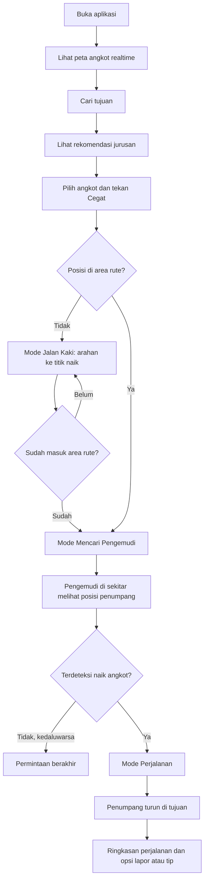

### 7.3 Pelaporan dan Tindak Lanjut

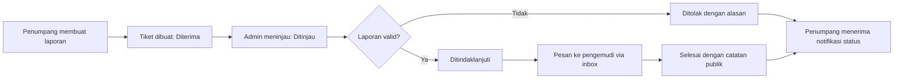

---
## 8. Arsitektur & Tech Stack

### 8.1 Arsitektur Sistem

Seluruh bagian ini adalah **usulan arsitektur** yang dapat disesuaikan tim.

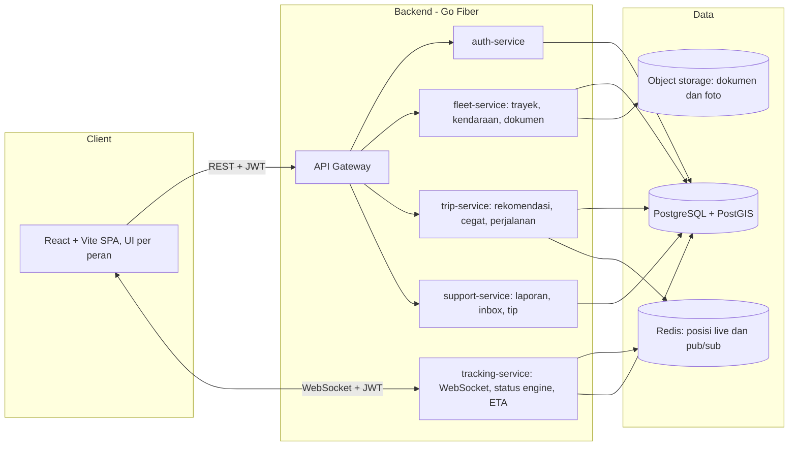

**Prinsip:**
- **Satu SPA, banyak peran.** Antarmuka dimuat sesuai peran dari token.
- **Jalur realtime dipisah dari REST.** `tracking-service` memegang koneksi WebSocket, status engine, dan fan-out lokasi.
- **Redis** menyimpan posisi terakhir tiap kendaraan (dengan `GEOSEARCH` untuk pencarian sekitar) dan pub/sub agar `tracking-service` dapat diskalakan lebih dari satu instance.
- **PostgreSQL + PostGIS** menyimpan data permanen dan menangani kueri geospasial.

> **Saran praktis untuk lomba:** batas antar service dijaga **secara logis** (modul/paket terpisah, kontrak jelas), tetapi untuk MVP cukup dideploy sebagai **3 biner**: `gateway`, `core-api` (auth + fleet + trip + support), dan `tracking-service`, lewat Docker Compose. Ini tetap memenuhi arsitektur microservices, dengan beban operasional jauh lebih kecil. Pemecahan lebih jauh dilakukan di Fase 2.

### 8.2 Keputusan Database

| Opsi | Kelebihan | Kekurangan |
|---|---|---|
| **MongoDB** | Indeks geospasial `2dsphere`, skema fleksibel | Data bersifat relasional (verifikasi, laporan, trip, dokumen), jadi join dan konsistensi lebih repot |
| **PostgreSQL + PostGIS** (mis. via Supabase) | Relasional kuat, PostGIS punya fungsi siap pakai untuk *snap* dan jarak sepanjang rute (`ST_ClosestPoint`, `ST_LineLocatePoint`, `ST_DWithin`) | Perlu belajar PostGIS |

**Rekomendasi: PostgreSQL + PostGIS untuk data utama, Redis untuk posisi live.**

Alasan: sebagian besar kebutuhan ini relasional dan geospasial (status verifikasi, trayek, laporan, riwayat trip, serta snap-to-route dan ETA). Realtime bawaan Supabase tidak cukup karena aturan visibilitas (6.5) butuh logika server sendiri, jadi realtime tetap lewat `tracking-service`. Supabase dapat dipakai sebagai **managed Postgres + Storage**, sementara autentikasi tetap di `auth-service` agar RBAC REST dan WebSocket konsisten.

### 8.3 Tech Stack (Usulan)

| Lapisan | Teknologi |
|---|---|
| Frontend | React + Vite (SPA), TypeScript, React Router, TanStack Query, state ringan (Zustand), Tailwind CSS |
| Peta | MapLibre GL JS (atau Leaflet), tile OpenStreetMap atau penyedia tile lain |
| Grafik | Recharts atau Chart.js |
| Backend | Go, Fiber, WebSocket (modul `contrib/websocket`), `pgx` / `sqlc`, `golang-migrate` |
| Auth | JWT (access + refresh), hashing bcrypt/argon2, RBAC middleware |
| Database | PostgreSQL + PostGIS |
| Cache & pub/sub | Redis |
| Storage | Supabase Storage atau S3-compatible (bucket privat + signed URL) |
| Geocoding (pencarian tujuan) | Basis data halte/terminal sendiri + penyedia geocoder (perlu keputusan, lihat Open Questions) |
| Infra | Docker Compose, reverse proxy (Caddy/Nginx) dengan TLS |

### 8.4 Alur Realtime

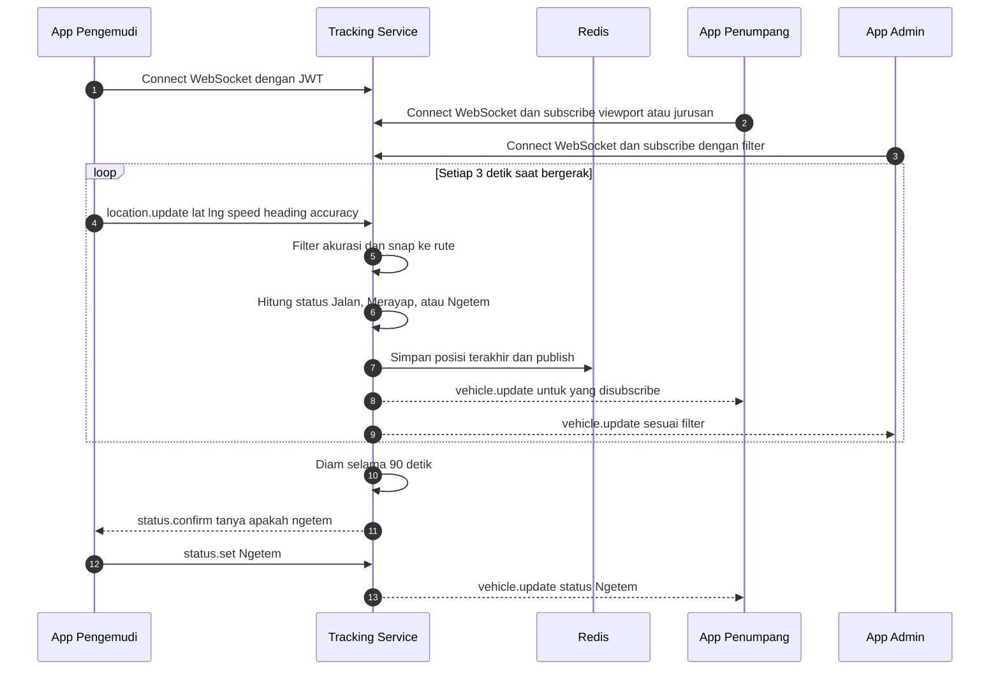

### 8.5 Alur Cegat dan Deteksi Naik

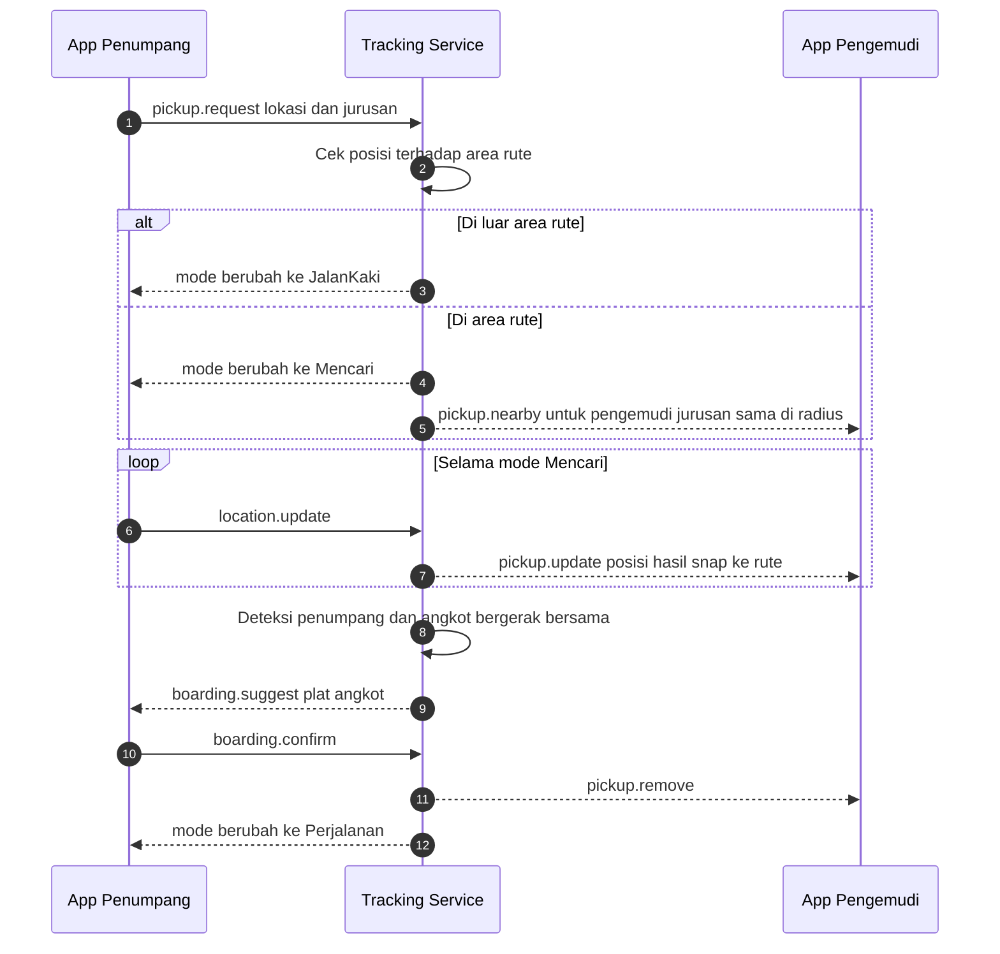

### 8.6 Kontrak API (Ringkasan)

**REST** (prefix `/api/v1`):

| Modul | Endpoint | Peran |
|---|---|---|
| Auth | `POST /auth/register/passenger`, `POST /auth/register/driver`, `POST /auth/login`, `POST /auth/refresh`, `POST /auth/logout` | Publik |
| Trayek | `GET /routes`, `GET /routes/:id`, `POST/PUT/DELETE /routes` (admin) | Semua / Admin |
| Halte | `GET /routes/:id/stops`, `POST/PUT/DELETE /stops` (admin) | Semua / Admin |
| Kendaraan & dokumen | `GET /vehicles`, `POST /drivers/me/documents`, `GET /admin/vehicles` | Admin / Pengemudi |
| Verifikasi | `GET /admin/drivers?status=`, `POST /admin/drivers/:id/approve`, `POST /admin/drivers/:id/reject` | Admin |
| Rekomendasi | `GET /trips/recommendations?from=&to=` | Penumpang |
| Trip | `GET /trips/me`, `GET /trips/me/summary` | Penumpang |
| Laporan | `POST /reports`, `GET /reports/me`, `GET /admin/reports`, `PATCH /admin/reports/:id` | Penumpang / Admin |
| Inbox | `GET /inbox`, `PATCH /inbox/:id/read`, `POST /admin/messages` | Pengemudi / Admin |
| Analitik | `GET /admin/analytics/overview`, `GET /drivers/me/stats`, `GET /passengers/me/stats` | Per peran |

**WebSocket** (`/ws`):

| Event | Arah | Peran | Isi |
|---|---|---|---|
| `location.update` | Klien → Server | Pengemudi, Penumpang | lat, lng, accuracy, speed, heading, ts |
| `subscribe` | Klien → Server | Penumpang, Admin | viewport / jurusan / filter |
| `vehicle.update` | Server → Klien | Penumpang, Admin | id, posisi, status, jurusan, plat, ETA |
| `status.set` | Klien → Server | Pengemudi | narik / ngetem / istirahat / offline |
| `status.confirm` | Server → Klien | Pengemudi | pertanyaan konfirmasi ngetem |
| `pickup.request` / `pickup.cancel` | Klien → Server | Penumpang | lokasi, jurusan |
| `pickup.nearby` / `pickup.update` / `pickup.remove` | Server → Klien | Pengemudi | daftar penumpang di depan (posisi ter-snap) |
| `boarding.suggest` / `boarding.confirm` | Dua arah | Penumpang | plat angkot |
| `inbox.new` | Server → Klien | Pengemudi, Penumpang | pesan baru / perubahan status laporan |

---

## 9. Data Model

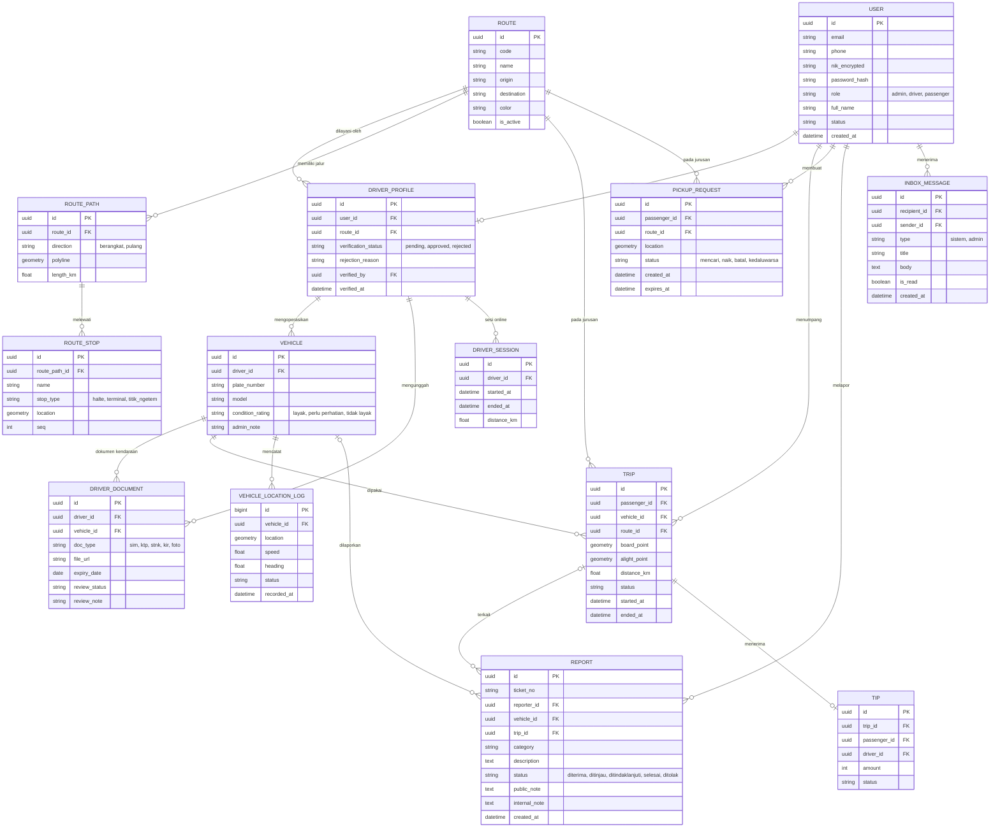

**Catatan data:**
- `VEHICLE_LOCATION_LOG` bersifat *append-only* dan tumbuh cepat. Ambil sampel (mis. tiap 10–15 detik) atau simpan dengan kebijakan retensi, lalu agregasi untuk analitik.
- Posisi live terbaru **tidak** dibaca dari tabel ini, melainkan dari Redis.
- `PICKUP_REQUEST` yang selesai dihapus atau dianonimkan sesuai kebijakan retensi (lihat 10).
- `nik_encrypted` memakai enkripsi tingkat kolom. Kunci disimpan di luar database.

---

## 10. Non-Functional Requirements

| Kategori | Requirement | Target |
|---|---|---|
| **Performa** | Latensi posisi end-to-end | p95 ≤ 2 detik |
| | Waktu muat halaman awal (4G) | ≤ 3 detik |
| | Respons REST (non-geospasial berat) | p95 ≤ 500 ms |
| **Skalabilitas** | Koneksi WebSocket bersamaan | ≥ 200 pada MVP, desain mendukung horizontal scaling |
| **Ketersediaan** | Reconnect otomatis klien | Backoff eksponensial, pulihkan state |
| **Akurasi** | Filter GPS | Buang titik akurasi > 30 m, snap ke rute |
| **Keamanan** | Autentikasi & otorisasi | JWT + RBAC di REST dan WebSocket |
| | Data sensitif | NIK terenkripsi di kolom, dokumen di bucket privat (signed URL berumur pendek) |
| | Transport | HTTPS/WSS wajib |
| | Proteksi umum | Rate limit, validasi input, CORS ketat, proteksi terhadap kategori risiko OWASP Top 10 |
| | Audit | Log keputusan verifikasi dan akses data sensitif |
| **Privasi** | Kepatuhan | Merujuk UU No. 27 Tahun 2022 tentang Pelindungan Data Pribadi: persetujuan, tujuan jelas, minimisasi data |
| | Lokasi penumpang | Dibagikan hanya saat mode Mencari. Ditampilkan ke pengemudi sebagai posisi ter-snap tanpa identitas |
| | Retensi | Lokasi mentah penumpang dihapus/dianonimkan setelah periode tertentu (usulan 30 hari) |
| **Usability** | Responsif | Mobile-first untuk penumpang dan pengemudi, desktop-first untuk admin |
| | Aksesibilitas | Status tidak hanya dibedakan lewat warna, kontras memadai, target sentuh ≥ 44 px |
| | Bahasa | Bahasa Indonesia |
| **Maintainability** | Kualitas kode | Linting, migrasi database berversi, dokumentasi API (OpenAPI) |
| **Observability** | Log dan metrik | Log terstruktur, metrik koneksi WebSocket dan latensi update |

---

## 11. Risiko, Asumsi & Dependensi

### 11.1 Risiko

| # | Risiko | Dampak | Mitigasi |
|---|---|---|---|
| R1 | **GPS di browser berhenti saat tab/layar di latar belakang** | Posisi pengemudi putus, tracking tidak andal | Pakai Screen Wake Lock API, instruksi "biarkan layar menyala", indikator sinyal hilang. Pertimbangkan pembungkus native/PWA di Fase 2 |
| R2 | Akurasi GPS buruk (gedung tinggi, ponsel murah) | Status dan ETA salah | Filter akurasi, snap-to-route, penghalusan EMA |
| R3 | Kendaraan nyata tidak tersedia untuk demo | Demo realtime tidak meyakinkan | Simulator GPS (F-SYS-05) dan skenario terskrip |
| R4 | Data rute belum tersedia dalam format digital | Peta dan rekomendasi tidak bisa jalan | Digitalisasi manual 2–3 trayek pilot (GeoJSON) di awal |
| R5 | Scope terlalu besar untuk waktu lomba | Fitur setengah jadi | Disiplin MoSCoW, tunda F-PSG-07 dan F-PSG-11 |
| R6 | Kebocoran data sensitif (NIK, dokumen SIM/KTP/STNK) | Risiko hukum dan reputasi | Enkripsi, bucket privat, akses terbatas dan tercatat. Gunakan **data dummy** untuk demo |
| R7 | Penyalahgunaan fitur Cegat atau laporan palsu | Pengemudi terganggu, data kotor | Satu permintaan aktif, TTL, rate limit laporan, NIK sebagai akuntabilitas |
| R8 | Batas penggunaan layanan peta/geocoding gratis | Peta atau pencarian terblokir saat demo | Cek kebijakan penggunaan tile dan geocoder, siapkan alternatif atau self-host |
| R9 | Pengemudi tidak mengadopsi (di dunia nyata) | Nilai produk turun | Antarmuka sederhana, insentif tip (Fase 2), pendampingan awal. Di luar cakupan lomba |

### 11.2 Asumsi

- Pengemudi dan penumpang memiliki ponsel dengan GPS dan koneksi data.
- Wilayah pilot terdiri dari beberapa trayek yang rutenya dapat didigitalisasi.
- Verifikasi dokumen dilakukan manual oleh admin.
- Penilaian lomba berfokus pada **demo fungsional dan kesesuaian subtema** (perlu dikonfirmasi dengan panduan resmi).

### 11.3 Dependensi

- Penyedia tile peta dan geocoding.
- Layanan email untuk verifikasi dan notifikasi.
- Hosting (VPS atau cloud) untuk backend, database, dan Redis.
- (Fase 2) Payment gateway atau e-wallet untuk tip.

---

## 12. Roadmap & Milestone

> Tanggal pada Gantt adalah **asumsi** (mulai 2 November 2026). Sesuaikan dengan tenggat resmi lomba.

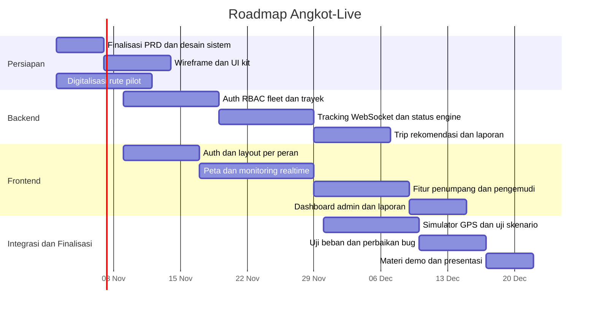

| Milestone | Deliverable | Kriteria selesai |
|---|---|---|
| **M1 — Fondasi** | Auth, RBAC, CRUD trayek, verifikasi pengemudi | Admin dapat membuat jurusan dan menyetujui pengemudi |
| **M2 — Realtime inti** | Tracking WebSocket, status engine, peta realtime | Angkot simulasi bergerak di peta penumpang dan admin dengan status benar |
| **M3 — Alur penumpang** | Pencarian, rekomendasi, Cegat, perjalanan, laporan | Skenario cari → cegat → naik → turun → lapor berjalan end-to-end |
| **M4 — Analitik & polish** | Dashboard, inbox, perbaikan UX | Seluruh fitur Must selesai dan stabil |
| **M5 — Siap demo** | Simulator, data pilot, materi presentasi | Demo berjalan mulus 3 kali berturut-turut |

**Fase 2 (setelah lomba):** perjalanan multi-angkot, tip dan pembayaran, aplikasi native/PWA dengan pelacakan latar belakang, verifikasi dokumen semi-otomatis, ETA berbasis data historis.

---

## 13. Referensi

**Kompetisi**
- Multimedia In Action (MIA) 2026, www.mia2026.com (subtema: Open Government Data, Public Service Tracking, Civic Reporting & Accountability, Data-Driven Decision Support).

**Teknis**
- Go Fiber: https://docs.gofiber.io
- Fiber contrib (WebSocket): https://github.com/gofiber/contrib
- PostGIS: https://postgis.net/documentation/
- Redis: https://redis.io/docs/
- MapLibre GL JS: https://maplibre.org/maplibre-gl-js/docs/
- Leaflet: https://leafletjs.com
- MDN Geolocation API: https://developer.mozilla.org/en-US/docs/Web/API/Geolocation_API
- MDN Screen Wake Lock API: https://developer.mozilla.org/en-US/docs/Web/API/Screen_Wake_Lock_API
- MDN WebSocket API: https://developer.mozilla.org/en-US/docs/Web/API/WebSockets_API
- Kebijakan tile OSM: https://operations.osmfoundation.org/policies/tiles/
- Kebijakan Nominatim: https://operations.osmfoundation.org/policies/nominatim/
- OWASP ASVS: https://owasp.org/www-project-application-security-verification-standard/

**Regulasi**
- Undang-Undang No. 27 Tahun 2022 tentang Pelindungan Data Pribadi.

**Menyusul**
- [ ] Data dan statistik transportasi publik untuk latar belakang (ditambahkan pada tahap berikutnya)
- [ ] Studi atau aplikasi pembanding yang sudah diverifikasi sumbernya

---

## 14. Lampiran

### 14.1 Glosarium

| Istilah | Arti |
|---|---|
| **Angkot** | Angkutan kota, kendaraan umum berukuran kecil dengan trayek tetap |
| **Trayek / Jurusan** | Rute tetap yang dilayani angkot, dari asal ke tujuan |
| **Ngetem** | Angkot berhenti menunggu penumpang |
| **Merayap** | Angkot bergerak sangat lambat, biasanya akibat macet |
| **Cegat / Megat** | Penumpang memberi isyarat agar angkot berhenti |
| **Halte / Terminal / Titik ngetem** | Titik henti resmi atau lazim di sepanjang rute |
| **SIM** | Surat Izin Mengemudi |
| **KTP** | Kartu Tanda Penduduk |
| **STNK** | Surat Tanda Nomor Kendaraan |
| **KIR** | Uji berkala kendaraan bermotor (kelayakan jalan) |
| **NIK** | Nomor Induk Kependudukan |
| **Snap-to-route** | Menyesuaikan koordinat GPS ke titik terdekat pada garis rute |
| **ETA** | *Estimated Time of Arrival*, estimasi waktu tiba |
| **Polyline** | Garis yang dibentuk dari urutan titik koordinat |

### 14.2 Open Questions

| # | Pertanyaan | Dampak | Usulan |
|---|---|---|---|
| Q1 | Wilayah dan trayek pilot mana yang dipakai? | Data rute, uji lapangan | Pilih 2–3 trayek yang bisa disurvei langsung |
| Q2 | Apa kriteria penilaian dan tenggat resmi lomba? | Prioritas fitur dan roadmap | Periksa panduan resmi MIA 2026 |
| Q3 | Database final: PostgreSQL + PostGIS atau MongoDB? | Arsitektur, skema | Ikuti rekomendasi 8.2 |
| Q4 | Penyedia peta dan geocoding? | Biaya, batas pemakaian | Mulai dari OSM + data halte sendiri, evaluasi alternatif |
| Q5 | Tip: simulasi atau integrasi pembayaran sungguhan? | Scope Fase 2 | Simulasi untuk demo |
| Q6 | Pembagian tugas dan ukuran tim? | Realisme jadwal | Tentukan sebelum M1 |
| Q7 | Perlukah verifikasi nomor telepon (OTP) pada MVP? | Biaya, UX registrasi | Tunda ke Fase 2 |
| Q8 | Apakah kebijakan "dokumen kedaluwarsa memblokir online" diberlakukan? | Aturan operasional | Default hanya peringatan |
