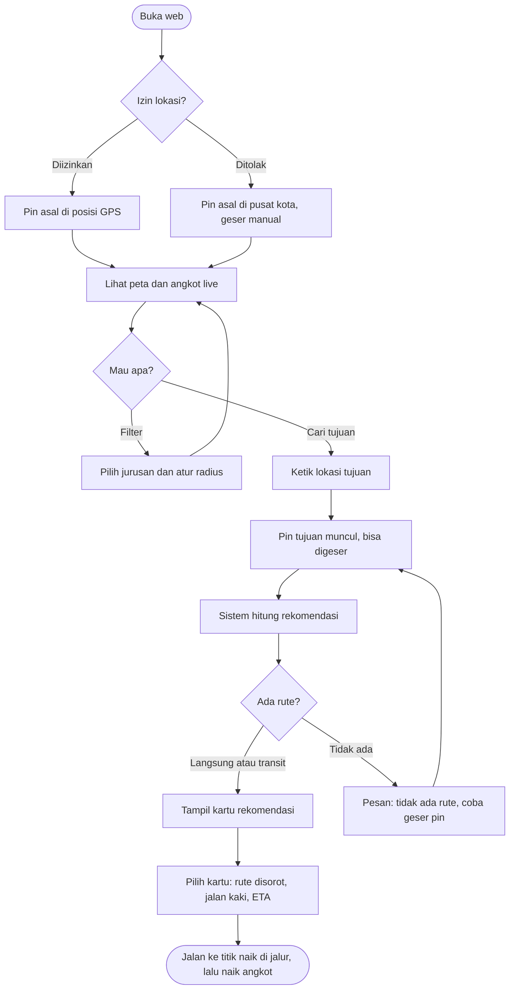
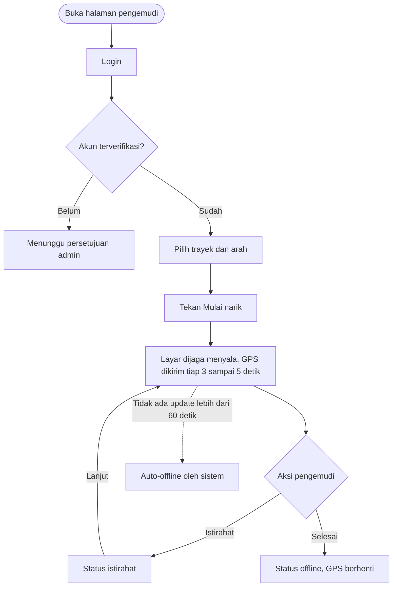
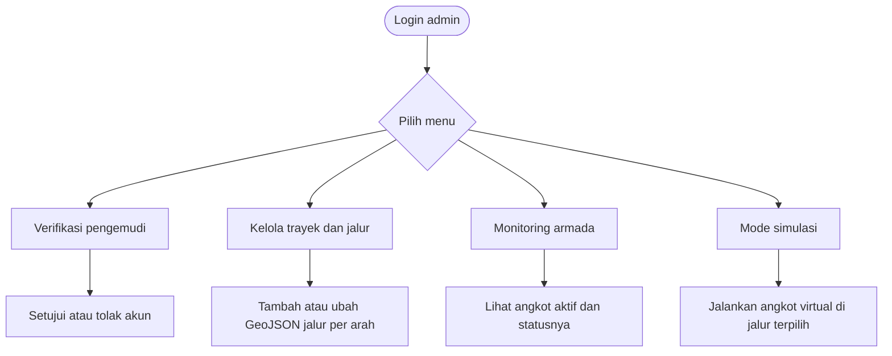
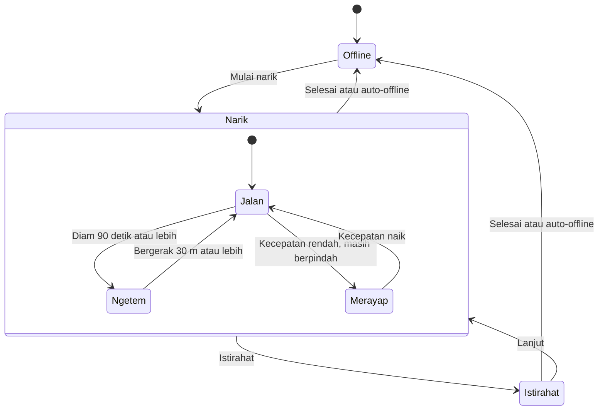
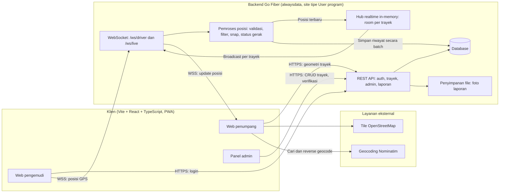
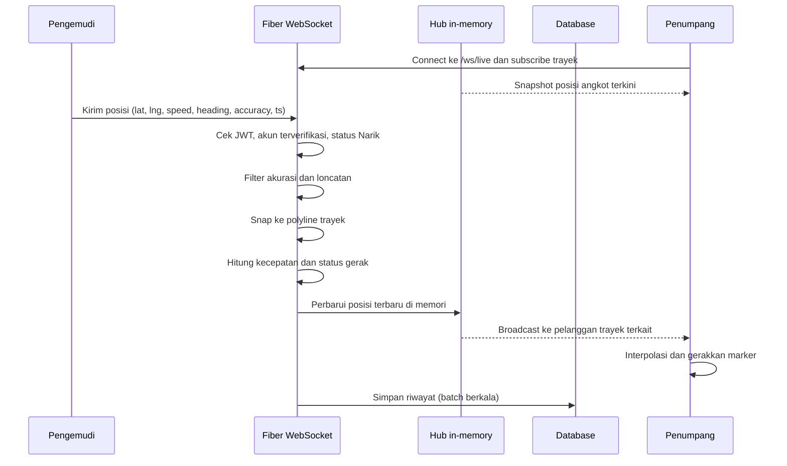
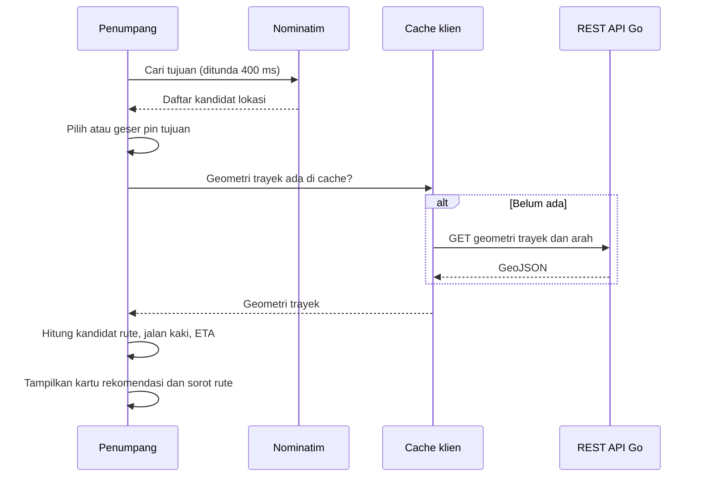
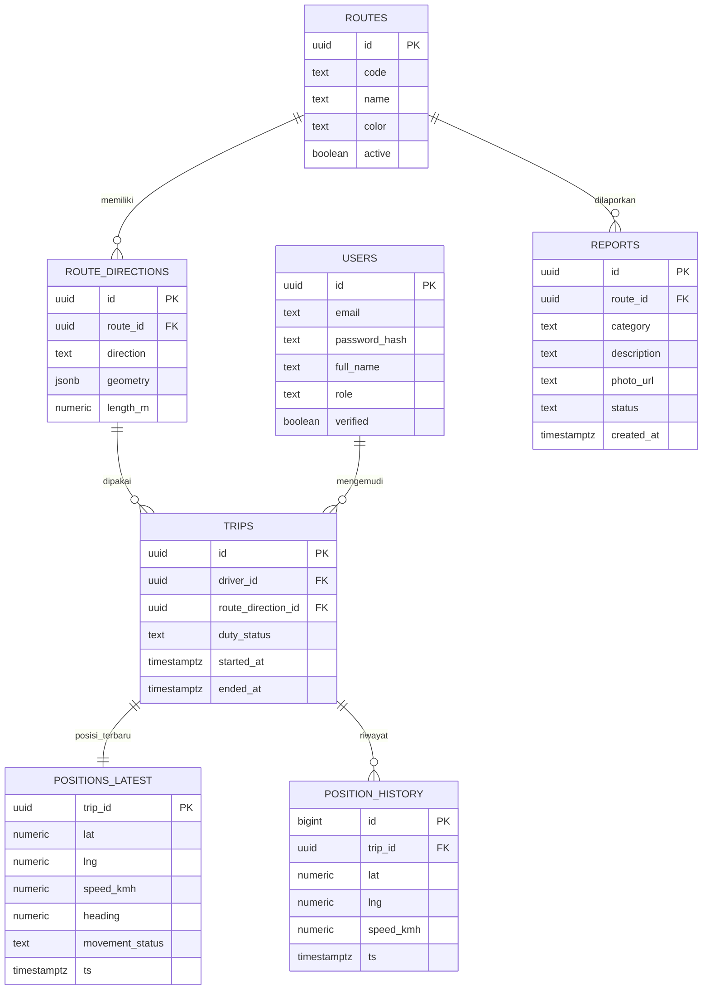

# PRD: Angkot Live

| | |
|---|---|
| **Kompetisi** | Web In Action (WIA) MIA 2026, KSM Multimedia UPN Veteran Jakarta |
| **Subtema** | Public Service Tracking |
| **Wilayah awal** | Kota Bandung |
| **Platform** | Web (PWA), tanpa aplikasi native |

Legenda prioritas: **P0** wajib ada saat demo, **P1** pembeda, **P2** dikerjakan kalau waktu cukup.

---

## 1. Ringkasan

Angkot Live adalah aplikasi web untuk memantau posisi angkot secara real-time dan membantu penumpang menemukan angkot yang tepat menuju tujuan mereka. Posisi angkot berasal dari GPS HP pengemudi yang dikirim lewat browser. Penumpang melihat angkot bergerak di peta, memfilter berdasarkan jurusan dan radius, mencari tujuan, lalu mendapat rekomendasi angkot beserta rute yang divisualisasikan.

Angkot berjalan di satu rute tetap secara siklus dan **tidak menjemput penumpang**. Penumpang yang mendatangi jalur, boleh naik atau turun di titik mana pun di pinggir jalan selama dilewati rute angkot.

## 2. Latar belakang dan masalah

Angkutan kota di Bandung tidak punya informasi layanan yang bisa diakses penumpang. Akibatnya:

- Penumpang tidak tahu angkot mana yang menuju tujuannya.
- Penumpang tidak tahu kapan angkot berikutnya lewat atau apakah angkotnya sedang beroperasi.
- Tidak ada data layanan (jeda antar angkot, durasi ngetem) yang bisa dipakai untuk evaluasi layanan.

Relevansi dengan subtema: aplikasi memberi transparansi status layanan publik dari sisi pengguna, dengan pelacakan yang bisa dilihat langsung oleh warga.

## 3. Tujuan dan non-tujuan

### Tujuan

1. Penumpang dapat melihat posisi angkot yang sedang narik secara real-time.
2. Penumpang dapat menemukan angkot menuju tujuan beserta titik naik, titik turun, dan jalan kaki yang harus ditempuh.
3. Pengemudi dapat mengirim posisi hanya dengan beberapa sentuhan, tanpa perangkat tambahan.
4. Sistem menghasilkan data layanan (headway, ngetem) yang bisa dianalisis.
5. Seluruh alur dapat didemokan secara stabil, termasuk tanpa angkot sungguhan.

### Non-tujuan (di luar scope)

- Pembayaran digital (QRIS atau tarif per kilometer).
- Portal data terbuka (Open Government Data) dan API publik.
- Aplikasi mobile native.
- Pemesanan atau penjemputan angkot.
- Prediksi kepadatan berbasis AI.
- Chat atau forum antar pengguna.

### Metrik keberhasilan (target awal, untuk demo)

| Metrik | Target |
|---|---|
| Jeda posisi dikirim sampai tampil di peta penumpang | 5 detik atau kurang |
| Waktu hitung rekomendasi rute | 2 detik atau kurang |
| Alur utama bisa didemokan tanpa kegagalan | 3 kali percobaan berturut-turut |
| Cakupan trayek | 3 sampai 5 trayek dengan data akurat |

## 4. Persona

| Persona | Kebutuhan | Perangkat |
|---|---|---|
| **Penumpang** (mahasiswa, pekerja, warga umum) | Tahu angkot mana yang ke tujuan, kapan datang, naik di mana | HP, browser, tanpa login |
| **Pengemudi** | Mengirim posisi dengan sentuhan minimal saat menyetir | HP di dashboard, layar menyala |
| **Admin** (pengelola sistem) | Kelola trayek, verifikasi pengemudi, pantau armada | Laptop |

## 5. Aturan bisnis

| ID | Aturan |
|---|---|
| BR-01 | Satu angkot melayani satu trayek, bergerak siklus di rute tetap. |
| BR-02 | Angkot tidak menjemput. Titik naik dan turun adalah titik mana pun di sepanjang jalur. |
| BR-03 | Data posisi hanya diterima dari pengemudi yang sudah diverifikasi admin dan sedang berstatus Narik. |
| BR-04 | Lokasi dan pin penumpang hanya disimpan di perangkat penumpang dan tidak pernah dikirim ke server atau pengemudi. |
| BR-05 | Status tugas ditentukan pengemudi, status gerak ditentukan sistem. |

### Model status angkot

| Lapis | Status | Penentu |
|---|---|---|
| Tugas | Offline, Narik, Istirahat | Pengemudi (tombol) |
| Gerak (hanya saat Narik) | Jalan, Merayap, Ngetem | Sistem (otomatis dari GPS) |

Aturan deteksi gerak (nilai awal, perlu dikalibrasi di lapangan):

| Status | Aturan |
|---|---|
| Jalan | Kecepatan rata-rata 5 km/jam atau lebih dalam jendela 90 detik |
| Ngetem | Perpindahan posisi kurang dari 30 m selama 90 detik atau lebih |
| Merayap | Kecepatan rendah tetapi posisi masih berpindah |
| Perubahan status | Berlaku setelah 2 sampai 3 sampel berturut-turut (histeresis) |

Umur data (indikator data basi):

| Umur data | Tampilan |
|---|---|
| Kurang dari 15 detik | Normal |
| 15 sampai 60 detik | Marker diredupkan, label "update N detik lalu" |
| Lebih dari 60 detik | Dianggap offline (auto-offline) |

## 6. Kebutuhan fungsional

### 6.1 Peta dan trayek

| ID | Kebutuhan | Prioritas | Kriteria penerimaan |
|---|---|---|---|
| FR-01 | Peta Kota Bandung (Leaflet + OpenStreetMap) | P0 | Peta tampil dan bisa di-zoom/geser lancar di HP |
| FR-02 | Jalur trayek berupa polyline per arah, satu warna per trayek | P0 | Jalur mengikuti jalan, bukan garis lurus antar titik |
| FR-03 | Filter jurusan, multi-pilih | P0 | Angkot trayek yang tidak dipilih disembunyikan |
| FR-04 | Info trayek (nama, panjang rute, jumlah angkot aktif) | P1 | Tampil di kartu info |

### 6.2 Live monitoring (penumpang)

| ID | Kebutuhan | Prioritas | Kriteria penerimaan |
|---|---|---|---|
| FR-10 | Marker angkot real-time | P0 | Update tampil maksimal 5 detik dari pengiriman, marker bergeser mulus (interpolasi) |
| FR-11 | Arah dan status marker | P1 | Ikon berputar sesuai arah, warna berbeda untuk Jalan, Ngetem, Merayap |
| FR-12 | Indikator data basi | P1 | Sesuai tabel umur data pada bagian 5 |
| FR-13 | Detail angkot saat marker diklik | P1 | Tampil trayek, kecepatan, status, update terakhir |
| FR-14 | Lokasi pengguna dari GPS browser | P0 | Hanya diproses di perangkat pengguna (BR-04) |

### 6.3 Pencarian, pin, dan radius

| ID | Kebutuhan | Prioritas | Kriteria penerimaan |
|---|---|---|---|
| FR-20 | Cari lokasi tujuan dengan autocomplete | P0 | Request ditunda 400 ms setelah ketikan terakhir |
| FR-21 | Pin asal, default dari GPS, bisa digeser | P0 | Setelah digeser tidak lagi mengikuti GPS, tersedia tombol "kembali ke lokasi saya" |
| FR-22 | Pin tujuan dari pencarian atau tap di peta, bisa digeser | P0 | Alamat diperbarui (reverse geocoding), rekomendasi dihitung ulang saat pin dilepas |
| FR-23 | Filter radius 200 m sampai 3 km | P0 | Lingkaran berpusat di pin asal, hanya angkot di dalam lingkaran yang tampil |

Perilaku izin lokasi:

| Situasi | Perilaku |
|---|---|
| Izin diberikan | Pin asal di posisi GPS |
| Izin ditolak | Pin asal di pusat kota, pengguna geser atau cari sendiri |

### 6.4 Rekomendasi jurusan dan rute

| ID | Kebutuhan | Prioritas | Kriteria penerimaan |
|---|---|---|---|
| FR-30 | Rekomendasi angkot langsung ke tujuan | P0 | Menampilkan trayek, titik naik, titik turun |
| FR-31 | Visualisasi rute di peta | P0 | Segmen yang ditempuh disorot, sisanya diredupkan |
| FR-32 | Titik naik dan turun terdekat di sepanjang jalur | P0 | Dihitung dari proyeksi pin ke polyline (BR-02) |
| FR-33 | Jalan kaki awal dan akhir | P1 | Jarak dan garis jalan kaki tampil |
| FR-34 | Transit satu kali | P1 | Dipakai bila tidak ada rute langsung |
| FR-35 | Alternatif 2 sampai 3 rute | P1 | Diurutkan dari tercepat atau paling sedikit transit |
| FR-36 | Estimasi waktu total | P1 | Jalan kaki + tunggu + naik angkot |

### 6.5 Info layanan

| ID | Kebutuhan | Prioritas |
|---|---|---|
| FR-40 | ETA angkot ke titik tertentu | P1 |
| FR-41 | Angkot terdekat (satu tombol) | P1 |
| FR-42 | Info titik di jalur (angkot yang lewat dan ETA) | P1 |
| FR-43 | Status layanan trayek (banyak, sepi, belum ada) | P2 |
| FR-44 | Lacak satu angkot | P2 |
| FR-45 | Tempat favorit (disimpan lokal) | P2 |
| FR-46 | Bagikan rute lewat tautan | P2 |

### 6.6 Sisi pengemudi

| ID | Kebutuhan | Prioritas | Kriteria penerimaan |
|---|---|---|---|
| FR-50 | Login pengemudi | P0 | Hanya akun terverifikasi yang bisa mengirim posisi |
| FR-51 | Pilih trayek dan arah | P0 | Tersimpan selama sesi narik |
| FR-52 | Tombol Mulai narik dan Selesai | P0 | Tombol besar, bisa ditekan sambil menyetir |
| FR-53 | Tombol Istirahat | P2 | Angkot ditandai istirahat dan tidak dihitung dalam ETA |
| FR-54 | Kirim GPS berkala | P0 | Interval 3 sampai 5 detik |
| FR-55 | Wake Lock agar layar tetap menyala | P0 | GPS tidak mati karena layar padam |
| FR-56 | Indikator status GPS | P1 | GPS aktif, sinyal lemah, gagal kirim |
| FR-57 | Antrean offline | P2 | Data ditahan saat sinyal putus, dikirim ulang saat tersambung |

### 6.7 Backend dan realtime

| ID | Kebutuhan | Prioritas |
|---|---|---|
| FR-60 | Simpan posisi terbaru dan riwayat | P0 |
| FR-61 | Broadcast realtime per trayek | P0 |
| FR-62 | Filter akurasi GPS (buang titik akurasi buruk dan loncatan tidak wajar) | P1 |
| FR-63 | Snap titik ke polyline trayek | P1 |
| FR-64 | Penentu status gerak otomatis | P1 |
| FR-65 | Auto-offline untuk angkot tanpa update | P1 |

### 6.8 Analitik

| ID | Kebutuhan | Prioritas |
|---|---|---|
| FR-70 | Headway (jeda antar angkot) per trayek per jam | P1 |
| FR-71 | Lokasi dan durasi ngetem | P2 |
| FR-72 | Heatmap permintaan (hanya data agregat dan anonim) | P2 |
| FR-73 | Insight otomatis dalam bahasa awam | P2 |

### 6.9 Lapor (pelengkap)

| ID | Kebutuhan | Prioritas |
|---|---|---|
| FR-80 | Form lapor (kategori, foto, lokasi, trayek) | P1 |
| FR-81 | Verifikasi warga | P2 |
| FR-82 | Status tindak lanjut | P2 |
| FR-83 | Skor akuntabilitas per trayek | P2 |

### 6.10 Admin dan demo

| ID | Kebutuhan | Prioritas | Kriteria penerimaan |
|---|---|---|---|
| FR-90 | CRUD trayek dan jalur per arah | P0 | Jalur disimpan sebagai GeoJSON |
| FR-91 | Verifikasi akun pengemudi | P0 | Setujui atau tolak |
| FR-92 | Monitoring semua angkot | P1 | Daftar angkot aktif beserta status |
| FR-93 | Mode simulasi | P0 | Angkot virtual bergerak di jalur tanpa GPS asli |
| FR-94 | PWA | P1 | Dapat dipasang di layar utama |

## 7. Kebutuhan non-fungsional

| Aspek | Kebutuhan |
|---|---|
| Performa | Peta termuat kurang dari 3 detik di jaringan seluler biasa, rekomendasi rute 2 detik atau kurang |
| Kompatibilitas | Chrome Android untuk pengemudi (disarankan), browser modern untuk penumpang, tampilan responsif dengan prioritas mobile |
| Keamanan | Autentikasi JWT dan middleware otorisasi per peran, hanya pengemudi terverifikasi dengan trip Narik yang boleh mengirim posisi, pembatasan laju kirim per akun, validasi Origin pada koneksi WebSocket, WSS wajib |
| Privasi | Lokasi dan pin penumpang tetap di perangkat, analitik permintaan hanya agregat dan anonim |
| Keandalan | Auto-offline untuk angkot tanpa update, aplikasi tetap bisa dipakai bila geocoding gagal (pin manual) |
| Usability | Tombol halaman pengemudi besar, teks kontras tinggi, minim langkah |
| Observabilitas | Log error pengiriman posisi dan latensi broadcast (minimal) |

## 8. User flow

### 8.1 Alur penumpang



### 8.2 Alur pengemudi



### 8.3 Alur admin



### 8.4 Siklus status angkot



## 9. Arsitektur sistem

### 9.1 Gambaran umum



Keputusan arsitektur:

- **Satu service Go Fiber** yang menjalankan REST API dan WebSocket dalam satu proses.
- **Hub realtime in-memory** dengan room per trayek. Untuk skala demo satu proses cukup, jadi tidak butuh Redis atau message broker. Konsekuensinya: bila proses restart, posisi terbaru hilang sampai pengemudi mengirim lagi (atau dipulihkan dari snapshot di database).
- **Pengemudi mengirim posisi lewat WebSocket** (`/ws/driver`, wajib JWT), **penumpang subscribe lewat `/ws/live`** dengan menyebut trayek yang sedang dilihat. Saat subscribe, server mengirim snapshot posisi terkini lebih dulu, lalu update berikutnya.
- **Pencarian rute dihitung di sisi klien** (geometri 3 sampai 5 trayek kecil dan bisa di-cache), memakai Turf.js. Backend tidak mengurus routing.
- **Riwayat posisi disimpan secara batch**, bukan satu insert per pesan, supaya database tidak jadi bottleneck.
- **Lokasi dan pin penumpang tidak pernah meninggalkan browser** (BR-04). Koneksi WebSocket penumpang hanya mengirim daftar trayek yang disubscribe.
- **Deploy di alwaysdata:** berdasarkan dokumentasinya, aplikasi Go dijalankan sebagai site tipe User program dan harus listen pada IP dan port yang diberikan lewat environment (`IP` dan `PORT`). Binary dikompilasi di luar (cross-compile untuk Linux) lalu diunggah.

### 9.2 Aliran data posisi



### 9.3 Aliran rekomendasi rute



## 10. Model data



Catatan data:

- `ROUTE_DIRECTIONS.direction` bernilai pergi atau pulang, karena jalur tiap arah bisa berbeda.
- `duty_status` bernilai offline, narik, atau istirahat. `movement_status` bernilai jalan, merayap, atau ngetem.
- `POSITION_HISTORY` menjadi bahan analitik headway dan ngetem. Perlu kebijakan retensi agar tabel tidak membengkak.
- `POSITIONS_LATEST` dipakai sebagai snapshot untuk pemulihan setelah restart. Sumber utama posisi terbaru tetap hub in-memory, disalin ke tabel ini secara berkala.
- Geometri jalur disimpan sebagai GeoJSON (`jsonb`), sehingga ekstensi geospasial database tidak diwajibkan. Perhitungan geospasial dilakukan di Go dan di klien.

## 11. Algoritma kunci

### 11.1 Rekomendasi rute

Untuk setiap arah trayek:

1. Proyeksikan pin asal ke polyline, ambil titik terdekat sebagai kandidat titik naik. Abaikan bila jarak jalan kaki melebihi batas.
2. Proyeksikan pin tujuan ke polyline yang sama, ambil kandidat titik turun, dengan batas yang sama.
3. Terima kandidat hanya bila **posisi titik naik berada sebelum titik turun menurut arah rute** (urutan sepanjang polyline).
4. Hitung biaya: jalan kaki awal + tunggu + jarak naik + jalan kaki akhir.
5. Bila tidak ada rute langsung, cari pasangan trayek yang berpotongan atau berdekatan (jarak pindah di bawah batas) dan hitung rute dengan satu kali transit.
6. Urutkan hasil dan tampilkan 2 sampai 3 teratas.

| Parameter | Nilai awal |
|---|---|
| Batas jalan kaki ke titik naik atau dari titik turun | 400 m |
| Batas jarak pindah antar trayek saat transit | 200 m |
| Kecepatan jalan kaki | 5 km/jam |
| Kecepatan angkot cadangan (bila data live belum ada) | 15 km/jam |

Semua nilai di atas adalah asumsi awal dan perlu dikalibrasi.

### 11.2 ETA

```
ETA = sisa_jarak_sepanjang_rute / kecepatan_rata_rata_terkini + tambahan_ngetem
```

- Sisa jarak dihitung sepanjang polyline setelah titik di-snap, bukan jarak lurus.
- Kecepatan memakai rata-rata bergerak dalam jendela sekitar 2 menit, dengan batas bawah agar tidak menghasilkan ETA tak terhingga.
- Bila angkot sedang ngetem, tambahkan perkiraan sisa waktu ngetem dari median riwayat, atau nilai tetap bila riwayat belum ada.

### 11.3 Filter akurasi dan snap

- Buang sampel dengan `accuracy` di atas ambang (misal 50 m).
- Buang sampel yang menyiratkan kecepatan tidak masuk akal dibanding sampel sebelumnya.
- Snap titik ke polyline arah yang dipilih pengemudi, lalu hitung perpindahan sepanjang rute. Proses ini berjalan di backend Go (bisa memakai pustaka geospasial seperti `paulmach/orb` atau implementasi sendiri).

## 12. Stack teknologi

| Lapisan | Pilihan | Catatan |
|---|---|---|
| Frontend | Vite + React + TypeScript, PWA | Keputusan final |
| Peta | Leaflet + OpenStreetMap | Gratis, tanpa API key |
| Geospasial klien | Turf.js | Proyeksi titik ke garis, jarak sepanjang garis |
| Backend | Go + Fiber | Keputusan final |
| Realtime | WebSocket (Fiber), hub in-memory | Room per trayek |
| Autentikasi | JWT buatan sendiri di Go, hash password (bcrypt atau argon2) | Menggantikan layanan auth siap pakai |
| Database | PostgreSQL atau MySQL dari alwaysdata | Belum dipilih (lihat pertanyaan terbuka) |
| Hosting backend | alwaysdata, site tipe User program | Masih "kayaknya", perlu diuji sejak awal |
| Hosting frontend | Belum diputuskan | Opsi: static site di alwaysdata atau layanan statis lain |
| Geocoding | Nominatim (OSM) | Gratis, ada batas pemakaian |

## 13. Rencana pengerjaan

Urutan, bukan jadwal (tenggat lomba belum dimasukkan):

| Tahap | Isi | Keluaran |
|---|---|---|
| 1 | Data trayek, jalur, peta, dan CRUD admin | Peta menampilkan 3 sampai 5 trayek akurat |
| 2 | Backend Go Fiber, autentikasi, WebSocket hub, halaman pengemudi, deploy awal ke alwaysdata | Posisi dari HP tampil di peta penumpang lewat WebSocket |
| 3 | Marker live, filter jurusan, filter radius, pin asal dan tujuan | Pengalaman pantau lengkap |
| 4 | **Mode simulasi** | Demo tidak bergantung angkot asli |
| 5 | Pencarian tujuan dan algoritma rekomendasi rute | Rekomendasi dan visualisasi rute |
| 6 | ETA, angkot terdekat, status gerak, filter akurasi, snap | Pembeda utama |
| 7 | Analitik headway, form lapor, PWA, polishing | Nilai tambah |

Bagian paling berisiko: **algoritma rekomendasi rute** dan **pipeline realtime**. Kerjakan lebih awal, jangan ditunda ke akhir.

## 14. Skenario demo

1. Buka peta, angkot simulasi bergerak di beberapa trayek.
2. Filter jurusan dan atur radius, tunjukkan angkot yang tersaring.
3. Cari tujuan, geser pin, tampilkan rekomendasi dan rute yang disorot.
4. Buka halaman pengemudi di HP, tekan Mulai narik, tunjukkan marker asli muncul di peta.
5. Tunjukkan status ngetem dan indikator data basi (matikan GPS HP sejenak).
6. Tampilkan dashboard headway.

## 15. Risiko dan mitigasi

| Risiko | Dampak | Mitigasi |
|---|---|---|
| GPS browser berhenti saat layar mati atau tab di background | Posisi tidak terkirim | PWA + Wake Lock, HP dipasang di dashboard dengan layar menyala, jelaskan batasan ini saat presentasi |
| GPS tidak akurat atau loncat | Marker melenceng, jarak salah | Filter akurasi, snap ke polyline |
| Data trayek salah atau tidak lengkap | Rekomendasi salah, kehilangan kredibilitas | Validasi ke lapangan atau Dishub, mulai dari 3 sampai 5 trayek |
| Tidak ada angkot asli saat demo | Demo gagal | Mode simulasi sebagai cadangan utama |
| Batas pemakaian Nominatim | Pencarian gagal | Debounce, cache, dan pin manual sebagai cadangan |
| Scope terlalu besar | Fitur setengah jadi | Kerjakan P0 dulu, potong dari P2 dan modul Lapor |
| Ambang status gerak tidak cocok | Label ngetem atau jalan keliru | Kalibrasi dengan data jalan asli sebelum dikunci |
| Trayek serupa sudah dibuat tim lain | Kurang pembeda | Fokus pada satu kota, data lokal, ETA, dan analitik headway |
| WebSocket di alwaysdata belum teruji | Realtime tidak jalan saat sudah dekat tenggat | Uji koneksi WSS end-to-end di awal tahap 2, siapkan cadangan (HTTP polling atau hosting lain) |
| Batas paket gratis alwaysdata (CPU, RAM, disk, proses) belum diverifikasi | Proses dimatikan atau melambat saat demo | Cek batas paket sebelum commit, minimalkan beban (riwayat disimpan batch) |
| State hub in-memory hilang saat proses restart | Marker angkot hilang sampai pengemudi kirim lagi | Snapshot posisi berkala ke database, klien pengemudi reconnect otomatis |
| Autentikasi dan keamanan WebSocket dibuat sendiri | Celah akses atau penyalahgunaan | JWT dengan masa berlaku pendek, validasi Origin, pembatasan laju, WSS wajib |

## 16. Pertanyaan terbuka

1. Tenggat pengumpulan dan format penilaian WIA/MIA 2026 (untuk menentukan jadwal dan bobot fitur).
2. Trayek mana yang dipilih, dan sumber data jalurnya (survei sendiri, Dishub, atau data terbuka).
3. Nama produk final.
4. Hosting frontend (di alwaysdata atau layanan statis lain), pilihan database (PostgreSQL atau MySQL), dan pembagian kerja bila dikerjakan dalam tim.
5. Apakah arah pergi atau pulang dipilih manual oleh pengemudi, atau dideteksi otomatis dari pergerakan.
6. Apakah modul Lapor ikut dikerjakan atau dikorbankan bila waktu mepet.
7. Apakah heatmap permintaan (FR-72) perlu dikerjakan, mengingat butuh pencatatan pencarian secara anonim.
