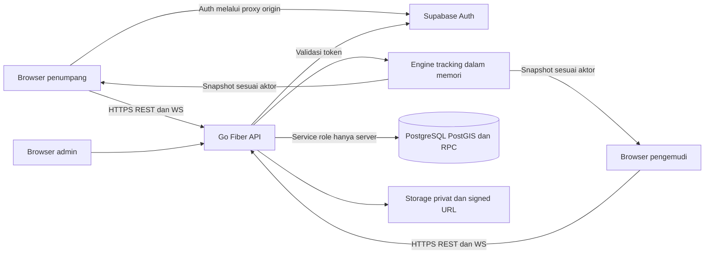
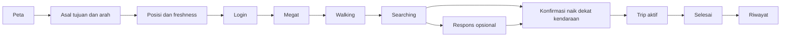
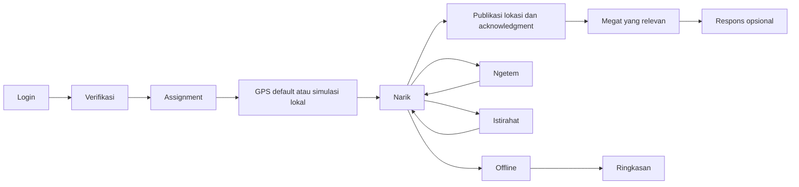
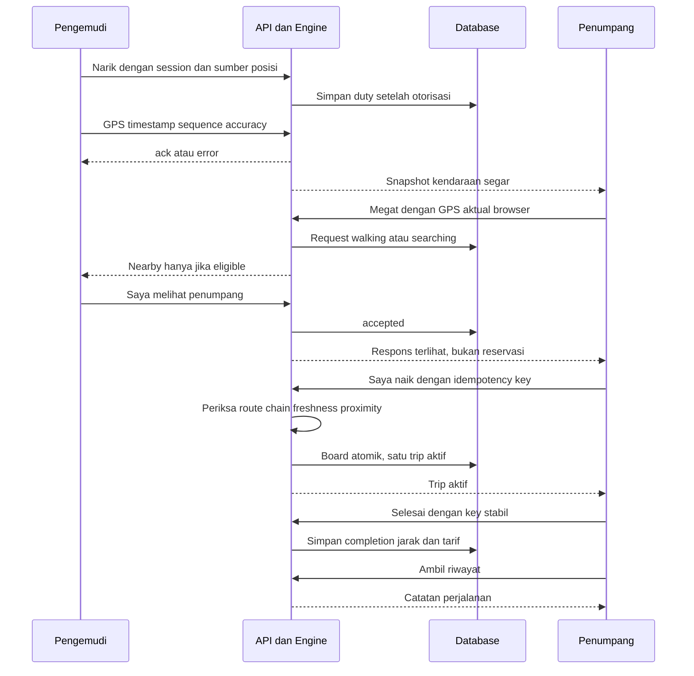
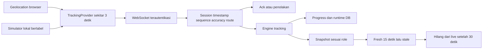
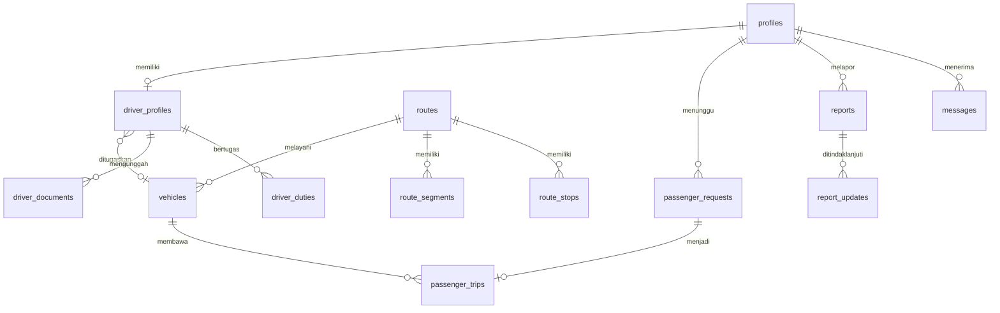
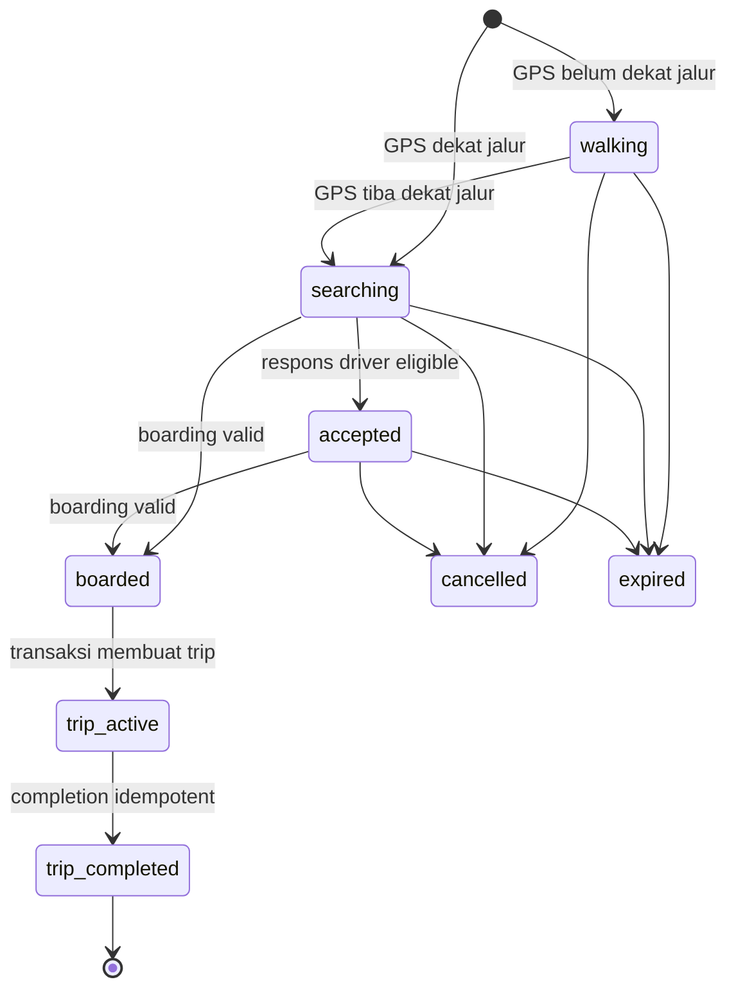

# Arsitektur, audit dan integrasi

Peninjauan source: 11 November 2026. Status implementasi berbeda dari penerimaan runtime. Backend dan migration tidak diubah dalam pekerjaan ini; alur existing dipertahankan. Lihat [hasil pengujian](TEST_RESULTS.md) untuk cakupan bukti aktual.

## Temuan prioritas

| Prioritas | Bukti/masalah | Tindakan dan status |
|---|---|---|
| P0 | Tidak ditemukan kerentanan kritis yang terbukti dalam pemeriksaan ini | Bukan jaminan audit keamanan menyeluruh; unit/RBAC/SQL perlu dilengkapi integrasi nyata |
| P1 | public-shell menyembunyikan desktop nav sampai lg dan menu mulai md, sehingga lebar 768–1023 tanpa nav | Diperbaiki; regression browser 900 px lulus |
| P1 | Rehearsal/smoke membaca settings.json wajib dan membentuk HTTPS walau startup baru default HTTP | Helper demo-settings memakai default hanya saat ENOENT dan mempertahankan HTTPS eksplisit; dua unit lulus |
| P1 | Klaim armada terverifikasi Dishub dan laporan diteruskan ke petugas Dishub tidak didukung kontrak aplikasi | Footer, bantuan, toast laporan, label tanggapan dan pengirim pesan diganti menjadi verifikasi/peninjauan admin aplikasi |
| P1 | Preview/statistik menyebut seluruh kendaraan aktif sebagai GPS, termasuk simulation | Label dan warna dibedakan; posisi preview hanya ditampilkan saat connected dan fresh |
| P1 | Lingkungan tidak memiliki Docker, backend/Supabase aktif atau connection.json | Integrasi DB, dua role nyata dan rehearsal BLOCKED; langkah setup/recovery disediakan |
| P2 | Navigasi drawer tidak menutup setelah memilih halaman publik | State drawer dikontrol; regression penutupan lulus |
| P2 | Landing belum menjelaskan Megat, batas ETA, simulasi dan urutan penggunaan secara lengkap | Guide dua role, FAQ, state loading/error/kosong dan retry tersedia |
| P2 | Ruang kerja tidak membedakan request kosong dengan koneksi belum dapat dikonfirmasi | Tambah pesan disconnected, recovery GPS, assignment kosong/error dan pembatasan respons ketika disconnected |
| P2 | Restart API mengakhiri seluruh duty dan menghapus lokasi runtime | Perilaku existing satu proses; didokumentasikan. Hindari restart selama presentasi |
| P2 | Assertion browser memaksa status disconnected saat fixture masih mengirim snapshot tiap 250 ms | Snapshot dijeda sebelum assertion; flow smoke dijalankan tiga kali berturut-turut dan lulus |
| P2 | CTA Cari Trayek memakai `?tab=rute` yang tidak dibaca peta | Peta membuka panel, memfokuskan kolom tujuan, lalu membersihkan parameter; regression landing lulus |
| P2 | Preview landing menampilkan error penuh saat refetch katalog gagal padahal cache masih ada | Peta cache dipertahankan dan error ditampilkan sebagai peringatan dengan retry |
| P2 | Tautan Cara Kerja tidak menggulir ulang bila hash sudah sama | Efek memakai `location.key`, sehingga klik ulang tetap menggulir |
| P2 | Tip recovery GPS muncul juga saat koneksi putus atau simulasi tertunda | Pesan dipisahkan untuk koneksi, simulasi, dan GPS perangkat |
| P3 | Lint mencatat tiga warning existing; penerimaan aksesibilitas/performa lapangan belum lengkap | Tidak diperluas menjadi refactor di luar cakupan; catat sebagai batas |
| P3 | Animasi pulse dan smooth scroll belum menghormati reduced motion | Media query `prefers-reduced-motion` ditambahkan; belum ada audit assistive technology penuh |

## Matriks penelusuran

Semua endpoint berikut memiliki prefix `/api`. “Ada” berarti source terintegrasi; runtime nyata sesi ini belum dibuktikan.

| Fitur | Frontend | API/WS | Backend | Database | Status dan perbaikan |
|---|---|---|---|---|---|
| Landing/CTA | landing-page, landing-guide, map-preview | GET routes, stats/public, WS snapshot | katalog dan statistik publik | routes, flow_public_stats, engine | Ada; fixture lulus, CTA Cari Trayek membuka panel tujuan, label GPS/simulasi terpisah |
| Auth/RBAC | auth-store, RequireRole | auth/:action, me | platform.User dan actor | Auth, profiles, flow_command | Ada; fixture login lulus; jangan percaya role UI saja |
| Lokasi penumpang | use-gps, TrackingProvider | passenger:position | handle live + geometry | passenger_requests | Ada; fixture/browser emulasi, bukan Android |
| Lokasi pengemudi | TrackingProvider, simulator | driver:position | tracking.Engine.Position | live_locations, driver_duties | Ada; Go race lulus, pipeline DB belum diuji sesi ini |
| Duty | driver-map-page | POST driver/duty, snapshot | session ownership + authorization reconciliation | driver_profiles, vehicles, driver_duties | Ada; recovery dan informasi assignment diperjelas |
| Kendaraan publik | useLiveVehicles, map-screen | vehicles, snapshot | engine stale/remove/lease | posisi + assignment | Ada; preview membedakan GPS/simulasi dan disconnected |
| Katalog | useRoutes | GET routes, search/route | catalog + geo.Direct | routes, route_segments, route_stops | Ada; arah dan segmen tidak digabung sembarang |
| Megat | use-megat, map-screen | passenger/requests, passenger:position | eligibility, GPS/projection | passenger_requests | Ada; fixture happy path, Go unit eligibility |
| Respons driver | driver-map-page | driver/requests/respond | respond + eligibility | matched_vehicle_id, status | Ada; respons tidak menjamin pemesanan; tombol dibatasi saat disconnected |
| Boarding | megatStore.board | POST passenger/trips | board proximity/freshness/chain | flow_command, passenger_trips, idempotency | Ada; fixture UI lulus, transaksi SQL nyata BLOCKED |
| Trip aktif | active-trip-page | snapshot | trip_active command | passenger_trips | Ada; reload fixture lulus |
| Completion/history | active-trip-page, useTrips | trips/complete, GET trips | complete/progress | passenger_trips | Ada; fixture lulus, DB persisted nyata belum diverifikasi sesi ini |
| Statistik | usePublicStatistics | stats/public | statistics | flow_public_stats + engine | Ada; tipe telemetry dilengkapi dan label dikoreksi |

## Sistem

Vite pada development dan Nginx deployment menyediakan proxy satu origin. Landing menggunakan SVG geometri katalog; tidak memuat Leaflet untuk preview. Sumber geocoding, walking routing dan tile tetap eksternal.

## Journey penumpang

## Journey pengemudi

## Interaksi dua role

## GPS dan koneksi

Lease driver sekitar 60 detik. Watchdog snapshot mendeteksi koneksi setengah terbuka; reconnect memakai backoff, event online/visibility dan refresh token. Nearby serta trip privat disusun sesuai aktor; kendaraan publik belum memakai room subscription per jurusan. Filter frontend bukan pengganti otorisasi data privat.

## Entitas utama MVP

Diagram menyederhanakan relasi; kolom, nullability dan constraints mengacu migration. `passenger_trips` saat ini satu angkot; `trip_legs` dari rancangan awal bukan lifecycle runtime MVP.

## Status request dan trip

Boarding melewati walking tidak diperbolehkan. Detail perubahan posisi/request tetap mengikuti validasi server dan migration, bukan diagram sebagai kontrak baru.
