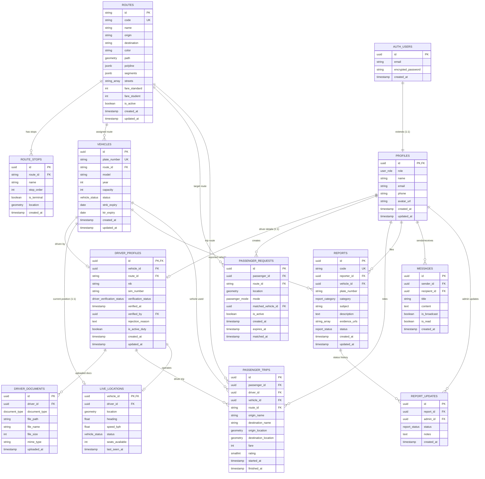

# Entity Relationship Diagram (ERD) — Angkot-Live

**Platform:** Supabase (PostgreSQL 15+ dengan ekstensi PostGIS)  
**Dokumen Referensi:** [PRD.md](./PRD.md)  
**Terakhir Diperbarui:** 9 November 2026  

---

## 1. Diagram ERD (Mermaid)

---

## 2. Definisi Entitas & Kamus Data

### 2.1. `profiles`
Menyimpan profil pengguna yang tersinkronisasi otomatis dengan `auth.users` Supabase saat registrasi.
- `id` (UUID, PK): Menunjuk ke `auth.users(id)` dengan `ON DELETE CASCADE`.
- `role` (`user_role` enum): `'penumpang'`, `'pengemudi'`, `'admin'`.
- `name` (TEXT): Nama lengkap pengguna.
- `email` (TEXT): Email terdaftar.
- `phone` (TEXT): Nomor telepon/WhatsApp.
- `avatar_url` (TEXT): URL foto profil.

### 2.2. `driver_profiles`
Menyimpan data administrasi pengemudi untuk verifikasi dan kepatuhan hukum.
- `id` (UUID, PK): Relasi 1:1 ke `profiles(id)`.
- `vehicle_id` (UUID, FK): Angkot yang saat ini dikemudikan (opsional/nullable jika belum dipasangkan).
- `route_id` (TEXT, FK): Trayek resmi tempat pengemudi bertugas.
- `nik` (TEXT): Nomor Induk Kependudukan (16 digit).
- `sim_number` (TEXT): Nomor Surat Izin Mengemudi (SIM A Umum / B1).
- `verification_status` (`driver_verification_status` enum): `'menunggu'`, `'disetujui'`, `'ditolak'`.
- `verified_at` (TIMESTAMPTZ): Waktu verifikasi oleh petugas.
- `verified_by` (UUID, FK): Admin yang memverifikasi.
- `rejection_reason` (TEXT): Catatan alasan bila ditolak.
- `is_active_duty` (BOOLEAN): Status apakah sedang aktif dinas hari ini.

### 2.3. `driver_documents`
File dokumen pengemudi dan kendaraan yang diunggah ke storage privat Supabase.
- `id` (UUID, PK): ID dokumen.
- `driver_id` (UUID, FK): Relasi ke `driver_profiles(id)`.
- `document_type` (`document_type` enum): `'sim'`, `'ktp'`, `'stnk'`, `'kir'`, `'foto_kendaraan'`.
- `file_path` (TEXT): Path file pada bucket privat Supabase Storage (`driver-documents`).
- `file_name` (TEXT): Nama asli file.
- `file_size` (INTEGER): Ukuran file dalam bytes.
- `mime_type` (TEXT): Format file (`image/jpeg`, `image/png`, `application/pdf`).

### 2.4. `routes`
Daftar trayek angkot resmi berdasarkan data Dinas Perhubungan & OpenStreetMap.
- `id` (TEXT, PK): ID unik trayek (e.g. `'3415464'`, `'01A'`).
- `code` (TEXT, UNIQUE): Kode trayek publik (e.g. `'01A'`, `'08'`).
- `name` (TEXT): Nama trayek resmi (e.g. `'Cicaheum - Abdul Muis via Binong'`).
- `origin` (TEXT): Terminal / titik asal.
- `destination` (TEXT): Terminal / titik tujuan.
- `color` (TEXT): Kode warna heksadesimal untuk polyline peta.
- `path` (GEOMETRY(LineString, 4326)): Bentuk lintasan jalan berurutan menggunakan tipe spasial PostGIS.
- `polyline` (JSONB): Koordinat lat-lng array untuk kemudahan rendering frontend.
- `segments` (JSONB): Array segmen rute bila trayek memiliki sub-alur pergi-pulang terpisah.
- `streets` (TEXT[]): Daftar nama jalan yang dilalui trayek.
- `fare_standard` (INTEGER): Tarif reguler penumpang umum (default Rp 5.000).
- `fare_student` (INTEGER): Tarif khusus pelajar (default Rp 3.000).
- `is_active` (BOOLEAN): Status operasional trayek.

### 2.5. `route_stops`
Titik-titik halte, terminal, dan titik henti reguler di sepanjang rute angkot.
- `id` (UUID, PK): ID titik henti.
- `route_id` (TEXT, FK): Trayek pemilik titik henti.
- `name` (TEXT): Nama halte atau terminal.
- `stop_order` (INTEGER): Urutan nomor urut pada trayek (1, 2, 3...).
- `is_terminal` (BOOLEAN): Penanda apakah merupakan terminal awal/akhir.
- `location` (GEOMETRY(Point, 4326)): Titik koordinat spasial PostGIS (SRID 4326: WGS84).

### 2.6. `vehicles`
Armada mobil angkot yang terdaftar dalam sistem pengawasan publik.
- `id` (UUID, PK): ID armada kendaraan.
- `plate_number` (TEXT, UNIQUE): Nomor polisi kendaraan (e.g. `'D 1982 AB'`).
- `route_id` (TEXT, FK): Trayek izin trayek kendaraan.
- `model` (TEXT): Tipe kendaraan (e.g. `'Suzuki Carry 1.5 Futura'`).
- `year` (INTEGER): Tahun pembuatan armada.
- `capacity` (INTEGER): Kapasitas maksimal penumpang (standar 12-14 penumpang).
- `status` (`vehicle_status` enum): `'jalan'`, `'merayap'`, `'ngetem'`, `'istirahat'`, `'offline'`.
- `stnk_expiry` (DATE): Tanggal kedaluwarsa pajak/STNK (untuk monitoring kelaikan kelaikan Dishub).
- `kir_expiry` (DATE): Tanggal kedaluwarsa uji KIR berkala.

### 2.7. `live_locations`
Menyimpan posisi GPS realtime terkini armada angkot untuk disiarkan ke publik dan peta penumpang.
- `vehicle_id` (UUID, PK, FK): Angkot terkait.
- `driver_id` (UUID, FK): Pengemudi yang sedang mengoperasikan.
- `location` (GEOMETRY(Point, 4326)): Posisi koordinat GPS terkini.
- `heading` (REAL): Derajat arah kendaraan (0–360°).
- `speed_kph` (REAL): Kecepatan pergerakan kendaraan (km/jam).
- `status` (`vehicle_status` enum): Status pergerakan (`jalan`, `merayap`, `ngetem`, `istirahat`, `offline`).
- `seats_available` (INTEGER): Jumlah sisa bangku kosong.
- `last_seen_at` (TIMESTAMPTZ): Waktu ping GPS terakhir (digunakan untuk auto-stale/offline bila >15 detik).

### 2.8. `passenger_requests` (Megat Angkot)
Permintaan tunggu / "megat" angkot oleh calon penumpang di area rute.
- `id` (UUID, PK): ID permintaan megat.
- `passenger_id` (UUID, FK): Penumpang yang menekan megat.
- `route_id` (TEXT, FK): Trayek angkot yang ditunggu.
- `location` (GEOMETRY(Point, 4326)): Titik posisi menunggu penumpang.
- `mode` (`passenger_mode` enum): `'idle'`, `'jalan_kaki'`, `'mencari'`, `'perjalanan'`.
- `matched_vehicle_id` (UUID, FK): Angkot terdekat yang mencocokkan.
- `is_active` (BOOLEAN): Status apakah masih aktif menunggu.
- `expires_at` (TIMESTAMPTZ): Batas waktu timeout permintaan (default 60 detik).

### 2.9. `passenger_trips`
Log riwayat perjalanan penumpang setelah naik hingga turun dari angkot.
- `id` (UUID, PK): ID riwayat perjalanan.
- `passenger_id` (UUID, FK): Pengguna penumpang.
- `driver_id` (UUID, FK): Pengemudi yang mengantar.
- `vehicle_id` (UUID, FK): Kendaraan yang dinaiki.
- `route_id` (TEXT, FK): Trayek yang digunakan.
- `origin_name` (TEXT): Lokasi naik.
- `destination_name` (TEXT): Lokasi turun.
- `fare` (INTEGER): Tarif yang dibayarkan.
- `rating` (SMALLINT): Penilaian penumpang (1–5 bintang).
- `started_at` (TIMESTAMPTZ): Waktu mulai perjalanan.
- `finished_at` (TIMESTAMPTZ): Waktu selesai turun.

### 2.10. `reports` & `report_updates`
Kanal pelaporan partisipasi warga terhadap pelanggaran layanan angkot (tarif getok, ugal-ugalan, fasilitas buruk).
- `reports.code` (TEXT, UNIQUE): Kode tiket pengaduan publik (e.g. `'LPR-1082'`).
- `reports.category` (`report_category` enum): `'pengemudi'`, `'fasilitas'`, `'tarif'`, `'lainnya'`.
- `reports.status` (`report_status` enum): `'diterima'`, `'diproses'`, `'selesai'`.
- `reports.evidence_urls` (TEXT[]): URL foto/video bukti pelanggaran.
- `report_updates`: Log kronologis tindak lanjut oleh admin/Dishub beserta catatan resmi kepada pelapor.

### 2.11. `messages`
Sistem notifikasi dan pengumuman dari instansi/admin ke pengemudi (atau pesan broadcast satu arah).

---

## 3. Matriks Hak Akses Row-Level Security (RLS)

| Tabel | Anon / Publik | Penumpang | Pengemudi | Admin / Dishub |
|---|---|---|---|---|
| `profiles` | Read (nama publik) | Read & Update miliknya | Read & Update miliknya | Full CRUD semua profil |
| `driver_profiles` | Read terbatas (nama supir) | Read terbatas | Read & Update miliknya | Full CRUD & Verifikasi |
| `driver_documents` | ❌ No Access | ❌ No Access | Read & Insert miliknya | Full Read & Delete (Review) |
| `routes` | Read (aktif) | Read | Read | Full CRUD |
| `route_stops` | Read | Read | Read | Full CRUD |
| `vehicles` | Read | Read | Read | Full CRUD |
| `live_locations` | Read (angkot aktif) | Read | Insert/Update lokasi armadanya | Full Read & Monitor |
| `passenger_requests` | ❌ No Access | Full CRUD miliknya | Read (radius rutenya) | Read (analitik permintaan) |
| `passenger_trips` | ❌ No Access | Read miliknya | Read trip miliknya | Read agregat |
| `reports` | ❌ No Access | Insert & Read miliknya | Read (jika terlapor) | Full CRUD & Update Status |
| `report_updates` | Read (publik status) | Read status laporannya | Read status terkait | Full Insert & Update |
| `messages` | ❌ No Access | Read jika penerima | Read miliknya & broadcast | Full CRUD & Broadcast |

---

## 4. Fungsi Spasial PostGIS

1. **`nearby_vehicles(p_lat float, p_lng float, p_radius_km float, p_route_id text)`**:
   Mencari seluruh angkot aktif dalam radius kilometer tertentu di sekitar pengguna dengan urutan jarak terdekat (`ST_DWithin` & `ST_Distance`).
2. **`nearby_passengers_for_driver(p_route_id text, p_lat float, p_lng float, p_radius_km float)`**:
   Memungkinkan pengemudi melihat sebaran penumpang yang sedang dalam mode `'mencari'` di rute yang sama.
3. **`view_public_stats`**:
   View SQL agregat yang menghitung total armada aktif, persentase tindak lanjut laporan, dan rata-rata waktu respons untuk halaman transparansi publik `/statistik`.

