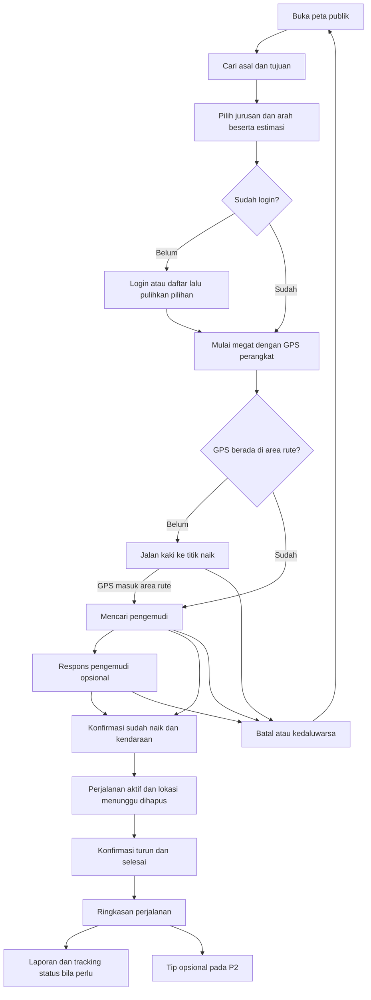
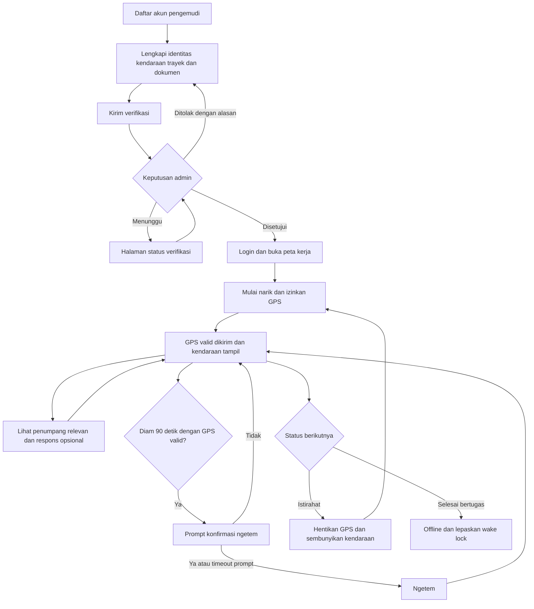

# Rencana implementasi flow penumpang dan pengemudi

Tanggal screening: **11 November 2026**. Acuan: [PRD](./PRD.md) dan [ERD](./erd.md).

> Status implementasi: flow inti P0/P1 telah dihubungkan setelah screening ini. Temuan di bawah merekam kondisi sebelum implementasi; lihat [SETUP.md](./SETUP.md) untuk cara menjalankan, validasi, dan batas yang masih berlaku.

> Acuan terbaru untuk pekerjaan berikutnya: [Rencana integrasi MVP berbasis sprint](./MVP_INTEGRATION_PLAN.md). Fokusnya Supabase lokal, seed dari mock, dan quick login; Docker dibatasi untuk Supabase lokal.

## 1. Kesimpulan screening

Codebase saat ini merupakan prototipe frontend dengan UI, data trayek, pencarian perjalanan, dan sebagian aturan megat yang dapat dipakai kembali. Flow penumpang dan pengemudi **belum berjalan end-to-end antarperangkat**. Pekerjaan utama adalah membangun backend, mengamankan skema yang sudah ada, menghubungkan GPS asli dan WebSocket, lalu menyambungkan siklus megat hingga perjalanan selesai.

Rencana ini mencakup P0 dan P1 untuk kedua peran, beserta dependensi admin untuk verifikasi dan laporan. P2 dipisahkan agar tidak menghambat flow utama. Implementasi mempertahankan desain halaman yang ada. Dokumen ini belum mengubah perilaku aplikasi.

Screening dilakukan pada working tree saat ini, termasuk perubahan lokal yang belum di-commit. Migrasi SQL ditinjau secara statis; belum dijalankan terhadap instance Supabase. Hasil ini bukan verifikasi konfigurasi atau keamanan deployment.

### Yang sudah tersedia dan gap aktual

| Area | Bukti kode | Kondisi aktual dan implikasi |
|---|---|---|
| Routing dan guard | [router.tsx](../apps/web/src/app/router.tsx) | Pemisahan publik/penumpang/pengemudi/admin tersedia. Onboarding dan status verifikasi berada di luar guard; perlu aturan akses tersendiri. Guard pengemudi masih meloloskan nilai verifikasi yang tidak terisi. |
| Auth | [auth-store.ts](../apps/web/src/features/auth/auth-store.ts), [login](../apps/web/src/features/auth/login-page.tsx), [register](../apps/web/src/features/auth/register-passenger-page.tsx) | Login membuat user lokal berdasarkan role pilihan; tidak memverifikasi password. Register penumpang langsung membuat sesi demo. Belum ada JWT/RBAC server. |
| Supabase | [client](../apps/web/src/lib/supabase.ts), [migration](../supabase/migrations/20261109000000_initial_schema.sql), [types](../apps/web/src/types/database.types.ts) | Client, skema, RLS, RPC spasial, dan tipe sudah ada. Client belum dipakai flow fitur. Storage privat dan integrasi backend belum tersedia dalam repository. |
| Trayek | [data](../apps/web/src/data/angkot-routes.json), [generator](../apps/web/scripts/build-angkot-routes.mjs), [directory](../apps/web/src/features/tracking/route-directory.ts) | Frontend memiliki 82 arah trayek; dua arah dikelompokkan memakai kode. Data ini adalah aset rute, walaupun diimpor melalui `mocks/data.ts`. |
| Peta kendaraan | [use-live-vehicles.ts](../apps/web/src/features/tracking/use-live-vehicles.ts), [animated-vehicles.ts](../apps/web/src/features/tracking/animated-vehicles.ts) | Posisi berasal dari animasi berbasis waktu, dengan `isExample: true`. Bukan WebSocket/GPS asli. ETA contoh dihitung menuju ujung trayek, bukan titik penumpang. |
| Pencarian perjalanan | [trip-planner.ts](../apps/web/src/features/routing/trip-planner.ts), [walking-router.ts](../apps/web/src/features/routing/walking-router.ts) | Sudah menghitung rute berarah, langsung, satu dan dua transit, serta akses jalan kaki. Belum graph Dijkstra/A* sesuai PRD; jangan membangun ulang sebelum integrasi P0 selesai. |
| Megat | [engine](../apps/web/src/features/tracking/megat-engine.ts), [store](../apps/web/src/features/tracking/megat-store.ts), [hook](../apps/web/src/features/tracking/use-megat.ts) | Ada state `walking/searching/accepted/boarded/cancelled/expired`, proyeksi ke rute, filter arah/radius, dan timeout. Sinkronisasi masih localStorage/BroadcastChannel pada browser/origin yang sama. |
| Megat di UI | [map-screen.tsx](../apps/web/src/features/map/map-screen.tsx) | Kendaraan contoh memang diblokir untuk megat. Lokasi diperoleh sekali per tindakan; belum dipantau kontinu. Kedatangan ke jalur masih melalui tindakan pengguna. Respons driver belum terhubung ke UI pengemudi. |
| Perjalanan aktif | [active-trip-page.tsx](../apps/web/src/features/passenger/active-trip-page.tsx) | Hanya empty state. `board()` menutup request lokal tetapi belum membuat trip. Riwayat/dashboard penumpang masih memakai mock. |
| Pengemudi bertugas | [driver-map-page.tsx](../apps/web/src/features/driver/driver-map-page.tsx), [dashboard](../apps/web/src/features/driver/driver-dashboard-page.tsx) | Peta hanya pratinjau trayek dengan tombol status nonaktif. Dashboard memiliki status lokal terpisah dan label GPS aktif statis. Tidak ada pengiriman GPS, wake lock, atau auto-ngetem operasional. |
| Onboarding dan verifikasi | [onboarding](../apps/web/src/features/driver/driver-onboarding-page.tsx), [verifikasi](../apps/web/src/features/driver/driver-verification-page.tsx), [admin store](../apps/web/src/features/admin/verification-store.ts) | Submit onboarding hanya toast + navigasi, belum membuat akun/berkas. Pengemudi dapat mengganti status simulasi sendiri; keputusan admin belum tersambung ke profil akun nyata. |
| Laporan dan inbox | [report-store.ts](../apps/web/src/features/reports/report-store.ts), [message-store.ts](../apps/web/src/features/messages/message-store.ts) | Persistensi lokal dengan data seed. Belum terisolasi berdasarkan pemilik akun atau tersinkron antarperangkat; bukti laporan belum diunggah. |
| Backend dan delivery | Struktur repository | `apps/api`, konfigurasi deploy, dan workflow CI belum ada. Manifest dan service worker dasar sudah tersedia. |

README memiliki deskripsi progres yang tidak seluruhnya sesuai kode: perjalanan aktif masih kosong, auto-ngetem belum operasional, dan Supabase migration serta tes Node sudah tersedia. Perbarui dokumentasi tersebut saat integrasi, dengan hasil kode sebagai acuan.

### Temuan fondasi yang harus diselesaikan lebih awal

1. **Role dan verifikasi belum terlindungi pada tingkat kolom.** Trigger `handle_new_user()` menerima role dari metadata pendaftar, termasuk enum admin. Policy update profil sendiri tidak membatasi kolom `role`; policy update `driver_profiles` sendiri tidak membatasi `verification_status`, kendaraan, atau trayek. Batasi registrasi publik ke penumpang/pengemudi, provisioning admin lewat jalur tepercaya, dan perubahan kolom sensitif lewat backend terotorisasi.
2. **Profil pengemudi terverifikasi terbuka sebagai seluruh baris.** Policy SELECT publik dapat membuka `nik` dan `sim_number`, bukan hanya nama. Pisahkan DTO publik dari profil privat dan tutup akses langsung ke baris sensitif.
3. **Visibilitas lokasi belum memenuhi BR-02/BR-07.** `live_locations` dapat dibaca publik tanpa filter verifikasi, freshness, dan istirahat. RPC kendaraan hanya mengecualikan offline. RPC penumpang menerima rute/lokasi dari pemanggil tanpa mengikatnya ke pengemudi login. Policy penumpang belum memeriksa radius/area jalur/mode dan memakai `dp.route_id = route_id` yang ambigu terhadap kolom query bagian dalam; gunakan referensi eksplisit ke request luar. Semua jalur baca harus menerapkan aturan yang sama.
4. **Identitas kendaraan belum cukup terikat pada pengirim GPS.** Policy penulisan lokasi memeriksa identitas driver dan verifikasi, tetapi belum memastikan `vehicle_id` adalah kendaraan yang ditugaskan kepadanya. Backend wajib menurunkan identitas driver/kendaraan dari sesi dan assignment.
5. **Skema trayek tidak cocok dengan data dua arah.** `routes.code UNIQUE` menghalangi impor dua arah dengan kode sama. `path` masih satu LineString, sementara data frontend dapat memiliki beberapa `segments`. `routeLine()` hanya memilih chain terpanjang; matching pada chain lain dapat keliru.
6. **Lifecycle request dan trip belum cukup dimodelkan.** Database hanya memiliki `mode`, `is_active`, dan kendaraan cocok; belum ada status lengkap, revision, hubungan request-trip, atau constraint satu request/trip aktif. `passenger_trips` belum memiliki data jarak dan status eksplisit. Histori snapshot `vehicle_positions` yang disebut PRD juga belum tersedia.
7. **Seed belum menjadi fixture integrasi yang memadai.** Seed berisi tiga contoh trayek yang tidak seluruhnya cocok dengan dataset frontend dan posisi kendaraan contoh. Insert langsung ke `auth.users` tidak menyediakan password login yang dapat dipakai. Buat akun pengujian melalui mekanisme Auth yang didukung dan impor trayek kanonis; kendaraan tidak boleh aktif sebelum GPS asli diterima.

## 2. Keputusan implementasi yang disarankan

| Topik | Keputusan awal |
|---|---|
| Arsitektur | Ikuti PRD: React/Vite + Go/Fiber modular monolith + Supabase Auth/PostgreSQL/PostGIS/Storage + WebSocket. Mulai satu instance API dengan posisi terkini di memori; Redis baru diperlukan bila menjalankan beberapa instance. |
| Sumber kebenaran | Server mengatur status operasional, request, expiry, verifikasi, dan trip. React Query untuk data server; Zustand untuk sesi/UI dan snapshot realtime. localStorage/BroadcastChannel tidak menjadi transport antarperan. |
| Autentikasi | `/auth/register`, `/auth/login`, `/auth/refresh` menjadi adapter tipis ke Supabase Auth, tanpa sistem password/JWT buatan sendiri. Tetapkan satu pengelola refresh sesi pada frontend; backend memvalidasi JWT dan memeriksa role/verification dari data tepercaya. |
| Data operasional | Ganti animasi pada jalur produksi dengan snapshot GPS server. Contoh animasi hanya boleh berada pada pratinjau yang diberi label jelas; koneksi putus tidak boleh mengaktifkan fallback kendaraan contoh. |
| Login penumpang | Peta dan pencarian tetap publik. Login diperlukan saat megat, membuat trip, atau melapor. Simpan asal, tujuan, arah trayek, dan pilihan itinerary ketika berpindah ke login. |
| Makna megat | Sinyal keberadaan penumpang di trayek. Respons pengemudi adalah pemberitahuan bahwa ia melihat penumpang, tanpa reservasi kendaraan/kursi atau pembayaran. Konfirmasi naik dilakukan penumpang pada kendaraan yang benar-benar dinaiki. |
| Boarding | Respons pengemudi tidak wajib untuk naik. Dari `searching`, penumpang boleh memilih kendaraan nyata yang memenuhi trayek/arah dan kedekatan; dari `accepted`, konfirmasi kendaraan yang merespons. Server memvalidasi keduanya. |
| Tahap awal rute | P0 memanfaatkan logika rute langsung yang tersedia dengan dataset kanonis. Letakkan kontrak pencarian di API; port logika langsung ke modul Go dan jalankan fixture pembanding. Transfer frontend yang sudah ada boleh tetap menjadi pratinjau, belum dianggap memenuhi P2 sampai backend dan trip multi-leg siap. |
| Scope admin | Kerjakan hanya verifikasi, assignment kendaraan/trayek, dan tindak lanjut laporan yang dibutuhkan flow kedua peran. Analitik lengkap dan modul admin lain mengikuti backlog terpisah. |
| GPS perangkat | Wajib HTTPS/localhost, persetujuan lokasi, dan halaman pengemudi aktif. Wake lock membantu selama halaman terlihat; uji penghentian lokasi ketika browser masuk background dan biarkan TTL server menyembunyikan kendaraan bila GPS berhenti. |

Keputusan yang belum ditetapkan PRD memakai nilai awal di bagian 7; kalibrasi dengan pengujian GPS asli sebelum dinyatakan final.

## 3. Flow penumpang yang ditargetkan

| Langkah | Perilaku yang harus diimplementasikan | Acuan |
|---|---|---|
| Jelajah | Peta membuka trayek, marker nyata, filter kode/arah/radius, serta indikator koneksi dan data terakhir. Bedakan tidak ada angkot, masih memuat, dan koneksi gagal. | PUB-01, PAX-01/02 |
| Cari dan pilih | Geocoding/manual point untuk perencanaan, rekomendasi langsung sesuai arah, akses jalan kaki, detail jurusan/pengemudi/plat, serta ETA ke titik naik. Tanpa GPS pengguna, ETA hanya boleh memakai titik asal pilihan yang diberi label. | PAX-03/04 |
| Auth | Email + nomor telepon saat daftar; login, refresh, logout, reset password, dan ubah profil sungguhan. Redirect login harus menyimpan `pathname` dan `search` secara konsisten; format `state.from` saat ini berbeda antara guard dan login. | AUTH-01/02/06 |
| Mulai megat | Pilih `route_id` arah yang pasti, validasi GPS segar beserta akurasi, buat satu request aktif. Titik custom untuk perencanaan tidak dianggap posisi aktual penumpang. Jangan wajibkan ada angkot aktif terlebih dahulu; tampilkan kondisi belum ada pengemudi dan biarkan timeout berjalan. | PAX-05, BR-03/05/08 |
| Jalan kaki | Tampilkan panduan menuju titik naik pada arah terpilih. `watchPosition` mengirim posisi aktual; server otomatis berpindah ke `searching` ketika memenuhi batas jarak/akurasi. Request jalan kaki belum dibagikan ke pengemudi. | BR-02/03 |
| Menunggu | Hanya pengemudi terverifikasi, aktif, searah, pada area jalur dan radius yang melihat lokasi. Tampilkan sisa waktu, respons bila ada, batal kapan saja, dan kedaluwarsa dari waktu server. | BR-02/08 |
| Naik | Konfirmasi kendaraan yang benar-benar dinaiki. Dalam satu transaksi: tutup request menunggu, buat trip aktif, dan publikasi penghapusan marker penumpang. Tidak boleh tercipta dua trip karena klik ulang/reconnect. | PAX-06, BR-04 |
| Dalam perjalanan | Tampilkan kendaraan, tujuan/titik turun, kemajuan sepanjang rute, dan estimasi turun. Jika data terputus, beri status jelas tanpa posisi/ETA buatan. Reload memulihkan trip aktif dari server. | PAX-06 |
| Selesai | Tombol selesai menyimpan waktu/titik turun dan jarak sepanjang rute, menghentikan berbagi lokasi, lalu menampilkan ringkasan dan CTA laporan. Riwayat dasar diperlukan untuk pemulihan/konfirmasi trip; statistik lengkap tetap P2. | PAX-06/08 |
| Laporan | Kendaraan terisi dari trip atau plat manual; kategori, kronologi, dan bukti disimpan. Reporter melihat timeline `diterima → diproses → selesai` beserta tanggapan admin pada perangkat lain. | PAX-07 |

State request: `walking → searching → accepted (opsional) → boarded`; `searching → boarded` juga valid setelah validasi kendaraan. `walking/searching/accepted → cancelled/expired` adalah terminal. Trip: `active → completed`. Gangguan koneksi tidak otomatis menyelesaikan trip; pulihkan atau minta pengguna menyelesaikannya.

## 4. Flow pengemudi yang ditargetkan

| Langkah | Perilaku yang harus diimplementasikan | Acuan |
|---|---|---|
| Akun dan draft | Langkah akun membuat identitas Auth; langkah berikutnya memerlukan sesi pengemudi. Draft tersimpan server, dapat dilanjutkan setelah reload. Validasi email/telepon/NIK/SIM di frontend dan backend. | AUTH-01/03 |
| Berkas | Upload file asli ke bucket privat: SIM, STNK, KIR, foto kondisi kendaraan, serta data NIK/identitas. Validasi MIME, ukuran, masa berlaku, dan ownership. Tampilkan progres, gagal/coba ulang, dan review data sebenarnya. | AUTH-03 |
| Verifikasi | Submit menjadi `menunggu`; admin menyetujui atau menolak dengan alasan. Revisi dokumen mengembalikan status ke menunggu. Pengemudi membaca keputusan, tidak dapat menetapkannya. | AUTH-04/05 |
| Assignment | Kendaraan dan arah trayek aktif berasal dari assignment tervalidasi. Pratinjau trayek tidak memberi hak mengirim GPS pada sembarang kendaraan/rute. Perubahan assignment saat bertugas harus menutup sesi lama. | DRV-01/03 |
| Mulai bertugas | Pilih narik, minta izin GPS, tunggu koordinat valid dan ack server, lalu tampilkan aktif. Kegagalan izin/GPS/backend tidak boleh menampilkan label GPS aktif. | DRV-01/02 |
| GPS | Pantau posisi selama narik/ngetem; kirim berkala 3–5 detik. Server validasi koordinat, waktu, akurasi, urutan, dan loncatan; lakukan map matching lalu broadcast. GPS di luar jalur jangan dipaksa ke jalur jauh. | DRV-01, BR-05 |
| Peta kerja | Hanya kendaraan sendiri, trayek tugas, serta penumpang menunggu yang memenuhi BR-02; bukan armada pengemudi lain. Marker dan daftar penumpang berasal dari subscription yang sama. | DRV-03/04 |
| Status | Satu state operasional bersama untuk peta, dashboard, dan profil. `narik` dipetakan ke jalan/merayap oleh server; ngetem manual/otomatis; istirahat/offline menyembunyikan kendaraan dan menghentikan GPS. | DRV-02 |
| Auto-ngetem | Setelah diam 90 detik dari sampel GPS valid, server mengirim prompt dengan deadline. Jawaban ya atau timeout menetapkan ngetem; jawaban tidak mereset pengamatan. Putus GPS tidak dihitung sebagai diam. Batalkan prompt bila kendaraan bergerak atau status berubah. | DRV-07, BR-01 |
| Wake lock | Minta ketika bertugas dan halaman terlihat; lepaskan saat istirahat/offline/logout. Pulihkan saat kembali terlihat; tampilkan status bila tidak didukung atau ditolak. | DRV-08 |
| Ringkasan | Data kendaraan dan jarak tugas berasal dari assignment/snapshot nyata. Nilai tip ditampilkan hanya ketika modul tip tersedia. Inbox sistem/admin dan tip lanjutan adalah P2. | DRV-05/06 |

Pisahkan `verification_status`, `driver_mode`, `vehicle_status`, dan `connection_state`. Sesi baru selalu mulai offline; koneksi WebSocket tersambung bukan bukti GPS aktif. Satu kendaraan hanya boleh memiliki satu sesi pengirim yang berwenang; konflik tab/perangkat harus menghasilkan penolakan atau pengambilalihan eksplisit, bukan update bercampur.

## 5. Perubahan model data dan akses

Gunakan **migration tambahan** di `supabase/migrations`; jangan mengasumsikan migration awal belum pernah dipasang.

| Objek | Perubahan yang direncanakan |
|---|---|
| `profiles` dan Auth trigger | Allowlist role registrasi; role tidak dapat diubah pengguna. Batasi update ke atribut profil yang diizinkan. Telepon dinormalisasi. Status verifikasi/email dipulihkan dari sumber server. |
| `driver_profiles` | Simpan draft/submission terpisah dari hasil verifikasi. Tambahkan metadata submit/review yang dibutuhkan. Assignment kendaraan/trayek dan hasil verifikasi hanya melalui operasi berotorisasi. Dokumen identitas tidak ikut DTO publik. |
| `vehicles` dan assignment | Tegakkan satu kendaraan pada satu sesi pengemudi aktif; validasi kesesuaian trayek driver/kendaraan. Simpan mode manual terpisah dari status tampilan hasil derivasi. |
| `routes` | Pertahankan `id` sebagai identitas per arah; lepaskan unique pada `code`, tambahkan identitas arah eksplisit. Impor seluruh dataset kanonis, endstop, urutan, segments, dan metadata versi. Gunakan route-segment/chain terurut atau MultiLineString dengan urutan eksplisit; hindari garis sambungan fiktif antarsegmen. |
| `driver_documents` dan Storage | Tambahkan masa berlaku/revisi bila diperlukan; bucket privat, path milik driver, metadata file tervalidasi, signed URL singkat untuk admin. Untuk default sesuai PRD, isi dokumen dibaca admin; pemilik dapat mengunggah dan melihat metadata/status berkasnya. |
| `live_locations` | Jadikan proyeksi/snapshot terbatas dari posisi terkini; simpan koordinat mentah dan hasil matching terpisah, waktu sampel/terima, akurasi, sequence, chain dan offset. Public read melalui DTO aman dengan filter status/verification/freshness. |
| `vehicle_positions` / sesi tugas | Tambahkan snapshot berkala dan data mulai/akhir tugas untuk jarak tempuh serta audit. Memori menyimpan posisi terbaru; persistence tidak harus setiap sampel GPS. Setelah restart, hanya snapshot yang masih segar boleh tampil, lalu tunggu GPS baru. |
| `passenger_requests` | Tambah `status`, titik pickup, tujuan, `last_seen_at`, revision, waktu terminal, dan relasi kendaraan respons. Constraint unik parsial untuk satu request aktif per penumpang. Timeout walking/searching/accepted terpisah, ditegakkan server. |
| `passenger_trips` | Pertahankan nama tabel aktual untuk tahap satu angkot; tambah `request_id` unik, status, jarak rute, titik naik/turun, dan constraint satu trip aktif per penumpang. Pembuatan trip sekaligus penutupan request dalam transaksi. |
| `reports` / `report_updates` | Ikat laporan ke reporter dan kendaraan/trip opsional; bukti memakai referensi storage privat. Tulis perubahan status + timeline dalam transaksi. Identitas pelapor tidak dibuka ke driver. |
| `messages` / agregat | Keputusan verifikasi dapat menghasilkan notifikasi sistem sederhana. Agregat jarak/jumlah perjalanan berasal dari trip/tugas selesai, bukan mock. Inbox penuh dan tip menyusul P2. |

PRD halaman menyebut `trips/trip_legs`, sedangkan migration/ERD aktual memakai `passenger_trips`. Gunakan `passenger_trips` untuk flow satu angkot dan dokumentasikan pemetaan. Tambahkan model leg ketika implementasi perjalanan transfer, tanpa rename massal yang tidak diperlukan.

Audit ulang RLS, hak UPDATE per kolom, helper `SECURITY DEFINER` beserta `search_path`/EXECUTE grant, dan seluruh RPC. Tidak cukup memfilter marker di frontend. Query radius harus memakai indeks yang sesuai dengan ekspresi geometry/geography yang dipakai; buktikan dengan query plan saat data pengujian tersedia.

## 6. Kontrak backend dan realtime

### REST

Endpoint berikut merupakan usulan kontrak; detail payload/error ditulis dahulu ke `apps/api/api/openapi.yaml`. Endpoint di luar daftar awal PRD diperlukan untuk menutup lifecycle yang dijelaskan PRD.

| Kelompok | Endpoint |
|---|---|
| Auth dan akun | `POST /auth/register`, `/auth/login`, `/auth/refresh`, `/auth/logout`; operasi reset password melalui Supabase Auth; `GET/PATCH /me`. |
| Trayek dan pencarian | `GET /routes`, `GET /routes/:id`, `GET /search/route?from=&to=`; snapshot `GET /vehicles?route_id=&lat=&lng=&radius_km=` dan detail publik aman. |
| Onboarding | `GET/PATCH /driver/onboarding`, `POST /driver/documents/upload-url`, `POST /driver/documents` untuk finalisasi file, `POST /driver/submissions`, `GET /driver/verification`, `GET /driver/assignment`. |
| Duty | `POST /driver/duty`, `PATCH /driver/duty` untuk transisi status, `GET /driver/duty`; perubahan harus di-ack lalu disiarkan. |
| Megat | `POST /passenger/requests`, `GET /passenger/requests/current`, `POST /passenger/requests/:id/cancel`, `POST /driver/requests/:id/respond`. |
| Trip | `POST /passenger/trips` dengan request dan kendaraan aktual; `GET /passenger/trips/active`, `GET /passenger/trips`, `GET /passenger/trips/:id`, `POST /passenger/trips/:id/complete`. |
| Laporan | `POST /reports`, `GET /reports` milik pengguna, `GET /reports/:id`, upload bukti privat; `GET /admin/reports`, `PATCH /admin/reports/:id`. |
| Admin minimum | `GET /admin/drivers?status=menunggu`, `GET /admin/drivers/:id`, `PATCH /admin/drivers/:id/verify`, akses dokumen bertanda tangan dan assignment kendaraan/trayek. |
| Ringkasan | `GET /driver/dashboard`, `GET /passenger/dashboard`; statistik lanjut mengikuti prioritas P2. |

Standarkan `menunggu` pada domain/DB/UI; bila parameter `pending` dari contoh PRD dipertahankan, petakan secara eksplisit di adapter. Identitas pelaku selalu berasal dari sesi, bukan `passengerId`/`driverId` kiriman klien. Gunakan idempotency key untuk create request/boarding/completion dan revision untuk menolak transisi lama.

### WebSocket

| Event | Arah dan tanggung jawab |
|---|---|
| `subscribe` / snapshot | Klien memilih area/arah. Server membatasi hak role, mengirim snapshot awal serta revision/cursor. Subscription publik hanya memiliki kendaraan, tanpa lokasi penumpang. |
| `driver:position` | Driver → server: GPS mentah, `accuracy`, heading, speed, `sampled_at`, `sequence`, sesi tugas; driver/kendaraan diturunkan dari assignment. |
| `driver:status` | Driver → server: perintah status ber-id; gunakan service transisi yang sama dengan REST agar tidak ada dua sumber kebenaran. |
| `vehicles:update` | Server → subscriber: posisi matched, status publik, timestamp/freshness, metadata minimum, serta penghapusan kendaraan yang keluar area/offline/kedaluwarsa. |
| `passenger:position` | Penumpang → server hanya selama request/trip terkait aktif. Mode aktual dihitung server; payload tidak dapat memaksa visibilitas atau boarding. |
| `passengers:nearby` | Server → driver: subset request yang memenuhi rute, arah, area, radius, status, dan freshness. Sertakan penghapusan saat batal, naik, pindah area, atau expired. |
| `request:updated` | Server → pemilik request/driver relevan: searching, respons, batal, expired, boarded. Event tambahan ini menutup gap sinkronisasi megat pada PRD. |
| `trip:updated` | Server → pihak terkait: trip dimulai/selesai. Setelah reconnect, REST/snapshot tetap dapat memulihkan keadaan. |
| `ngetem:prompt` / `ngetem:answer` | Prompt ber-ID dan deadline server, respons ya/tidak, serta penolakan respons terlambat. |
| `message:new` | Notifikasi verifikasi/laporan sederhana; inbox admin lengkap mengikuti P2. |

Tambahkan ack/error terstruktur, timestamp server, version, heartbeat, reconnect dengan backoff/jitter, resubscribe, dan pemulihan snapshot. Paket lama/duplikat tidak boleh menghidupkan request yang telah batal atau menimpa GPS baru. Saat reconnect, kirim GPS terbaru; jangan memutar ulang antrean lokasi lama.

Jangan letakkan token jangka panjang di URL WebSocket. Tetapkan autentikasi handshake atau frame auth awal dengan batas waktu; koneksi belum boleh subscribe/mengirim data sebelum tervalidasi. Revalidasi saat token kedaluwarsa, logout, atau verifikasi dicabut. Kunci database/storage berprivilege hanya berada di server.

## 7. Aturan geospasial dan parameter awal

Angka selain 90 detik dan interval GPS adalah **usulan konfigurasi awal**, bukan keputusan final PRD.

| Parameter | Nilai awal | Perilaku |
|---|---|---|
| Interval GPS | 3 detik, dapat dinaikkan hingga 5 detik | Berlaku saat narik/ngetem; tidak mengirim ketika istirahat/offline. |
| Ambang akurasi GPS | 50 meter | Sampel lebih buruk diberi kondisi akurasi rendah; jangan memakainya untuk auto-arrival/boarding atau memaksa matching jauh. |
| Area rute penumpang | 100 meter | Memakai ambang engine saat ini; cek akurasi dan arah terpilih sebelum `searching`. |
| Radius driver melihat penumpang | 2 km | Tambahkan filter area rute dan posisi pickup di depan pengemudi pada arah tugas. |
| GPS kendaraan stale/hapus | 15 / 30 detik | Pada stale beri tanda terputus dan hentikan ETA; setelah 30 detik hapus marker. Snapshot/reload mengikuti aturan yang sama. |
| GPS penumpang stale | 30 detik | Sembunyikan dari driver sampai mendapat lokasi segar, tanpa otomatis memperpanjang batas waktu request. |
| Diam untuk prompt ngetem | 90 detik, perpindahan bersih di bawah 20 meter | Gunakan rangkaian sampel valid dan toleransi jitter; data GPS hilang tidak menambah durasi diam. |
| Timeout prompt ngetem | 15 detik | Menjadi ngetem jika tidak dijawab, selama kondisi diam/status masih valid. |
| Merayap | Kecepatan rata-rata < 5 km/jam selama 30 detik | Hanya ketika mode narik; manual ngetem tetap memiliki prioritas. Kalibrasi saat uji lapangan. |
| Timeout megat | Walking 5 menit; searching 60 detik; respons 5 menit | Searching dihitung ulang saat benar-benar tiba di area rute. Expiry memakai jam server dan berlaku setelah reload. |
| Kedekatan boarding | 100 meter dengan GPS segar | Trayek/arah kendaraan harus cocok; respons driver bukan bukti bahwa penumpang sudah naik. |
| Snapshot posisi | 30 detik dan pada perubahan status/akhir tugas | Kurangi penulisan database; hitung akumulasi jarak dari sampel valid di service tracking. |
| Transfer P2 | Target jalan kaki 150–200 meter | Saat ini kandidat transfer frontend memakai radius garis lurus 300 meter. Selaraskan batas dengan jarak jaringan pejalan kaki sebelum menyatakan sesuai PRD. |

ETA dihitung dari offset kendaraan menuju titik pickup/turun pada chain berarah, memakai kecepatan terfilter dan estimasi historis sederhana bila perlu. Jangan memakai jarak garis lurus atau waktu ke ujung trayek sebagai ETA penumpang. Jika kendaraan sudah lewat, berada pada chain yang tidak tersambung, stale, atau arah tidak cocok, ETA tidak tersedia. Ngetem perlu label ketidakpastian karena waktu berangkat belum diketahui.

Pisahkan metrik interval sampling 3–5 detik dari latensi pengiriman/pemrosesan/render ≤3 detik. Ukur timestamp pengambilan GPS, penerimaan server, publikasi, dan render pada dua perangkat; selaraskan perbedaan jam saat evaluasi.

## 8. Tahapan pengerjaan dan kriteria selesai

Urutan dependensi: **M0 → M1 → M2 → M3 → M4 → M5 → M6**. Setelah M3, pengembangan M4 dan M5 dapat dipisah oleh tim, tetapi integrasi akhirnya tetap diuji bersama. Tahapan merupakan paket pekerjaan, bukan estimasi tanggal tanpa mengetahui kapasitas tim.

### M0 — Kontrak, dataset kanonis, dan migrasi aman

- Buat kerangka `apps/api` beserta modul konfigurasi, database, auth/RBAC, HTTP error, logging, dan health check; siapkan OpenAPI/event schema.
- Tulis migration perbaikan hak akses, identitas trayek per arah, request/trip lifecycle, assignment, dan Storage privat.
- Buat importer idempotent dari dataset trayek yang sama dengan frontend, termasuk segmen dan terminal. Pertahankan ID yang dipakai URL frontend.
- Pindahkan ekspor trayek produksi keluar dari `mocks/data.ts`; pisahkan fixture kendaraan/demonstrasi dari data rute.
- Tetapkan lingkungan development/staging dan `.env.example` untuk API/WS/Supabase; jangan memakai posisi seed sebagai armada aktif.

**Selesai bila:** migrasi dapat dipasang ke database kosong dan database dengan skema awal; 82 arah trayek dapat diimpor tanpa konflik kode; uji akses menolak perubahan role/verifikasi dan baca NIK/SIM publik. Tidak ada jalur RPC lama yang membypass aturan baru.

### M1 — Auth nyata, onboarding, dan gerbang verifikasi

- Hubungkan login/register/reset password/profil ke Auth sebenarnya dan pemulihan sesi. Hilangkan pemilih role sebagai penentu otoritas.
- Perbaiki guard, loading saat hidrasi sesi, redirect dengan query asal/tujuan, dan pengemudi dengan status verifikasi hilang harus tertolak dari duty.
- Simpan draft onboarding, upload asli, submit, revisi, alasan penolakan, serta keputusan admin dari perangkat terpisah.
- Terapkan signed URL admin dan lifecycle pembersihan file upload gagal/tidak difinalisasi. Hapus kontrol simulasi verifikasi dari flow operasional.

**Selesai bila:** pendaftar driver baru dapat mengirim dokumen; admin menolak/menyetujui; keputusan terlihat pada akun yang sama setelah reload/login ulang. Driver pending/ditolak tidak dapat memulai duty lewat UI maupun request API langsung. Logout mencabut sesi sesuai scope yang dipilih dan menutup subscription/data akun.

### M2 — Satu flow GPS asli dari driver ke peta penumpang

- Tambahkan `useGeolocation`, `useWakeLock`, client API/WS, store duty bersama, store kendaraan, dan indikator GPS/koneksi.
- Implementasikan duty, pengiriman GPS berkala, validasi assignment, matching seluruh chain relevan, snapshot awal, broadcast, dan filter jurusan/radius.
- Ganti sumber `useLiveVehicles()` ke snapshot/event server; peta driver hanya menampilkan kendaraannya. Label dashboard membaca sumber duty yang sama.
- Terapkan TTL stale/hapus, berhenti saat istirahat/offline, dan pemulihan koneksi. Hentikan watcher/timer/channel ketika logout/unmount duty.

**Selesai bila:** perangkat driver terverifikasi mengirim GPS asli dan terlihat pada perangkat penumpang/publik; status serta posisi konsisten setelah reload. Istirahat/offline segera menghapus kendaraan dan menghentikan GPS; tab driver ditutup menyebabkan marker kedaluwarsa tanpa membutuhkan aksi penumpang.

### M3 — Lengkapi P0 pencarian, detail, dan ETA

- Sediakan `/routes`, `/search/route`, detail kendaraan, serta rekomendasi langsung berarah melalui API memakai dataset yang sama.
- Pakai fixture planner yang sudah ada untuk pembanding hasil port logika langsung; tangani segments, jalur berulang, dan arah pulang/pergi.
- Hubungkan detail/hasil rute ke GPS aktif dan ETA titik naik. Pertahankan input custom untuk perencanaan; lokasi aktual tetap dibedakan.
- Tangani layanan geocoding/jalan kaki gagal tanpa menggambar geometri jalan yang tidak terverifikasi.

**Selesai bila:** pengguna tanpa login dapat mencari asal–tujuan dan melihat jurusan yang benar beserta kendaraan/ETA nyata atau alasan ETA belum tersedia. Tidak ada rekomendasi naik berlawanan arah, teleport antarchain, atau angka ETA contoh pada flow produksi.

**Gerbang P0:** AUTH-01/02/06, PUB-01, PAX-01–04, dan DRV-01–03 berjalan menggunakan dua perangkat dan GPS asli. Verifikasi dasar sudah tersedia sebagai dependensi integritas driver meskipun prioritas PRD-nya P1.

### M4 — Megat, respons pengemudi, dan perjalanan P1

- Pindahkan lifecycle `megat-store` ke service backend; gunakan fungsi/tes engine sebagai referensi aturan, bukan otoritas frontend.
- Terapkan update GPS penumpang, auto-arrival, filter server BR-02, daftar penumpang pada peta kerja, respons opsional, batal/timeout, dan event removal.
- Implementasikan boarding atomik, halaman perjalanan aktif, pemulihan trip, completion idempotent, serta ringkasan/riwayat dasar dari database.
- Putuskan kondisi respons driver terputus: kembali searching jika waktu request masih berlaku, atau expired; jangan mempertahankan kendaraan cocok yang sudah hilang. Dalam trip aktif, cukup tandai koneksi terganggu dan tetap izinkan penyelesaian trip.

**Selesai bila:** penumpang di luar jalur diarahkan berjalan; setelah masuk area dengan GPS asli muncul pada driver yang tepat. Driver arah lain tidak melihatnya. Batal/timeout/boarding menghapus marker pada perangkat driver, dan naik → selesai menghasilkan tepat satu trip yang dapat dipulihkan setelah reload.

### M5 — Auto-ngetem, laporan, dan ringkasan P1

- Implementasikan BR-01/06 pada service tracking dengan timer/deadline server, jawaban prompt, dan perlindungan terhadap jitter/disconnect.
- Hubungkan pembuatan laporan, upload bukti, daftar/detail, timeline admin, serta notifikasi status minimum ke backend.
- Hubungkan profil kendaraan/dokumen dan ringkasan driver ke data sebenarnya; hitung jarak dari sampel valid, tanpa jarak semu akibat GPS meloncat.
- Perbarui halaman bantuan dan teks status agar tidak menjanjikan integrasi yang belum dibangun, termasuk klaim verifikasi eksternal/notifikasi WhatsApp/SMS pada UI demo.

**Selesai bila:** driver diam 90 detik menerima prompt; tanpa respons berubah ngetem pada deadline; jawaban tidak/gerak kembali tidak meninggalkan timer lama. Penumpang membuat laporan dari trip dan melihat perubahan status admin pada perangkat lain. Dashboard tidak menampilkan telemetri atau statistik contoh sebagai fakta.

### M6 — Validasi lapangan, performa, dan kesiapan demo

- Tambahkan CI frontend lint/build/tes Node dan backend unit/integration test; verifikasi migration/RLS pada database pengujian terisolasi.
- Uji end-to-end dengan dua akun dan dua perangkat HTTPS: login → verifikasi → narik → cari jurusan → megat → naik → selesai → laporan → tanggapan.
- Uji izin lokasi ditolak, akurasi rendah, network loss, background/foreground, token expired, GPS stale, API restart, submit ganda, dan konflik dua driver merespons request yang sama.
- Ukur marker ≥50 secara serentak, latensi GPS, waktu tampil peta, dan bundling. Lakukan lazy loading per role/halaman serta pemisahan dataset bila hasil ukur menunjukkan kebutuhan.
- Batasi cache service worker ke aset publik/app shell. Jangan cache profil, dokumen, laporan, auth, atau respons API privat ketika backend mulai dilayani pada origin yang sama.
- Tulis cara menjalankan API/database, seed akun yang dapat login, dan skenario demo GPS asli; selaraskan README/ERD/PRD bila ada keputusan desain baru.

**Selesai bila:** seluruh skenario utama lulus, update posisi memenuhi target latensi yang diukur, peta tetap mulus dengan ≥50 marker, dan target buka peta ≤3 detik pada profil jaringan 4G diuji. Pengujian beban boleh memakai fixture terisolasi; demo operasional tetap memakai GPS asli sesuai PRD.

## 9. Peta perubahan kode

| Lokasi | Pekerjaan |
|---|---|
| `apps/api/cmd/api`, `internal/platform`, `middleware` | Entry point, Postgres, Storage adapter, WS hub, JWT/RBAC, validasi, rate limit, observabilitas. |
| `apps/api/internal/auth`, `driver`, `vehicle`, `route` | Auth adapter, onboarding/verifikasi, assignment, duty, data trayek. |
| `apps/api/internal/tracking`, `passenger`, `trip`, `routing` | GPS/matching/status/ETA, subscription, megat, lifecycle trip, pencarian langsung. |
| `apps/api/internal/report`, `message`, `stats` | Laporan/timeline, notifikasi minimum, agregat nyata sesuai scope. |
| `apps/web/src/app/router.tsx`, `features/auth/*` | Auth nyata, guard/pemulihan sesi, redirect pilihan rute. |
| `apps/web/src/lib/api.ts`, `lib/ws.ts`, `hooks/*` (baru) | Kontrak HTTP, koneksi realtime, continuous GPS, wake lock, cleanup. |
| `apps/web/src/features/tracking/*` | Store snapshot server, adapter request, hapus dependensi transport lokal dari flow operasional. |
| `apps/web/src/features/map/map-screen.tsx` | Pisahkan hooks data, pemilihan rute, megat, dan panel peta; file saat ini mencampur banyak lifecycle. Refactor bertahap ketika integrasi agar perilaku pencarian terjaga. |
| `apps/web/src/features/passenger/*` | Megat/trip nyata, ringkasan/riwayat, laporan, profil. |
| `apps/web/src/features/driver/*` | Onboarding persisten, status verifikasi nyata, duty bersama, marker penumpang, ngetem, ringkasan. |
| `apps/web/src/features/admin/*` | Hanya dependensi verifikasi/assignment dan laporan pada tahap ini. |
| `supabase/migrations`, `seed.sql`, `types/database.types.ts` | Migration lanjutan, fixtures aman, dan regenerasi tipe setelah kontrak database stabil. |
| `apps/web/public/sw.js`, `.github/workflows` (baru), deploy | Cache privat, CI, HTTPS, reverse proxy REST/WS dan environment. |

## 10. Pengujian dan status baseline

Hasil pemeriksaan lokal pada **11 November 2026**, Node.js **24.22.0**:

| Pemeriksaan | Hasil |
|---|---|
| `cd apps/web && npm run build` | Lulus type-check dan production build. Ada peringatan chunk besar: JavaScript utama sekitar 2,13 MB / 546 KB gzip. Ini alasan untuk mengukur target buka peta, bukan bukti target sudah gagal. |
| `cd apps/web && npm run lint` | Exit code 0, dengan 6 warning terkait Fast Refresh, React Hook Form/compiler, set-state dalam effect, dan dependency effect. |
| `cd apps/web && node --test scripts/*.test.mjs` | 7 berkas tes lulus: animated vehicles, coordinates, geolocation, megat, route directory, trip planner, walking router. |
| API, migration terpasang, RLS runtime, WS antarperangkat, GPS lapangan | Belum diverifikasi; backend belum ada di repository. |

Tes saat ini membuktikan sebagian logika frontend lokal, belum membuktikan flow produksi. Tambahkan tes yang menutup risiko berikut ketika modulnya diimplementasikan:

- **Akses:** registrasi admin ditolak; role/verifikasi tidak dapat dinaikkan sendiri; NIK/SIM dan file privat tidak terbaca publik; penumpang/driver tidak dapat membaca atau mengubah data akun lain.
- **Tracking:** pengirim tidak bisa memakai kendaraan orang lain; paket lama/outlier ditolak; seluruh segmen relevan didukung; stale/offline/istirahat dan verifikasi dicabut menghilangkan kendaraan.
- **Megat:** same direction + radius + area rute + freshness wajib; waiting tidak terlihat ketika walking/trip; cancel/expiry tidak bangkit lagi karena event lama; respons bersamaan menghasilkan transisi deterministik.
- **Trip:** boarding/completion idempotent dan atomik, satu trip aktif per akun, refresh memulihkan state, jarak tidak bertambah karena GPS meloncat.
- **Ngetem:** tepat 90 detik pengamatan valid, timeout prompt, jawaban tidak, gerak kembali, perubahan status, dan kehilangan GPS.
- **End-to-end:** jalur sukses dua perangkat, reload di setiap state penting, dan pemulihan setelah koneksi putus.

## 11. Backlog P2 setelah flow utama stabil

1. Backend graph berarah Dijkstra/A* dengan sampling 50–100 meter, maksimal 1–2 transfer, dan validasi transfer jalan kaki sesuai PRD. Manfaatkan fixture hasil planner frontend yang sudah ada.
2. Trip multi-leg, perpindahan angkot saat transit, dan riwayat per leg.
3. Dashboard penumpang lengkap: total perjalanan/jarak, angkot favorit; dashboard analitik pengemudi lanjutan.
4. Tip simulasi yang diberi label, histori tip, dan ringkasan penerimaan tanpa integrasi pembayaran riil.
5. Inbox admin/sistem lengkap, status dibaca, dan notifikasi tambahan bila diperlukan. Push serta WhatsApp/SMS bukan syarat flow PRD saat ini.

**Titik mulai implementasi:** M0, terutama pembatasan role/verifikasi dan penyelarasan identitas trayek. Setelah itu selesaikan satu jalur nyata pada M1–M3 sampai GPS pengemudi terlihat pada perangkat penumpang; lanjutkan megat dan trip pada M4. UI yang telah tersedia menjadi permukaan integrasi, bukan ukuran bahwa flow sudah selesai.
