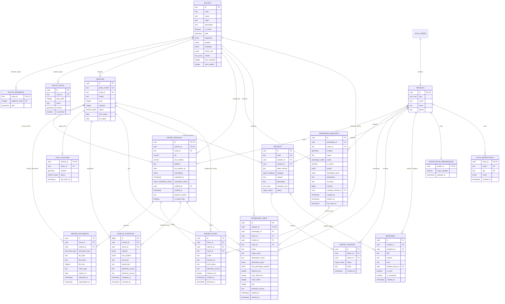

# ERD Angkot-Live — skema MVP

Diperbarui 11 November 2026 berdasarkan delapan migration yang sudah diterapkan pada Supabase lokal PostgreSQL 17/PostGIS. Tipe kolom lengkap dihasilkan dari database pada [database.generated.ts](../apps/web/src/types/database.generated.ts).

## Invariant dan geometri

- Identitas trayek adalah `routes.id` per arah; **code tidak unik**. Kedua arah boleh memakai kode yang sama.
- `route_segments` menyimpan LineString terurut per chain, SRID 4326 dengan GIST. UI `[lat,lng]` dikonversi eksplisit ke geometri `[lng,lat]`. Celah antar-chain tidak disambung. `routes.path` bernilai null untuk rute multichain.
- Admin CRUD memakai RPC `admin_route_command`; importer/seeder memanggil RPC `sync_route_geometry` untuk menulis segmen, halte, dan cache JSON dalam satu transaksi. `route_stops` unik pada `(route_id,stop_order)`. API/planner memakai `route_catalog()` dari database sejak Sprint 2, dengan cache Go 3 detik dan invalidasi langsung setelah mutasi admin.
- Assignment kendaraan pada driver unik. SIM/KTP/STNK/KIR memiliki satu revisi aktif per driver/jenis; foto dapat banyak. Revisi lama ditandai `superseded_at`. Submit/review memeriksa revisi aktif dan keberadaan objek privat di Storage.
- Satu request aktif per penumpang, satu trip aktif per penumpang, satu duty terbuka per driver. `request_id` trip unik; boarding dan penutupan request satu transaksi.
- Request aktif hanya untuk walking/searching/accepted, mode sesuai status; trip completed harus memiliki waktu selesai yang berurutan. Jarak, akurasi dan kapasitas dibatasi.
- Duty menyimpan assignment, mode, identitas sesi penerbit GPS dan sumber `gps`/`simulation`. Sesi lain ditolak saat duty aktif; expiry memakai session ID agar tidak menutup sesi pengganti. `tracking_authorizations()` memeriksa approval, assignment, arah aktif dan status akun Auth. `end_tracking()` menyimpan alasan penutupan dan jarak terakhir. Riwayat simulasi ditandai dan tidak menambah ringkasan operasional pengemudi.
- Duty menyimpan assignment dan mode. API tunggal menutup duty lama saat restart; snapshot historis tidak dipakai untuk menghidupkan kendaraan tanpa GPS baru.

## Auth, akses dan Storage

`auth.users` dimiliki Supabase Auth; profil dibentuk trigger registrasi. Role publik hanya penumpang/pengemudi. Seeder admin membuat akun penumpang terkonfirmasi terlebih dahulu, lalu mengubah role profil memakai service role lokal. Tidak ada tabel password aplikasi.

Browser hanya memiliki grant baca pada routes/route_stops. Tabel sensitif dan RPC mutation dicabut dari anon/authenticated; API memvalidasi JWT melalui Auth dan menjalankan command memakai service role. RLS aktif, tetapi policy lama tidak berarti direct read diizinkan ketika grant sudah dicabut. Hak admin/ownership diterapkan pada API/command, bukan klaim role kiriman browser.

Bucket `driver-documents` dan `report-evidence` privat, maksimal 5 MiB, tipe JPG/PNG/PDF. Path berformat `ownerUUID/objectUUID`. Referensi path tidak berupa FK SQL ke Storage; submit/review memeriksa keberadaan objek. Admin mendapat signed URL dokumen pengemudi, penumpang hanya bukti miliknya. Signed URL berlaku 120 detik dan melewati proxy origin frontend.

## Batas skema MVP

Tidak ada tabel tip, trip multi-leg atau analitik materialized. Preferensi notifikasi tanggapan laporan tersedia pada Sprint 4; pengaturan lain tidak ditawarkan. DB-05 di [audit](./SCHEMA_AUDIT_MVP.md) tetap opsional/backlog. `messages.kind` dan relasi laporan sudah tersedia; pengiriman pesan admin serta sinkronisasi preferensi UI mengikuti sprint berikutnya.

## Penutupan Sprint 4–5

`notification_preferences` hanya dapat diakses melalui command pemilik akun. Transisi laporan dikunci dan berurutan, retry memakai key yang sama tidak menggandakan timeline/pesan, dan setiap bukti harus ada di Storage privat milik actor. Trip menyimpan provenance posisi dan snapshot tarif kanonis saat boarding; perubahan tarif selanjutnya tidak mengubah histori. Signed URL berumur 120 detik dan tidak masuk cache service worker.
